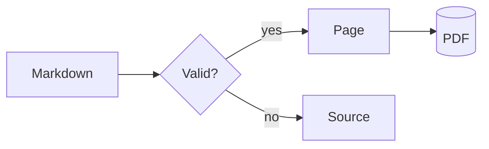
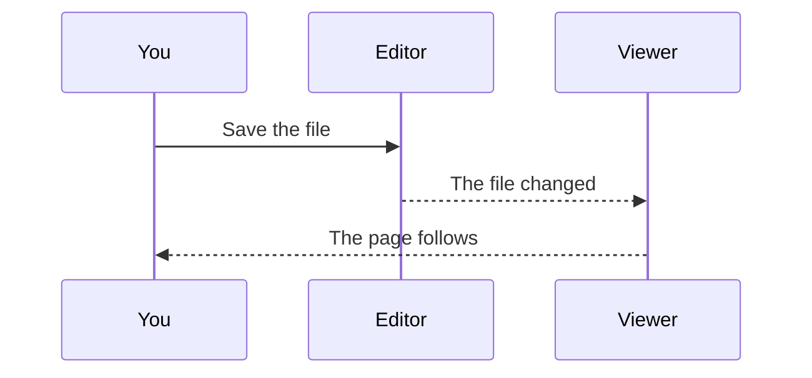
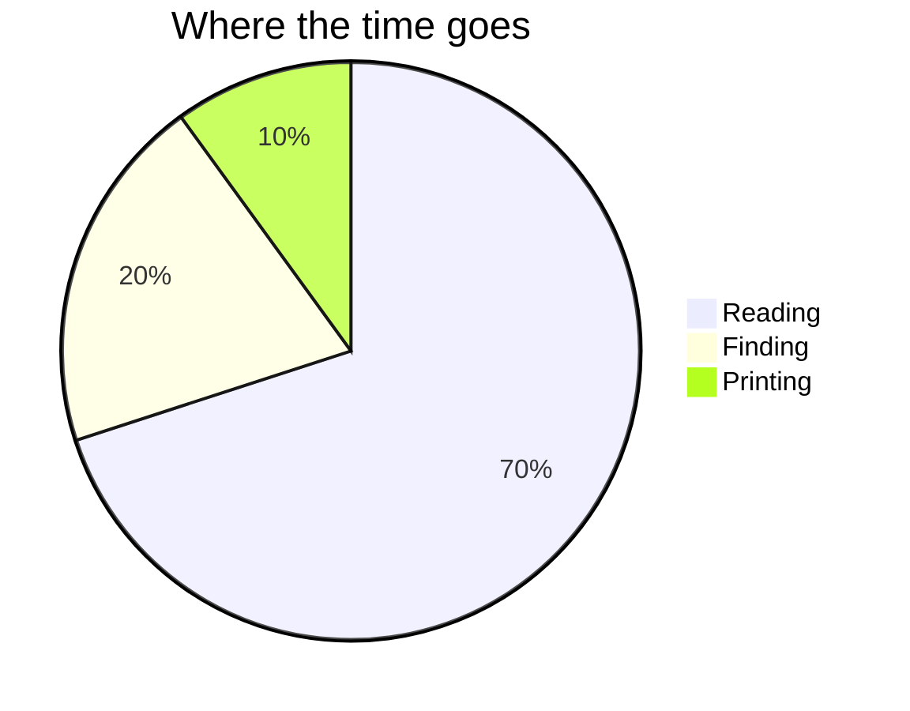
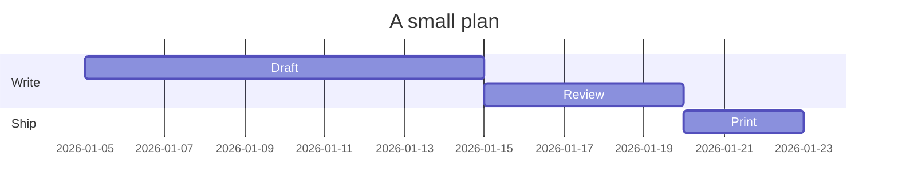
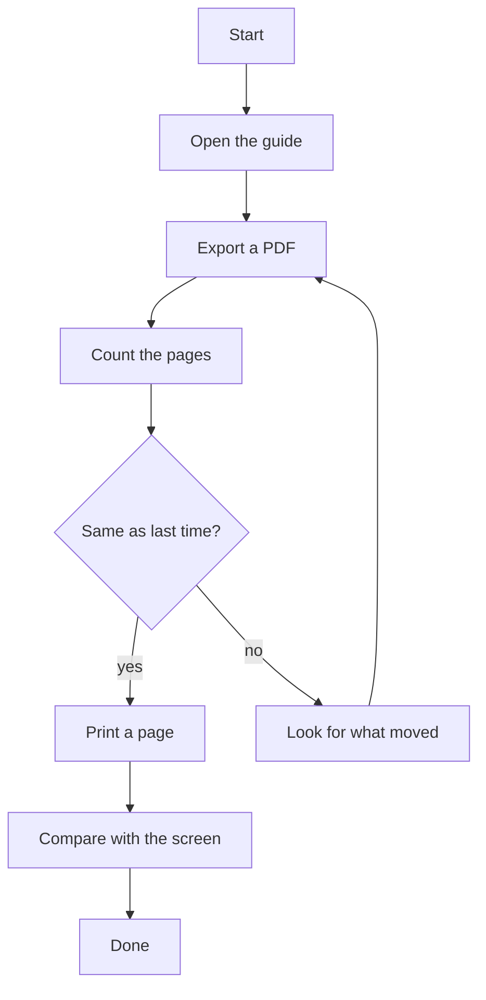

# Nacho Viewer নির্দেশিকা

Nacho Viewer Markdown ফাইল খোলে এবং সেগুলোকে সুন্দরভাবে সাজানো নথি হিসেবে দেখায়। এটি একটি ভিউয়ার, এডিটর নয়: যেকোনো এডিটরে ফাইল বদলান, এখানকার পৃষ্ঠা নিজে থেকেই তা অনুসরণ করবে।

এই নির্দেশিকার তিনটি অংশ:

1. [অ্যাপের ব্যবহার](#অ্যাপের-ব্যবহার): কীভাবে পড়বেন, খুঁজবেন, প্রিন্ট ও এক্সপোর্ট করবেন।
2. [Markdown কী দেখাতে পারে](#markdown-কী-দেখাতে-পারে): অ্যাপ যা যা দেখায় তার একটি করে উদাহরণ।
3. [প্রিন্ট ও এক্সপোর্ট পরীক্ষা](#প্রিন্ট-ও-এক্সপোর্ট-পরীক্ষা): কঠিন ক্ষেত্রগুলো, যাতে কাগজ আর পর্দা মেলানো যায়।

## অ্যাপের ব্যবহার

### নথি খোলা

- <kbd>Ctrl</kbd>+<kbd>O</kbd> চাপুন, অথবা ট্যাবের পাশের **+** চাপুন।
- একটি `.md` বা `.markdown` ফাইল উইন্ডোর ওপর ছেড়ে দিন।
- শুরুর পৃষ্ঠায় সাম্প্রতিক ফাইলগুলোর একটি বেছে নিন। ফাইলের পাশের **×** সেটিকে তালিকা থেকে সরায়।
- আপনার ফাইল ম্যানেজার থেকে Nacho Viewer দিয়ে একটি Markdown ফাইল খুলুন।

প্রতিটি নথির নিজস্ব ট্যাব থাকে। কোনো ট্যাবে ডান-ক্লিক করলে **পাথ কপি করুন** পাওয়া যায় এবং ফাইলটি আপনার ফাইল ম্যানেজারে দেখানো যায়।

> [!TIP]
> macOS-এ এই নির্দেশিকার সর্বত্র <kbd>Ctrl</kbd>-কে <kbd>Cmd</kbd> হিসেবে পড়ুন।

### পড়া

**রূপরেখা** (<kbd>Ctrl</kbd>+<kbd>B</kbd>) নথির শিরোনামগুলোর তালিকা দেখায়; একটিতে ক্লিক করে সেখানে যান। লিংক ব্রাউজারের মতোই কাজ করে, আর **পেছনে** ও **সামনে** (<kbd>Alt</kbd>+<kbd>←</kbd>, <kbd>Alt</kbd>+<kbd>→</kbd>) ট্যাবের মধ্যে সেই পথ ধরে ফিরে যায়:

- অন্য একটি Markdown ফাইলের লিংক সেটিকে একই ট্যাবে খোলে; <kbd>Ctrl</kbd>+ক্লিক নতুন ট্যাবে খোলে।
- কোনো শিরোনামের লিংক, যেমন এই পৃষ্ঠার শুরুরগুলো, সেখানে স্ক্রল করে নিয়ে যায়।
- কোনো ওয়েবসাইটের লিংক আপনার ব্রাউজারে খোলে।

<kbd>Ctrl</kbd>+<kbd>+</kbd> ও <kbd>Ctrl</kbd>+<kbd>-</kbd> দিয়ে জুম করুন, অথবা <kbd>Ctrl</kbd>+<kbd>0</kbd> দিয়ে ১০০%-এ ফিরুন। <kbd>Ctrl</kbd>+<kbd>9</kbd> পৃষ্ঠাকে উইন্ডোর মতো চওড়া করে এবং আবার আগের অবস্থায় ফেরায়, যা চওড়া টেবিলে কাজে লাগে।

**খুঁজুন** (<kbd>Ctrl</kbd>+<kbd>F</kbd>) প্রতিটি মিল হাইলাইট করে; <kbd>F3</kbd> ও <kbd>Shift</kbd>+<kbd>F3</kbd> সেগুলোর মধ্যে এগোয় ও পিছোয়। **সোর্স দেখুন** (<kbd>Ctrl</kbd>+<kbd>U</kbd>) ফাইলের সাধারণ লেখা দেখায়।

ডিস্কে ফাইল বদলালে পৃষ্ঠা নিজে থেকেই আবার লোড হয় এবং আপনার জায়গা ধরে রাখে। ফাইল মুছে ফেললে সর্বশেষ সংস্করণ পর্দায় থেকে যায়, ওপরে একটি বার্তাসহ।

### প্রিন্ট ও এক্সপোর্ট

| কী করবেন | চাপুন | কী পাবেন |
| :--- | :---- | :------ |
| প্রিন্ট | <kbd>Ctrl</kbd>+<kbd>P</kbd> | সিস্টেমের প্রিন্ট ডায়ালগ |
| এক্সপোর্ট | <kbd>Ctrl</kbd>+<kbd>Shift</kbd>+<kbd>E</kbd> | একটি PDF ফাইল, A4 |

দুটোই প্রথমে লেখার আকার জানতে চায়: ছোট, সাধারণ বা বড়, আর **প্রিভিউ** চূড়ান্ত করার আগে PDF-টি আপনার সিস্টেমের ভিউয়ারে দেখায়। পর্দায় থিম যা-ই হোক, কাগজে সবসময় হালকা রং ব্যবহার হয়।

### নিজের মতো করুন

**সেটিংস** (<kbd>Ctrl</kbd>+<kbd>,</kbd>) এ আছে থিম (সিস্টেম, হালকা বা গাঢ়; <kbd>Ctrl</kbd>+<kbd>Shift</kbd>+<kbd>L</kbd> দিয়েও বদলায়), পৃষ্ঠার স্টাইল (ক্লাসিক, সংবাদপত্র, কাগজ, ডক্স বা টাইপরাইটার), অ্যাপ ও এই নির্দেশিকার ভাষা (সিস্টেমের ভাষা, অথবা ইংরেজি, স্প্যানিশ, জার্মান, ফরাসি, ইতালীয়, পর্তুগিজ, চীনা, জাপানি, হিন্দি, বাংলা, ইন্দোনেশীয়, কোরিয়ান, তুর্কি, ভিয়েতনামি বা কাতালান) এবং ইন্টারনেট থেকে ছবি লোড হবে কি না।

আর যা কিছু দরকার, তার জন্য অ্যাপের সেটিংস ফোল্ডারে `user.css`-এ নিজের CSS রাখুন:

| সিস্টেম | ফোল্ডার |
| :----- | :----- |
| Linux | `~/.config/nacho-viewer/` |
| Windows | `%APPDATA%\nacho-viewer\` |
| macOS | `~/Library/Application Support/nacho-viewer/` |

### কীবোর্ড শর্টকাট

<kbd>F1</kbd> সবগুলোর তালিকা দেখায়। <kbd>Shift</kbd>+<kbd>F1</kbd> এই নির্দেশিকা খোলে।

### যোগাযোগ

Nacho Viewer বিনামূল্যে ও ওপেন সোর্স। **⋮** মেনুর **Nacho Viewer সম্পর্কে** আপনার সংস্করণ দেখায়। কোনো সমস্যা জানান বা কোড পড়ুন [GitHub](https://github.com/nuncaeslupus/nacho-viewer)-এ।

## Markdown কী দেখাতে পারে

### লেখা

সাধারণ লেখা, যাতে আছে *জোর*, **গাঢ় জোর**, ***দুটোই***, `ইনলাইন কোড`, ~~কাটা লেখা~~, ==হাইলাইট করা লেখা==, 25 m^2^ এবং H~2~O। একটি [লিংক](https://example.com), একটি স্বয়ংক্রিয় লিংক www.example.com, আর একটি বাধ্যতামূলক নতুন লাইন\
ঠিক এখানে। ইমোজি কোড :tada: একটি অক্ষরে পরিণত হয়।

HTML স্পেসিফিকেশন রক্ষণাবেক্ষণ করে W3C; এই দুটি নামের ওপর কার্সর রাখলে তাদের অর্থ দেখা যায়।

*[HTML]: Hyper Text Markup Language (হাইপারটেক্সট মার্কআপ ল্যাঙ্গুয়েজ)
*[W3C]: World Wide Web Consortium (ওয়ার্ল্ড ওয়াইড ওয়েব কনসোর্টিয়াম)

একটি বাক্য যাতে পাদটীকা আছে,[^short] এবং আরেকটি যাতে আছে একটু লম্বা একটি।[^long]

[^short]: একটি ছোট পাদটীকা।
[^long]: একটি লম্বা পাদটীকা। এটি কিছুক্ষণ চলে, যাতে যেকোনো পৃষ্ঠার প্রস্থে দ্বিতীয় লাইনে গড়ায় এবং দেখায় পাদটীকার লেখা কীভাবে সাজানো হয়।

একটি উইকি লিংক অন্য ফাইলে তার নাম ধরে যায়: [[Nacho Viewer Guide|এই নির্দেশিকা]]।

### শিরোনাম

#### চতুর্থ স্তর

##### পঞ্চম স্তর

###### ষষ্ঠ স্তর

### তালিকা

1. একটি ক্রমিক তালিকা
2. যার দ্বিতীয় একটি আইটেম আছে
   1. আর একটি ভেতরের আইটেম
   2. যা গণনা চালিয়ে যায়

- একটি বুলেট তালিকা
  - যার একটি ভেতরের আইটেম আছে
    - আর একটি তৃতীয় স্তর

- [x] একটি সম্পন্ন কাজ
- [ ] একটি খোলা কাজ

শব্দ
: একটি সংজ্ঞা।

আরেকটি শব্দ
: এর প্রথম সংজ্ঞা।
: এর দ্বিতীয় সংজ্ঞা।

### উদ্ধৃতি ও সতর্কবার্তা

> একটি ব্লক উদ্ধৃতি।
>
> > যার ভেতরে আরেকটি উদ্ধৃতি আছে।

> [!NOTE]
> কাজের তথ্য।

> [!TIP]
> সহায়ক পরামর্শ।

> [!IMPORTANT]
> মূল তথ্য।

> [!WARNING]
> জরুরি তথ্য।

> [!CAUTION]
> কোনো কাজের ঝুঁকি।

---

### টেবিল

| বামে | মাঝে | ডানে |
| :--- | :----: | ----: |
| এক | দুই | 3 |
| *চার* | `five` | 6.00 |
| একটি লম্বা ঘর, পৃষ্ঠায় কলামের জায়গা ফুরোলে যাকে ভেঙে পরের লাইনে যেতে হয় | b | 1,234.56 |

### কোড

    An indented code block.

```js
// JavaScript
const answer = [1, 2, 3].map((n) => n * 7);
console.log(`The answer is ${answer.at(-1) * 2}`);
```

```python
# Python
def greet(name: str = "world") -> str:
    return f"Hello, {name}!"
```

```rust
// Rust
fn main() {
    let total: u32 = (1..=9).sum();
    println!("{total}");
}
```

```bash
# Shell
for file in *.md; do wc -l "$file"; done
```

```json
{ "name": "Nacho Viewer", "free": true, "platforms": ["Linux", "Windows", "macOS"] }
```

```diff
- The old line
+ The new line
```

### গণিত

ইনলাইন গণিত: $e^{i\pi} + 1 = 0$ এবং $\sqrt{a^2 + b^2}$।


$$
\int_0^1 x^2 \, dx = \frac{1}{3}
\qquad
\sum_{n=1}^{\infty} \frac{1}{n^2} = \frac{\pi^2}{6}
$$

$$
\begin{pmatrix} a & b \\ c & d \end{pmatrix}
\begin{pmatrix} x \\ y \end{pmatrix}
=
\begin{pmatrix} ax + by \\ cx + dy \end{pmatrix}
$$

### ডায়াগ্রাম

ডায়াগ্রামের ওপর কার্সর নিলে জুম ও প্যান নিয়ন্ত্রণ দেখা যায়।









### ছবি

একটি লোকাল SVG লেখার রং নেয়, তাই এটি থিম অনুসরণ করে:


একটি লোকাল ছবি, `` ট্যাগসহ যা এর আকার ঠিক করে:


### কাঁচা HTML

নিরাপদ HTML কাজ করে; স্ক্রিপ্ট ও স্টাইল সরিয়ে দেওয়া হয়।

<details>
<summary>একটি অংশ যা খোলে</summary>

কপি করতে <kbd>Ctrl</kbd>+<kbd>C</kbd> চাপুন।

</details>

## প্রিন্ট ও এক্সপোর্ট পরীক্ষা

কাগজ আর পর্দা মিলিয়ে দেখতে এই নির্দেশিকা প্রিন্ট বা এক্সপোর্ট করুন। একই সংস্করণে প্রতিবার বিষয়বস্তু একই থাকে, তাই দুটি এক্সপোর্টে পৃষ্ঠা একই হওয়া উচিত, আর এক সিস্টেমের পৃষ্ঠাসংখ্যা অন্যটির থেকে এক পৃষ্ঠার মধ্যে থাকা উচিত।

দেখে নিন যে:

- [ ] পৃষ্ঠা A4, প্রতি দিকে মার্জিনসহ।
- [ ] প্রতিটি পৃষ্ঠা লেখা দিয়ে শুরু হয়, কাটা লাইন বা অর্ধেক ছবি দিয়ে নয়।
- [ ] অ্যাপের নিজস্ব বার ও বোতাম প্রিন্ট হয় না, ডায়াগ্রামের নিয়ন্ত্রণও না।
- [ ] পর্দায় গাঢ় থিম থাকলেও রংগুলো হালকা।
- [ ] পাদটীকা, সতর্কবার্তা, গণিত ও ডায়াগ্রাম পর্দার মতোই দেখায়।

### একটি চওড়া টেবিল

| ত্রৈমাসিক | অঞ্চল | পণ্য | একক | মূল্য | আয় | খরচ | মার্জিন | দায়িত্বে | অবস্থা |
| :------ | :----- | :------ | ---: | ---: | -----: | ---: | -----: | :---- | :----- |
| Q1 | উত্তর ইউরোপ | Reader Standard | 1,204 | 19.00 | 22,876.00 | 9,150.40 | 13,725.60 | Asha | পাঠানো হয়েছে |
| Q2 | দক্ষিণ ইউরোপ | Reader Standard | 987 | 19.00 | 18,753.00 | 7,501.20 | 11,251.80 | Bruno | পাঠানো হয়েছে |
| Q3 | উত্তর আমেরিকা | Reader Professional | 2,310 | 49.00 | 113,190.00 | 39,616.50 | 73,573.50 | Chidi | চলছে |
| Q4 | এশিয়া ও প্রশান্ত অঞ্চল | Reader Professional | 1,875 | 49.00 | 91,875.00 | 32,156.25 | 59,718.75 | Dana | পরিকল্পিত |

### একটি লম্বা টেবিল

একটি হেডার সারি, আর এমন সারি যা কখনো দুই পৃষ্ঠায় ভাঙা উচিত নয়।

| # | আইটেম | মন্তব্য |
| ---: | :--- | :--- |
| 1 | Alpha | সারিগুলোর প্রথম |
| 2 | Bravo | দ্বিতীয় |
| 3 | Charlie | তৃতীয় |
| 4 | Delta | চতুর্থ |
| 5 | Echo | পঞ্চম |
| 6 | Foxtrot | ষষ্ঠ |
| 7 | Golf | সপ্তম |
| 8 | Hotel | অষ্টম |
| 9 | India | নবম |
| 10 | Juliett | দশম |
| 11 | Kilo | একাদশ |
| 12 | Lima | দ্বাদশ |
| 13 | Mike | ত্রয়োদশ |
| 14 | November | চতুর্দশ |
| 15 | Oscar | পঞ্চদশ |
| 16 | Papa | ষোড়শ |
| 17 | Quebec | সপ্তদশ |
| 18 | Romeo | অষ্টাদশ |
| 19 | Sierra | ঊনবিংশ |
| 20 | Tango | বিংশ |
| 21 | Uniform | একবিংশ |
| 22 | Victor | দ্বাবিংশ |
| 23 | Whiskey | ত্রয়োবিংশ |
| 24 | X-ray | চতুর্বিংশ |
| 25 | Yankee | পঞ্চবিংশ |
| 26 | Zulu | সারিগুলোর শেষ |

### খুব লম্বা লাইন

কোডের একটি লাইন, যা পৃষ্ঠার চেয়ে অনেক চওড়া:

```text
0123456789 abcdefghij 0123456789 abcdefghij 0123456789 abcdefghij 0123456789 abcdefghij 0123456789 abcdefghij 0123456789 abcdefghij 0123456789 abcdefghij
```

একটি শব্দ যাতে ভাঙার কোনো জায়গা নেই: Pneumonoultramicroscopicsilicovolcanoconiosis_Pneumonoultramicroscopicsilicovolcanoconiosis_Pneumonoultramicroscopicsilicovolcanoconiosis।

একটি লম্বা ঠিকানা: <https://example.com/a/very/long/path/that/keeps/going/and/going/well/past/the/edge/of/the/sheet/on/any/paper/size>।

### একটি লম্বা কোড ব্লক

এই ব্লক বেশিরভাগ পৃষ্ঠায় যতটা ধরে তার চেয়ে লম্বা, তাই এটিকে পরের পৃষ্ঠায় চলতে হয়।

```python
# Sixty numbered lines.
line_01 = "one"
line_02 = "two"
line_03 = "three"
line_04 = "four"
line_05 = "five"
line_06 = "six"
line_07 = "seven"
line_08 = "eight"
line_09 = "nine"
line_10 = "ten"
line_11 = "eleven"
line_12 = "twelve"
line_13 = "thirteen"
line_14 = "fourteen"
line_15 = "fifteen"
line_16 = "sixteen"
line_17 = "seventeen"
line_18 = "eighteen"
line_19 = "nineteen"
line_20 = "twenty"
line_21 = "twenty-one"
line_22 = "twenty-two"
line_23 = "twenty-three"
line_24 = "twenty-four"
line_25 = "twenty-five"
line_26 = "twenty-six"
line_27 = "twenty-seven"
line_28 = "twenty-eight"
line_29 = "twenty-nine"
line_30 = "thirty"
line_31 = "thirty-one"
line_32 = "thirty-two"
line_33 = "thirty-three"
line_34 = "thirty-four"
line_35 = "thirty-five"
line_36 = "thirty-six"
line_37 = "thirty-seven"
line_38 = "thirty-eight"
line_39 = "thirty-nine"
line_40 = "forty"
line_41 = "forty-one"
line_42 = "forty-two"
line_43 = "forty-three"
line_44 = "forty-four"
line_45 = "forty-five"
line_46 = "forty-six"
line_47 = "forty-seven"
line_48 = "forty-eight"
line_49 = "forty-nine"
line_50 = "fifty"
line_51 = "fifty-one"
line_52 = "fifty-two"
line_53 = "fifty-three"
line_54 = "fifty-four"
line_55 = "fifty-five"
line_56 = "fifty-six"
line_57 = "fifty-seven"
line_58 = "fifty-eight"
line_59 = "fifty-nine"
line_60 = "sixty"
```

### একটি উঁচু ডায়াগ্রাম



### যে লেখা চলতেই থাকে

লম্বা অনুচ্ছেদ পৃষ্ঠার ছন্দ দেখায়: লাইনের দৈর্ঘ্য, শব্দের ফাঁক আর লেখা এক পৃষ্ঠা থেকে পরের পৃষ্ঠায় কীভাবে বয়ে যায়। একটি ভালো পৃষ্ঠা শিরোনামকে তার পরের লেখার সঙ্গে রাখে, এবং অনুচ্ছেদের একটিমাত্র লাইনকে পৃষ্ঠার মাথায় বা তলায় একা পড়ে থাকতে দেয় না।

মুদ্রকরা এই একা পড়ে থাকা লাইনগুলোকে বলেন উইডো ও অরফান। এগুলো পৃষ্ঠা থেকে দূরে রাখা পর্দার চেয়ে কাগজে বেশি জরুরি, কারণ পাঠক পর্দা স্ক্রল করতে পারেন কিন্তু পৃষ্ঠা স্ক্রল করতে পারেন না। পৃষ্ঠার নিচে পড়ে থাকা শিরোনাম, যার লেখা পাতার ওপাশে, তার ক্ষেত্রেও একই কথা: চোখ একটি প্রতিশ্রুতিতে থামে আর তা পূরণ হতে দেখতে পাতা উল্টাতে হয়।

এখানে কিছুই মনোযোগ দিয়ে পড়ার দরকার নেই। প্রতিটি পৃষ্ঠার শেষ লাইন আর পরের পৃষ্ঠার প্রথম লাইনটি দেখে নিলেই যথেষ্ট, আর দেখুন লেখা যথাযথভাবে চলছে কি না। চললে পৃষ্ঠা-বিভাজন ঠিকঠাক কাজ করছে।
