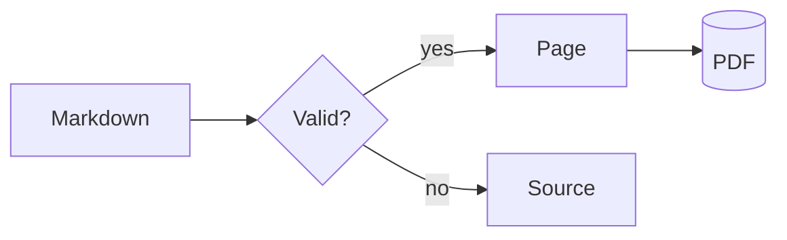
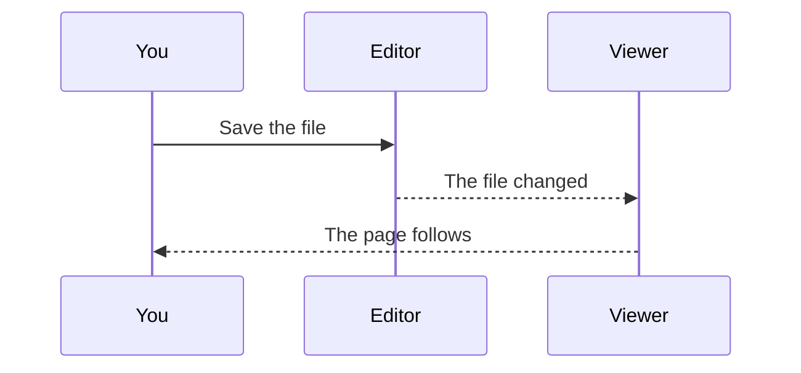
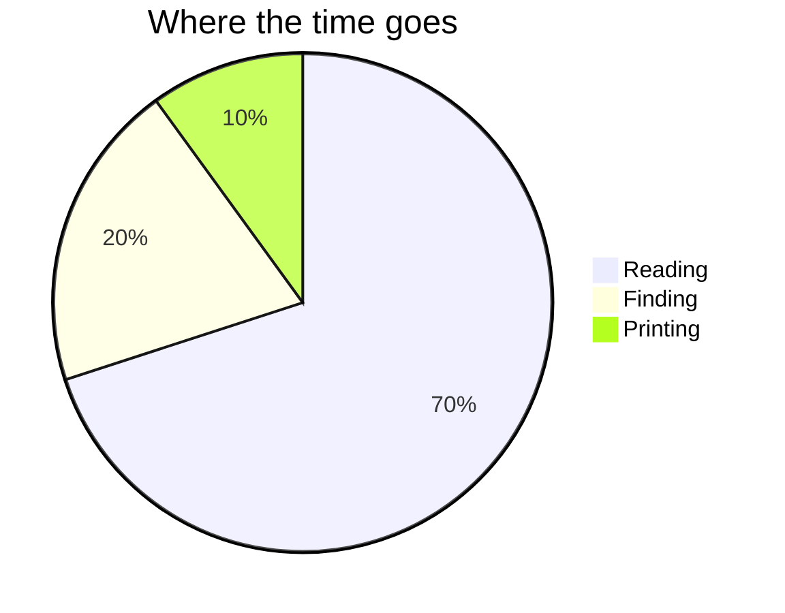
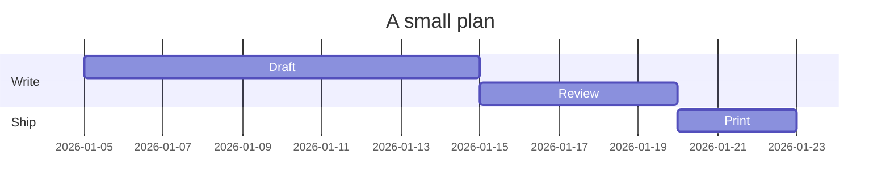
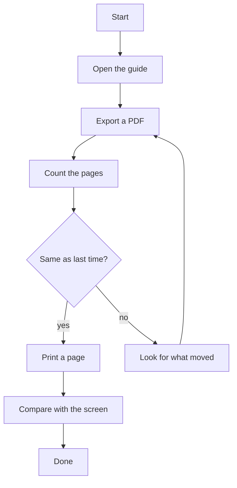

# Guia de Nacho Viewer

Nacho Viewer obre fitxers Markdown i els mostra com un document ben maquetat. És un visor, no un
editor: canvia un fitxer en qualsevol editor i la pàgina d'aquí el segueix.

Aquesta guia té tres parts:

1. [Ús de l'aplicació](#ús-de-laplicació): com llegir, cercar, imprimir i exportar.
2. [Què pot mostrar Markdown](#què-pot-mostrar-markdown): un exemple de tot el que l'aplicació representa.
3. [Prova d'impressió i exportació](#prova-dimpressió-i-exportació): els casos difícils, per comparar el paper amb la pantalla.

## Ús de l'aplicació

### Obrir un document

- Prem <kbd>Ctrl</kbd>+<kbd>O</kbd>, o el **+** al costat de les pestanyes.
- Deixa anar un fitxer `.md` o `.markdown` sobre la finestra.
- Tria un dels fitxers recents de la pàgina d'inici. La **×** al costat d'un fitxer el treu de la llista.
- Obre un fitxer Markdown des del teu gestor de fitxers amb Nacho Viewer.

Cada document té la seva pròpia pestanya. Fes clic dret en una pestanya per a **Copia la ruta** i per mostrar el fitxer al teu
gestor de fitxers.

> [!TIP]
> A macOS, llegeix <kbd>Ctrl</kbd> com a <kbd>Cmd</kbd> a tota aquesta guia.

### Llegir

L'**esquema** (<kbd>Ctrl</kbd>+<kbd>B</kbd>) llista els encapçalaments del document; fes clic en un per
anar-hi. Els enllaços funcionen com en un navegador, i **enrere** i **endavant**
(<kbd>Alt</kbd>+<kbd>←</kbd>, <kbd>Alt</kbd>+<kbd>→</kbd>) els recorren de nou a la pestanya:

- Un enllaç a un altre fitxer Markdown l'obre a la mateixa pestanya; <kbd>Ctrl</kbd>+clic l'obre en una pestanya nova.
- Un enllaç a un encapçalament, com els del principi d'aquesta pàgina, es desplaça fins a ell.
- Un enllaç a un lloc web s'obre al teu navegador.

Fes zoom amb <kbd>Ctrl</kbd>+<kbd>+</kbd> i <kbd>Ctrl</kbd>+<kbd>-</kbd>, o torna al 100% amb
<kbd>Ctrl</kbd>+<kbd>0</kbd>. <kbd>Ctrl</kbd>+<kbd>9</kbd> fa la pàgina tan ampla com la finestra i
la torna a la seva amplada, cosa que ajuda amb les taules amples.

**Cerca** (<kbd>Ctrl</kbd>+<kbd>F</kbd>) ressalta totes les coincidències; <kbd>F3</kbd> i
<kbd>Shift</kbd>+<kbd>F3</kbd> les recorren. **Mostra el codi font**
(<kbd>Ctrl</kbd>+<kbd>U</kbd>) mostra el text pla del fitxer.

Quan el fitxer canvia al disc, la pàgina es torna a carregar sola i conserva la teva posició. Si el fitxer
s'elimina, l'última versió es queda a la pantalla amb una nota a dalt.

### Imprimir i exportar

| Per a | Prem | Obtens |
| :--- | :---- | :------- |
| Imprimir | <kbd>Ctrl</kbd>+<kbd>P</kbd> | El diàleg d'impressió del sistema |
| Exportar | <kbd>Ctrl</kbd>+<kbd>Shift</kbd>+<kbd>E</kbd> | Un fitxer PDF, A4 |

Tots dos demanen primer una mida de text, Petit, Normal o Gran, i **Vista prèvia** mostra el PDF al
visor del teu sistema abans de confirmar. El paper sempre fa servir els colors clars, sigui quin sigui el tema a
la pantalla.

### Personalitzar

**Configuració** (<kbd>Ctrl</kbd>+<kbd>,</kbd>) inclou el tema (sistema, clar o fosc; també
<kbd>Ctrl</kbd>+<kbd>Shift</kbd>+<kbd>L</kbd>), l'estil de la pàgina (Clàssic, Diari, Paper,
Docs o Màquina d'escriure), l'idioma de l'aplicació i d'aquesta guia (el del sistema, o anglès,
espanyol, alemany, francès, italià, portuguès, xinès, japonès, hindi, bengalí, indonesi, coreà, turc, vietnamita o català) i si es carreguen les imatges d'
internet.

Per a qualsevol altra cosa, posa el teu propi CSS a `user.css` a la carpeta de configuració de l'aplicació:

| Sistema | Carpeta |
| :------ | :------ |
| Linux | `~/.config/nacho-viewer/` |
| Windows | `%APPDATA%\nacho-viewer\` |
| macOS | `~/Library/Application Support/nacho-viewer/` |

### Dreceres de teclat

<kbd>F1</kbd> les mostra totes. <kbd>Shift</kbd>+<kbd>F1</kbd> obre aquesta guia.

### Contacte

Nacho Viewer és gratuït i de codi obert. **Quant a Nacho Viewer**, al menú **⋮**, mostra la teva
versió. Informa d'un problema o consulta el codi a
[GitHub](https://github.com/nuncaeslupus/nacho-viewer).

## Què pot mostrar Markdown

### Text

Text senzill amb *èmfasi*, **èmfasi fort**, ***tots dos***, `codi en línia`,
~~ratllat~~, ==text ressaltat==, 25 m^2^ i H~2~O. Un [enllaç](https://example.com),
un autoenllaç www.example.com i un salt de línia forçat\
just aquí. El codi curt d'emoji :tada: es converteix en un caràcter.

L'especificació HTML la manté el W3C; passa el cursor per sobre d'aquests dos noms per veure'n el significat.

*[HTML]: Hyper Text Markup Language (llenguatge de marques d'hipertext)
*[W3C]: World Wide Web Consortium (consorci de la Web)

Una frase amb una nota al peu,[^short] i una altra amb una de més llarga.[^long]

[^short]: Una nota al peu breu.
[^long]: Una nota al peu més llarga. Continua durant una estona, de manera que es parteix en una segona línia a
    qualsevol amplada de pàgina i mostra com es composa el text de les notes al peu.

Un enllaç wiki porta a un altre fitxer pel seu nom: [[Nacho Viewer Guide|aquesta guia]].

### Encapçalaments

#### Quart nivell

##### Cinquè nivell

###### Sisè nivell

### Llistes

1. Una llista ordenada
2. amb un segon element
   1. i un d'imbricat
   2. que segueix comptant

- Una llista amb vinyetes
  - amb un element imbricat
    - i un tercer nivell

- [x] Una tasca acabada
- [ ] Una tasca pendent

Terme
: Una definició.

Un altre terme
: La seva primera definició.
: La seva segona definició.

### Cites i avisos

> Una cita en bloc.
>
> > Amb una cita a dins.

> [!NOTE]
> Informació útil.

> [!TIP]
> Un consell útil.

> [!IMPORTANT]
> Informació clau.

> [!WARNING]
> Informació urgent.

> [!CAUTION]
> Riscos d'una acció.

---

### Taules

| Esquerra | Centre | Dreta |
| :--- | :----: | ----: |
| u | dos | 3 |
| *quatre* | `cinc` | 6.00 |
| Una cel·la més llarga que ha de partir-se quan la columna es queda sense espai a la pàgina | b | 1,234.56 |

### Codi

    An indented code block.

```js
// JavaScript
const answer = [1, 2, 3].map((n) => n * 7);
console.log(`The answer is ${answer.at(-1) * 2}`);
```

```python
# Python
def greet(name: str = "world") -> str:
    return f"Hello, {name}!"
```

```rust
// Rust
fn main() {
    let total: u32 = (1..=9).sum();
    println!("{total}");
}
```

```bash
# Shell
for file in *.md; do wc -l "$file"; done
```

```json
{ "name": "Nacho Viewer", "free": true, "platforms": ["Linux", "Windows", "macOS"] }
```

```diff
- The old line
+ The new line
```

### Matemàtiques

Matemàtiques en línia: $e^{i\pi} + 1 = 0$ i $\sqrt{a^2 + b^2}$.

$$
\int_0^1 x^2 \, dx = \frac{1}{3}
\qquad
\sum_{n=1}^{\infty} \frac{1}{n^2} = \frac{\pi^2}{6}
$$

$$
\begin{pmatrix} a & b \\ c & d \end{pmatrix}
\begin{pmatrix} x \\ y \end{pmatrix}
=
\begin{pmatrix} ax + by \\ cx + dy \end{pmatrix}
$$

### Diagrames

Un diagrama té controls de zoom i desplaçament quan hi passes el cursor per sobre.









### Imatges

Un SVG local pren el color del text, així que segueix el tema:


Una imatge local, amb una etiqueta `` que en fixa la mida:


### HTML sense processar

L'HTML segur funciona; els scripts i els estils s'eliminen.

<details>
<summary>Una secció que s'obre</summary>

Prem <kbd>Ctrl</kbd>+<kbd>C</kbd> per copiar.

</details>

## Prova d'impressió i exportació

Imprimeix o exporta aquesta guia per comparar el paper amb la pantalla. El contingut mai no canvia entre execucions
de la mateixa versió, així que dues exportacions haurien de tenir les mateixes pàgines, i el nombre de pàgines en un sistema
hauria de diferir com a màxim en una pàgina del d'un altre.

Comprova que:

- [ ] Les pàgines són A4, amb marge pels quatre costats.
- [ ] Cada pàgina comença amb text, no amb una línia tallada ni mitja imatge.
- [ ] Les barres i els botons de la mateixa aplicació no s'imprimeixen, ni tampoc els controls dels diagrames.
- [ ] Els colors són els clars, encara que a la pantalla hi hagi el tema fosc.
- [ ] Les notes al peu, els avisos, les matemàtiques i els diagrames es veuen com a la pantalla.

### Una taula ampla

| Trimestre | Regió | Producte | Unitats | Preu | Ingressos | Cost | Marge | Responsable | Estat |
| :------ | :----- | :------ | ---: | ---: | -----: | ---: | -----: | :---- | :----- |
| T1 | Nord d'Europa | Reader Estàndard | 1,204 | 19.00 | 22,876.00 | 9,150.40 | 13,725.60 | Asha | Enviat |
| T2 | Sud d'Europa | Reader Estàndard | 987 | 19.00 | 18,753.00 | 7,501.20 | 11,251.80 | Bruno | Enviat |
| T3 | Amèrica del Nord | Reader Professional | 2,310 | 49.00 | 113,190.00 | 39,616.50 | 73,573.50 | Chidi | En curs |
| T4 | Àsia i el Pacífic | Reader Professional | 1,875 | 49.00 | 91,875.00 | 32,156.25 | 59,718.75 | Dana | Planificat |

### Una taula llarga

Una fila d'encapçalament, i files que mai no s'haurien de partir entre dues pàgines.

| # | Element | Nota |
| ---: | :--- | :--- |
| 1 | Alpha | Primera de les files |
| 2 | Bravo | Segona |
| 3 | Charlie | Tercera |
| 4 | Delta | Quarta |
| 5 | Echo | Cinquena |
| 6 | Foxtrot | Sisena |
| 7 | Golf | Setena |
| 8 | Hotel | Vuitena |
| 9 | India | Novena |
| 10 | Juliett | Desena |
| 11 | Kilo | Onzena |
| 12 | Lima | Dotzena |
| 13 | Mike | Tretzena |
| 14 | November | Catorzena |
| 15 | Oscar | Quinzena |
| 16 | Papa | Setzena |
| 17 | Quebec | Dissetena |
| 18 | Romeo | Divuitena |
| 19 | Sierra | Dinovena |
| 20 | Tango | Vintena |
| 21 | Uniform | Vint-i-unena |
| 22 | Victor | Vint-i-dosena |
| 23 | Whiskey | Vint-i-tresena |
| 24 | X-ray | Vint-i-quatrena |
| 25 | Yankee | Vint-i-cinquena |
| 26 | Zulu | Última de les files |

### Línies molt llargues

Una línia de codi molt més ampla que la pàgina:

```text
0123456789 abcdefghij 0123456789 abcdefghij 0123456789 abcdefghij 0123456789 abcdefghij 0123456789 abcdefghij 0123456789 abcdefghij 0123456789 abcdefghij
```

Una paraula que no té on tallar-se: Pneumonoultramicroscopicsilicovolcanoconiosis_Pneumonoultramicroscopicsilicovolcanoconiosis_Pneumonoultramicroscopicsilicovolcanoconiosis.

Una adreça llarga: <https://example.com/a/very/long/path/that/keeps/going/and/going/well/past/the/edge/of/the/sheet/on/any/paper/size>.

### Un bloc de codi llarg

Aquest bloc és més llarg del que caben a la majoria de pàgines, així que ha de continuar a la següent.

```python
# Sixty numbered lines.
line_01 = "one"
line_02 = "two"
line_03 = "three"
line_04 = "four"
line_05 = "five"
line_06 = "six"
line_07 = "seven"
line_08 = "eight"
line_09 = "nine"
line_10 = "ten"
line_11 = "eleven"
line_12 = "twelve"
line_13 = "thirteen"
line_14 = "fourteen"
line_15 = "fifteen"
line_16 = "sixteen"
line_17 = "seventeen"
line_18 = "eighteen"
line_19 = "nineteen"
line_20 = "twenty"
line_21 = "twenty-one"
line_22 = "twenty-two"
line_23 = "twenty-three"
line_24 = "twenty-four"
line_25 = "twenty-five"
line_26 = "twenty-six"
line_27 = "twenty-seven"
line_28 = "twenty-eight"
line_29 = "twenty-nine"
line_30 = "thirty"
line_31 = "thirty-one"
line_32 = "thirty-two"
line_33 = "thirty-three"
line_34 = "thirty-four"
line_35 = "thirty-five"
line_36 = "thirty-six"
line_37 = "thirty-seven"
line_38 = "thirty-eight"
line_39 = "thirty-nine"
line_40 = "forty"
line_41 = "forty-one"
line_42 = "forty-two"
line_43 = "forty-three"
line_44 = "forty-four"
line_45 = "forty-five"
line_46 = "forty-six"
line_47 = "forty-seven"
line_48 = "forty-eight"
line_49 = "forty-nine"
line_50 = "fifty"
line_51 = "fifty-one"
line_52 = "fifty-two"
line_53 = "fifty-three"
line_54 = "fifty-four"
line_55 = "fifty-five"
line_56 = "fifty-six"
line_57 = "fifty-seven"
line_58 = "fifty-eight"
line_59 = "fifty-nine"
line_60 = "sixty"
```

### Un diagrama alt



### Text que no s'acaba

Els paràgrafs llargs mostren el ritme de la pàgina: la longitud de línia, l'espaiat entre paraules i com flueix el text d'una
pàgina a la següent. Una bona pàgina manté un encapçalament junt al text que el segueix, i mai no deixa una
sola línia d'un paràgraf aïllada al principi o al final d'una pàgina.

Els tipògrafs anomenen aquestes línies aïllades vídues i òrfenes. Evitar-les importa més
en paper que a la pantalla, perquè un lector pot desplaçar una pantalla però no una pàgina. El mateix
passa amb un encapçalament al peu d'una pàgina, amb el seu text al revers: l'ull es posa en una promesa i
ha de passar la pàgina per veure que es compleix.

Res d'això necessita una lectura atenta. N'hi ha prou de mirar l'última línia de cada pàgina i la
primera de la següent, i veure que el text continua com cal. Si és així, els salts de pàgina
funcionen.
