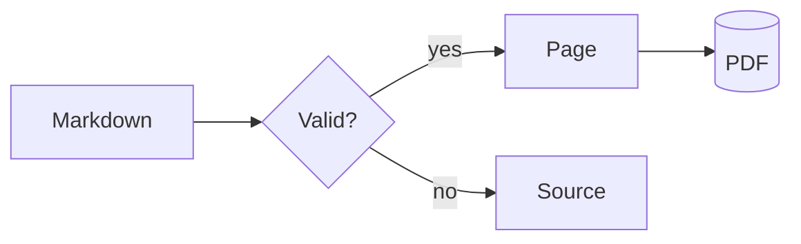
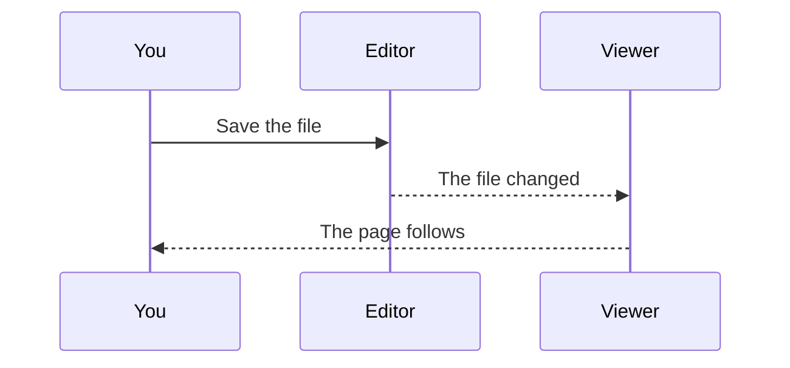
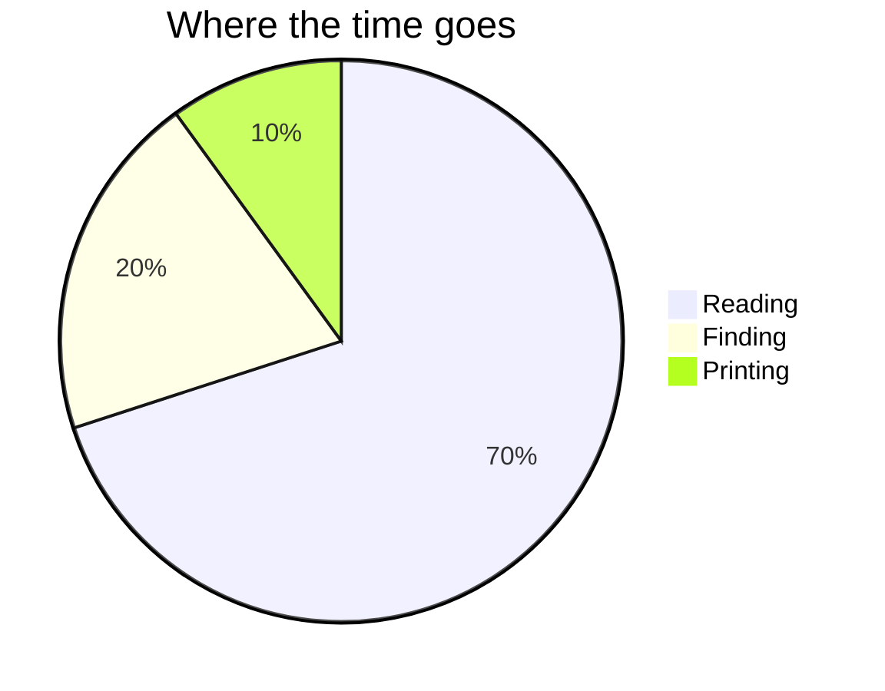
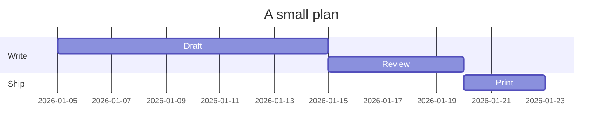
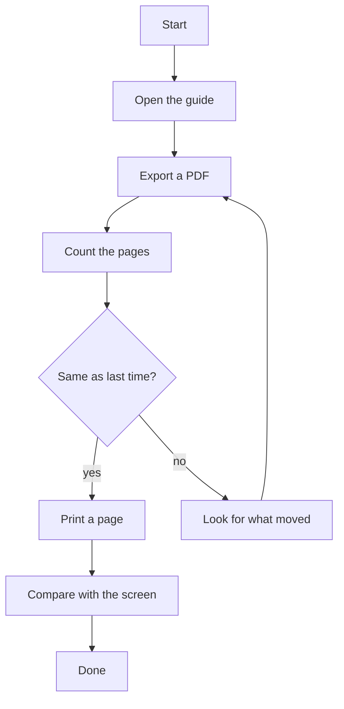

# Nacho-Viewer-Handbuch

Nacho Viewer öffnet Markdown-Dateien und zeigt sie als sauber gesetztes Dokument an. Es ist ein Viewer, kein
Editor: Ändere eine Datei in einem beliebigen Editor, und die Seite hier folgt.

Dieses Handbuch hat drei Teile:

1. [Die App verwenden](#die-app-verwenden): wie du liest, suchst, druckst und exportierst.
2. [Was Markdown darstellen kann](#was-markdown-darstellen-kann): je ein Beispiel für alles, was die App darstellt.
3. [Druck- und Exporttest](#druck--und-exporttest): die schwierigen Fälle, um Papier und Bildschirm zu vergleichen.

## Die App verwenden

### Ein Dokument öffnen

- Drücke <kbd>Ctrl</kbd>+<kbd>O</kbd> oder das **+** neben den Tabs.
- Ziehe eine `.md`- oder `.markdown`-Datei auf das Fenster.
- Wähle auf der Startseite eine der zuletzt geöffneten Dateien. Das **×** neben einer Datei entfernt sie aus der Liste.
- Öffne eine Markdown-Datei in deinem Dateimanager mit Nacho Viewer.

Jedes Dokument hat einen eigenen Tab. Mit Rechtsklick auf einen Tab findest du **Pfad kopieren** und kannst die Datei im
Dateimanager anzeigen.

> [!TIP]
> Unter macOS liest du in diesem Handbuch überall <kbd>Cmd</kbd> statt <kbd>Ctrl</kbd>.

### Lesen

Die **Gliederung** (<kbd>Ctrl</kbd>+<kbd>B</kbd>) listet die Überschriften des Dokuments auf; klicke auf eine, um
dorthin zu springen. Links funktionieren wie im Browser, und **Zurück** und **Vor**
(<kbd>Alt</kbd>+<kbd>←</kbd>, <kbd>Alt</kbd>+<kbd>→</kbd>) gehen sie im Tab erneut durch:

- Ein Link auf eine andere Markdown-Datei öffnet sie im selben Tab; <kbd>Ctrl</kbd>+Klick öffnet einen neuen Tab.
- Ein Link auf eine Überschrift, wie die oben auf dieser Seite, scrollt dorthin.
- Ein Link auf eine Website öffnet sich in deinem Browser.

Zoome mit <kbd>Ctrl</kbd>+<kbd>+</kbd> und <kbd>Ctrl</kbd>+<kbd>-</kbd> oder kehre mit
<kbd>Ctrl</kbd>+<kbd>0</kbd> zu 100 % zurück. <kbd>Ctrl</kbd>+<kbd>9</kbd> macht die Seite so breit wie das Fenster und
wieder zurück, was bei breiten Tabellen hilft.

**Suchen** (<kbd>Ctrl</kbd>+<kbd>F</kbd>) hebt jeden Treffer hervor; mit <kbd>F3</kbd> und
<kbd>Shift</kbd>+<kbd>F3</kbd> springst du durch sie. **Quelltext anzeigen**
(<kbd>Ctrl</kbd>+<kbd>U</kbd>) zeigt den reinen Text der Datei.

Wenn sich die Datei auf der Festplatte ändert, lädt die Seite von selbst neu und behält deine Position. Wird die Datei
gelöscht, bleibt die letzte Version mit einem Hinweis am oberen Rand auf dem Bildschirm.

### Drucken und exportieren

| Zweck | Drücke | Ergebnis |
| :--- | :---- | :------- |
| Drucken | <kbd>Ctrl</kbd>+<kbd>P</kbd> | Der Druckdialog des Systems |
| Exportieren | <kbd>Ctrl</kbd>+<kbd>Shift</kbd>+<kbd>E</kbd> | Eine PDF-Datei, A4 |

Beide fragen zuerst nach einer Textgröße, Klein, Normal oder Groß, und **Vorschau** zeigt das PDF im
Viewer deines Systems, bevor du dich festlegst. Papier verwendet immer die hellen Farben, egal welches Design
auf dem Bildschirm aktiv ist.

### Individuell anpassen

**Einstellungen** (<kbd>Ctrl</kbd>+<kbd>,</kbd>) bieten das Design (System, Hell oder Dunkel, auch mit
<kbd>Ctrl</kbd>+<kbd>Shift</kbd>+<kbd>L</kbd>), den Stil der Seite (Klassisch, Zeitung, Papier,
Docs oder Schreibmaschine), die Sprache der App und dieses Handbuchs (die des Systems oder
Englisch, Spanisch, Deutsch, Französisch, Italienisch, Portugiesisch, Chinesisch, Japanisch, Hindi, Bengalisch, Indonesisch, Koreanisch, Türkisch oder Vietnamesisch)
und ob Bilder aus dem Internet geladen werden.

Für alles Weitere legst du dein eigenes CSS in `user.css` im Einstellungsordner der App ab:

| System | Ordner |
| :----- | :----- |
| Linux | `~/.config/nacho-viewer/` |
| Windows | `%APPDATA%\nacho-viewer\` |
| macOS | `~/Library/Application Support/nacho-viewer/` |

### Tastaturkürzel

<kbd>F1</kbd> listet alle auf. <kbd>Shift</kbd>+<kbd>F1</kbd> öffnet dieses Handbuch.

### Kontakt

Nacho Viewer ist kostenlos und Open Source. **Über Nacho Viewer** im Menü **⋮** zeigt deine
Version an. Melde ein Problem oder lies den Code auf
[GitHub](https://github.com/nuncaeslupus/nacho-viewer).

## Was Markdown darstellen kann

### Text

Normaler Text mit *Hervorhebung*, **starker Hervorhebung**, ***beidem***, `Inline-Code`,
~~Durchgestrichenem~~, ==markiertem Text==, 25 m^2^ und H~2~O. Ein [Link](https://example.com),
ein Autolink www.example.com und ein harter Zeilenumbruch\
genau hier. Der Emoji-Shortcode :tada: wird zu einem Zeichen.

Die HTML-Spezifikation wird vom W3C gepflegt; fahre mit der Maus über diese beiden Namen, um ihre Bedeutung zu sehen.

*[HTML]: Hyper Text Markup Language (Hypertext-Auszeichnungssprache)
*[W3C]: World Wide Web Consortium (Konsortium für das World Wide Web)

Ein Satz mit einer Fußnote,[^short] und ein weiterer mit einer längeren.[^long]

[^short]: Eine kurze Fußnote.
[^long]: Eine längere Fußnote. Sie geht eine Weile weiter, damit sie bei jeder Seitenbreite in eine zweite Zeile
    umbricht und zeigt, wie Fußnotentext gesetzt wird.

Ein Wiki-Link führt über den Namen zu einer anderen Datei: [[Nacho Viewer Guide|dieses Handbuch]].

### Überschriften

#### Vierte Ebene

##### Fünfte Ebene

###### Sechste Ebene

### Listen

1. Eine geordnete Liste
2. mit einem zweiten Eintrag
   1. und einem verschachtelten
   2. der weiterzählt

- Eine Aufzählung
  - mit einem verschachtelten Eintrag
    - und einer dritten Ebene

- [x] Eine erledigte Aufgabe
- [ ] Eine offene Aufgabe

Begriff
: Eine Definition.

Weiterer Begriff
: Seine erste Definition.
: Seine zweite Definition.

### Zitate und Hinweise

> Ein Blockzitat.
>
> > Mit einem Zitat darin.

> [!NOTE]
> Nützliche Information.

> [!TIP]
> Hilfreicher Rat.

> [!IMPORTANT]
> Wichtige Information.

> [!WARNING]
> Dringende Information.

> [!CAUTION]
> Risiken einer Aktion.

---

### Tabellen

| Links | Zentriert | Rechts |
| :--- | :----: | ----: |
| eins | zwei | 3 |
| *vier* | `fünf` | 6.00 |
| Eine längere Zelle, die umbrechen muss, sobald der Platz in der Spalte auf der Seite ausgeht | b | 1,234.56 |

### Code

    An indented code block.

```js
// JavaScript
const answer = [1, 2, 3].map((n) => n * 7);
console.log(`The answer is ${answer.at(-1) * 2}`);
```

```python
# Python
def greet(name: str = "world") -> str:
    return f"Hello, {name}!"
```

```rust
// Rust
fn main() {
    let total: u32 = (1..=9).sum();
    println!("{total}");
}
```

```bash
# Shell
for file in *.md; do wc -l "$file"; done
```

```json
{ "name": "Nacho Viewer", "free": true, "platforms": ["Linux", "Windows", "macOS"] }
```

```diff
- The old line
+ The new line
```

### Mathematik

Mathematik im Text: $e^{i\pi} + 1 = 0$ und $\sqrt{a^2 + b^2}$.

$$
\int_0^1 x^2 \, dx = \frac{1}{3}
\qquad
\sum_{n=1}^{\infty} \frac{1}{n^2} = \frac{\pi^2}{6}
$$

$$
\begin{pmatrix} a & b \\ c & d \end{pmatrix}
\begin{pmatrix} x \\ y \end{pmatrix}
=
\begin{pmatrix} ax + by \\ cx + dy \end{pmatrix}
$$

### Diagramme

Ein Diagramm hat Zoom- und Schwenk-Steuerelemente, wenn du mit der Maus darüberfährst.









### Bilder

Ein lokales SVG übernimmt die Textfarbe und folgt damit dem Design:


Ein lokales Bild mit einem ``-Tag, der seine Größe festlegt:


### Rohes HTML

Sicheres HTML funktioniert; Skripte und Stile werden entfernt.

<details>
<summary>Ein Abschnitt, der sich öffnet</summary>

Drücke <kbd>Ctrl</kbd>+<kbd>C</kbd> zum Kopieren.

</details>

## Druck- und Exporttest

Drucke oder exportiere dieses Handbuch, um Papier und Bildschirm zu vergleichen. Der Inhalt ändert sich bei derselben Version
von Lauf zu Lauf nie, daher sollten zwei Exporte dieselben Seiten haben, und die Seitenzahl eines Systems
sollte höchstens eine Seite von der eines anderen abweichen.

Prüfe, dass:

- [ ] Die Seiten A4 sind, mit einem Rand auf jeder Seite.
- [ ] Jede Seite mit Text beginnt, nicht mit einer abgeschnittenen Zeile oder einem halben Bild.
- [ ] Die eigenen Leisten und Schaltflächen der App nicht mitgedruckt werden, ebenso wenig die Steuerelemente der Diagramme.
- [ ] Die Farben die hellen sind, auch wenn auf dem Bildschirm das dunkle Design aktiv ist.
- [ ] Fußnoten, Hinweise, Mathematik und Diagramme so aussehen wie auf dem Bildschirm.

### Eine breite Tabelle

| Quartal | Region | Produkt | Stück | Preis | Umsatz | Kosten | Marge | Verantwortlich | Status |
| :------ | :----- | :------ | ---: | ---: | -----: | ---: | -----: | :---- | :----- |
| Q1 | Nordeuropa | Reader Standard | 1,204 | 19.00 | 22,876.00 | 9,150.40 | 13,725.60 | Asha | Geliefert |
| Q2 | Südeuropa | Reader Standard | 987 | 19.00 | 18,753.00 | 7,501.20 | 11,251.80 | Bruno | Geliefert |
| Q3 | Nordamerika | Reader Professional | 2,310 | 49.00 | 113,190.00 | 39,616.50 | 73,573.50 | Chidi | In Arbeit |
| Q4 | Asien und Pazifik | Reader Professional | 1,875 | 49.00 | 91,875.00 | 32,156.25 | 59,718.75 | Dana | Geplant |

### Eine lange Tabelle

Eine Kopfzeile und Zeilen, die niemals über zwei Seiten getrennt werden sollten.

| # | Eintrag | Anmerkung |
| ---: | :--- | :--- |
| 1 | Alpha | Erste der Zeilen |
| 2 | Bravo | Zweite |
| 3 | Charlie | Dritte |
| 4 | Delta | Vierte |
| 5 | Echo | Fünfte |
| 6 | Foxtrot | Sechste |
| 7 | Golf | Siebte |
| 8 | Hotel | Achte |
| 9 | India | Neunte |
| 10 | Juliett | Zehnte |
| 11 | Kilo | Elfte |
| 12 | Lima | Zwölfte |
| 13 | Mike | Dreizehnte |
| 14 | November | Vierzehnte |
| 15 | Oscar | Fünfzehnte |
| 16 | Papa | Sechzehnte |
| 17 | Quebec | Siebzehnte |
| 18 | Romeo | Achtzehnte |
| 19 | Sierra | Neunzehnte |
| 20 | Tango | Zwanzigste |
| 21 | Uniform | Einundzwanzigste |
| 22 | Victor | Zweiundzwanzigste |
| 23 | Whiskey | Dreiundzwanzigste |
| 24 | X-ray | Vierundzwanzigste |
| 25 | Yankee | Fünfundzwanzigste |
| 26 | Zulu | Letzte der Zeilen |

### Sehr lange Zeilen

Eine Codezeile, die weit breiter ist als die Seite:

```text
0123456789 abcdefghij 0123456789 abcdefghij 0123456789 abcdefghij 0123456789 abcdefghij 0123456789 abcdefghij 0123456789 abcdefghij 0123456789 abcdefghij
```

Ein Wort, das keine Stelle zum Umbrechen hat: Pneumonoultramicroscopicsilicovolcanoconiosis_Pneumonoultramicroscopicsilicovolcanoconiosis_Pneumonoultramicroscopicsilicovolcanoconiosis.

Eine lange Adresse: <https://example.com/a/very/long/path/that/keeps/going/and/going/well/past/the/edge/of/the/sheet/on/any/paper/size>.

### Ein langer Codeblock

Dieser Block ist länger, als die meisten Seiten fassen können, und muss daher auf der nächsten weitergehen.

```python
# Sixty numbered lines.
line_01 = "one"
line_02 = "two"
line_03 = "three"
line_04 = "four"
line_05 = "five"
line_06 = "six"
line_07 = "seven"
line_08 = "eight"
line_09 = "nine"
line_10 = "ten"
line_11 = "eleven"
line_12 = "twelve"
line_13 = "thirteen"
line_14 = "fourteen"
line_15 = "fifteen"
line_16 = "sixteen"
line_17 = "seventeen"
line_18 = "eighteen"
line_19 = "nineteen"
line_20 = "twenty"
line_21 = "twenty-one"
line_22 = "twenty-two"
line_23 = "twenty-three"
line_24 = "twenty-four"
line_25 = "twenty-five"
line_26 = "twenty-six"
line_27 = "twenty-seven"
line_28 = "twenty-eight"
line_29 = "twenty-nine"
line_30 = "thirty"
line_31 = "thirty-one"
line_32 = "thirty-two"
line_33 = "thirty-three"
line_34 = "thirty-four"
line_35 = "thirty-five"
line_36 = "thirty-six"
line_37 = "thirty-seven"
line_38 = "thirty-eight"
line_39 = "thirty-nine"
line_40 = "forty"
line_41 = "forty-one"
line_42 = "forty-two"
line_43 = "forty-three"
line_44 = "forty-four"
line_45 = "forty-five"
line_46 = "forty-six"
line_47 = "forty-seven"
line_48 = "forty-eight"
line_49 = "forty-nine"
line_50 = "fifty"
line_51 = "fifty-one"
line_52 = "fifty-two"
line_53 = "fifty-three"
line_54 = "fifty-four"
line_55 = "fifty-five"
line_56 = "fifty-six"
line_57 = "fifty-seven"
line_58 = "fifty-eight"
line_59 = "fifty-nine"
line_60 = "sixty"
```

### Ein hohes Diagramm



### Text, der weiterläuft

Lange Absätze zeigen den Rhythmus der Seite: Zeilenlänge, Wortabstand und wie der Text von einer
Seite zur nächsten fließt. Eine gute Seite hält eine Überschrift beim folgenden Text zusammen und lässt nie eine
einzelne Zeile eines Absatzes am Anfang oder Ende einer Seite allein stehen.

Setzer nennen diese einzelnen Zeilen Hurenkinder und Schusterjungen. Sie von der Seite fernzuhalten ist auf
Papier wichtiger als auf dem Bildschirm, weil man einen Bildschirm scrollen kann, eine Seite aber nicht. Dasselbe
gilt für eine Überschrift am Seitenende, deren Text auf der Rückseite steht: Das Auge landet auf einem Versprechen und
muss umblättern, um zu sehen, dass es gehalten wird.

Nichts davon muss genau gelesen werden. Es genügt, die letzte Zeile jeder Seite und die
erste der nächsten anzusehen und zu prüfen, dass der Text wie vorgesehen weiterläuft. Wenn ja, funktionieren die
Seitenumbrüche.
