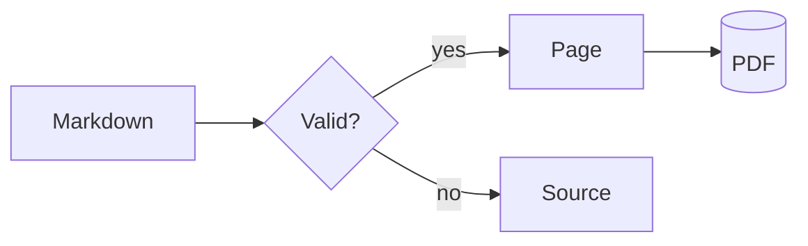
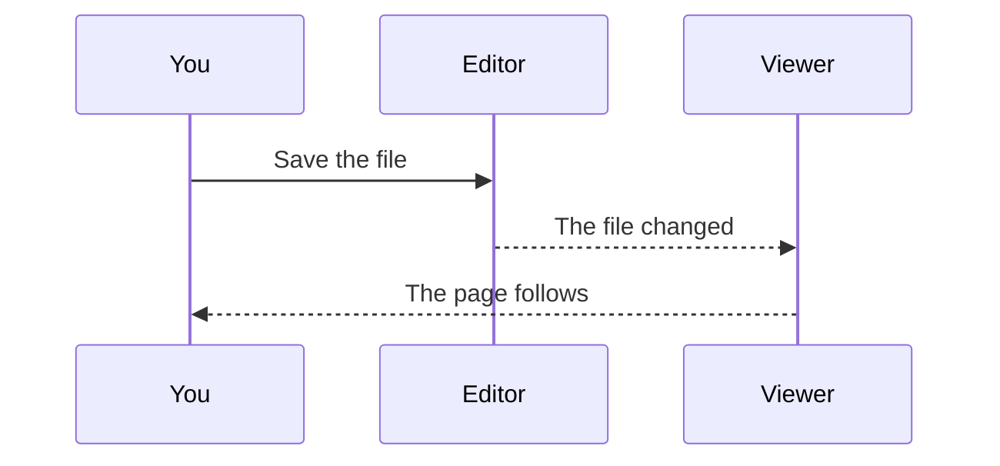
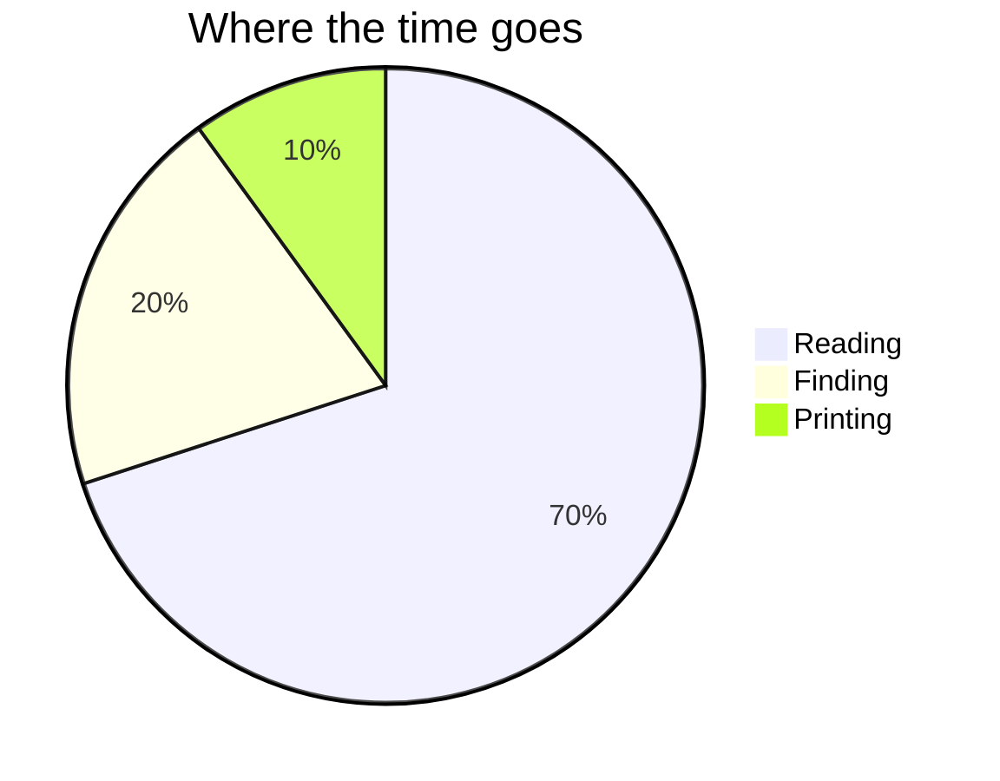
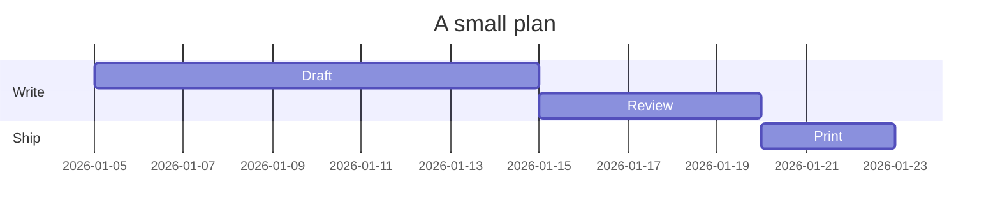
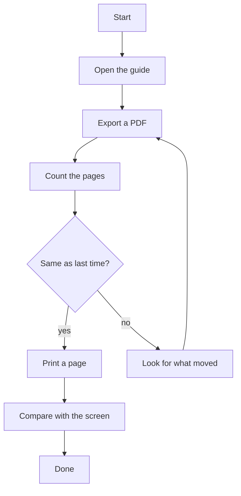

# Guía de Nacho Viewer

Nacho Viewer abre archivos Markdown y los muestra como un documento bien maquetado. Es un visor, no
un editor: cambia un archivo en cualquier editor y la página de aquí lo sigue.

Esta guía tiene tres partes:

1. [Uso de la aplicación](#uso-de-la-aplicación): cómo leer, buscar, imprimir y exportar.
2. [Qué puede mostrar Markdown](#qué-puede-mostrar-markdown): un ejemplo de todo lo que la aplicación representa.
3. [Prueba de impresión y exportación](#prueba-de-impresión-y-exportación): los casos difíciles, para comparar el papel con la pantalla.

## Uso de la aplicación

### Abrir un documento

- Pulsa <kbd>Ctrl</kbd>+<kbd>O</kbd>, o el **+** junto a las pestañas.
- Suelta un archivo `.md` o `.markdown` sobre la ventana.
- Elige uno de los archivos recientes de la página de inicio. La **×** junto a un archivo lo quita de la lista.
- Abre un archivo Markdown desde tu gestor de archivos con Nacho Viewer.

Cada documento tiene su propia pestaña. Haz clic derecho en una pestaña para **Copiar ruta** y para mostrar el archivo en tu
gestor de archivos.

> [!TIP]
> En macOS, lee <kbd>Ctrl</kbd> como <kbd>Cmd</kbd> en toda esta guía.

### Leer

El **esquema** (<kbd>Ctrl</kbd>+<kbd>B</kbd>) enumera los encabezados del documento; haz clic en uno para
ir allí. Los enlaces funcionan como en un navegador, y **atrás** y **adelante**
(<kbd>Alt</kbd>+<kbd>←</kbd>, <kbd>Alt</kbd>+<kbd>→</kbd>) los recorren de nuevo en la pestaña:

- Un enlace a otro archivo Markdown lo abre en la misma pestaña; <kbd>Ctrl</kbd>+clic lo abre en una pestaña nueva.
- Un enlace a un encabezado, como los del principio de esta página, se desplaza hasta él.
- Un enlace a un sitio web se abre en tu navegador.

Haz zoom con <kbd>Ctrl</kbd>+<kbd>+</kbd> y <kbd>Ctrl</kbd>+<kbd>-</kbd>, o vuelve al 100 % con
<kbd>Ctrl</kbd>+<kbd>0</kbd>. <kbd>Ctrl</kbd>+<kbd>9</kbd> hace la página tan ancha como la ventana y
la devuelve a su ancho, lo que ayuda con las tablas anchas.

**Buscar** (<kbd>Ctrl</kbd>+<kbd>F</kbd>) resalta todas las coincidencias; <kbd>F3</kbd> y
<kbd>Shift</kbd>+<kbd>F3</kbd> las recorren. **Ver código fuente**
(<kbd>Ctrl</kbd>+<kbd>U</kbd>) muestra el texto sin formato del archivo.

Cuando el archivo cambia en el disco, la página se recarga sola y conserva tu posición. Si el archivo se
elimina, la última versión se queda en pantalla con una nota arriba.

### Imprimir y exportar

| Para | Pulsa | Obtienes |
| :--- | :---- | :------- |
| Imprimir | <kbd>Ctrl</kbd>+<kbd>P</kbd> | El diálogo de impresión del sistema |
| Exportar | <kbd>Ctrl</kbd>+<kbd>Shift</kbd>+<kbd>E</kbd> | Un archivo PDF, A4 |

Ambos piden primero un tamaño de texto, Pequeño, Normal o Grande, y **Vista previa** muestra el PDF en el
visor de tu sistema antes de confirmar. El papel siempre usa los colores claros, sea cual sea el tema en
pantalla.

### Personalizar

**Ajustes** (<kbd>Ctrl</kbd>+<kbd>,</kbd>) incluye el tema (sistema, claro u oscuro; también
<kbd>Ctrl</kbd>+<kbd>Shift</kbd>+<kbd>L</kbd>), el estilo de la página (Clásico, Periódico, Papel,
Docs o Máquina de escribir), el idioma de la aplicación y de esta guía (el del sistema, o inglés,
español, alemán, francés, italiano, portugués, chino, japonés, hindi, bengalí, indonesio, coreano, turco, vietnamita o catalán) y si se cargan las imágenes de
internet.

Para cualquier otra cosa, pon tu propio CSS en `user.css` en la carpeta de ajustes de la aplicación:

| Sistema | Carpeta |
| :------ | :------ |
| Linux | `~/.config/nacho-viewer/` |
| Windows | `%APPDATA%\nacho-viewer\` |
| macOS | `~/Library/Application Support/nacho-viewer/` |

### Atajos de teclado

<kbd>F1</kbd> los muestra todos. <kbd>Shift</kbd>+<kbd>F1</kbd> abre esta guía.

### Contacto

Nacho Viewer es gratuito y de código abierto. **Acerca de Nacho Viewer**, en el menú **⋮**, muestra tu
versión. Informa de un problema o consulta el código en
[GitHub](https://github.com/nuncaeslupus/nacho-viewer).

## Qué puede mostrar Markdown

### Texto

Texto sencillo con *énfasis*, **énfasis fuerte**, ***ambos***, `código en línea`,
~~tachado~~, ==texto resaltado==, 25 m^2^ y H~2~O. Un [enlace](https://example.com),
un autoenlace www.example.com y un salto de línea forzado\
justo aquí. El código corto de emoji :tada: se convierte en un carácter.

La especificación HTML la mantiene el W3C; pasa el cursor sobre esos dos nombres para ver su significado.

*[HTML]: Hyper Text Markup Language (lenguaje de marcado de hipertexto)
*[W3C]: World Wide Web Consortium (consorcio de la Web)

Una frase con una nota al pie,[^short] y otra con una más larga.[^long]

[^short]: Una nota al pie breve.
[^long]: Una nota al pie más larga. Continúa durante un rato, de modo que se parte en una segunda línea en
    cualquier ancho de página y muestra cómo se compone el texto de las notas al pie.

Un enlace wiki lleva a otro archivo por su nombre: [[Nacho Viewer Guide|esta guía]].

### Encabezados

#### Cuarto nivel

##### Quinto nivel

###### Sexto nivel

### Listas

1. Una lista ordenada
2. con un segundo elemento
   1. y uno anidado
   2. que sigue contando

- Una lista con viñetas
  - con un elemento anidado
    - y un tercer nivel

- [x] Una tarea terminada
- [ ] Una tarea pendiente

Término
: Una definición.

Otro término
: Su primera definición.
: Su segunda definición.

### Citas y avisos

> Una cita en bloque.
>
> > Con una cita dentro.

> [!NOTE]
> Información útil.

> [!TIP]
> Un consejo útil.

> [!IMPORTANT]
> Información clave.

> [!WARNING]
> Información urgente.

> [!CAUTION]
> Riesgos de una acción.

---

### Tablas

| Izquierda | Centro | Derecha |
| :--- | :----: | ----: |
| uno | dos | 3 |
| *cuatro* | `cinco` | 6.00 |
| Una celda más larga que tiene que partirse cuando la columna se queda sin espacio en la página | b | 1,234.56 |

### Código

    An indented code block.

```js
// JavaScript
const answer = [1, 2, 3].map((n) => n * 7);
console.log(`The answer is ${answer.at(-1) * 2}`);
```

```python
# Python
def greet(name: str = "world") -> str:
    return f"Hello, {name}!"
```

```rust
// Rust
fn main() {
    let total: u32 = (1..=9).sum();
    println!("{total}");
}
```

```bash
# Shell
for file in *.md; do wc -l "$file"; done
```

```json
{ "name": "Nacho Viewer", "free": true, "platforms": ["Linux", "Windows", "macOS"] }
```

```diff
- The old line
+ The new line
```

### Matemáticas

Matemáticas en línea: $e^{i\pi} + 1 = 0$ y $\sqrt{a^2 + b^2}$.

$$
\int_0^1 x^2 \, dx = \frac{1}{3}
\qquad
\sum_{n=1}^{\infty} \frac{1}{n^2} = \frac{\pi^2}{6}
$$

$$
\begin{pmatrix} a & b \\ c & d \end{pmatrix}
\begin{pmatrix} x \\ y \end{pmatrix}
=
\begin{pmatrix} ax + by \\ cx + dy \end{pmatrix}
$$

### Diagramas

Un diagrama tiene controles de zoom y desplazamiento cuando pasas el cursor por encima.









### Imágenes

Un SVG local toma el color del texto, así que sigue el tema:


Una imagen local, con una etiqueta `` que fija su tamaño:


### HTML sin procesar

El HTML seguro funciona; los scripts y los estilos se eliminan.

<details>
<summary>Una sección que se abre</summary>

Pulsa <kbd>Ctrl</kbd>+<kbd>C</kbd> para copiar.

</details>

## Prueba de impresión y exportación

Imprime o exporta esta guía para comparar el papel con la pantalla. El contenido nunca cambia entre ejecuciones
de la misma versión, así que dos exportaciones deberían tener las mismas páginas, y el número de páginas en un sistema
debería diferir como máximo en una página del de otro.

Comprueba que:

- [ ] Las páginas son A4, con margen por los cuatro lados.
- [ ] Cada página empieza con texto, no con una línea cortada ni media imagen.
- [ ] Las barras y botones de la propia aplicación no se imprimen, ni tampoco los controles de los diagramas.
- [ ] Los colores son los claros, aunque en pantalla esté el tema oscuro.
- [ ] Las notas al pie, los avisos, las matemáticas y los diagramas se ven como en pantalla.

### Una tabla ancha

| Trimestre | Región | Producto | Unidades | Precio | Ingresos | Coste | Margen | Responsable | Estado |
| :------ | :----- | :------ | ---: | ---: | -----: | ---: | -----: | :---- | :----- |
| T1 | Norte de Europa | Reader Estándar | 1,204 | 19.00 | 22,876.00 | 9,150.40 | 13,725.60 | Asha | Enviado |
| T2 | Sur de Europa | Reader Estándar | 987 | 19.00 | 18,753.00 | 7,501.20 | 11,251.80 | Bruno | Enviado |
| T3 | Norteamérica | Reader Profesional | 2,310 | 49.00 | 113,190.00 | 39,616.50 | 73,573.50 | Chidi | En curso |
| T4 | Asia y el Pacífico | Reader Profesional | 1,875 | 49.00 | 91,875.00 | 32,156.25 | 59,718.75 | Dana | Planificado |

### Una tabla larga

Una fila de encabezado, y filas que nunca deberían partirse entre dos páginas.

| # | Elemento | Nota |
| ---: | :--- | :--- |
| 1 | Alpha | Primera de las filas |
| 2 | Bravo | Segunda |
| 3 | Charlie | Tercera |
| 4 | Delta | Cuarta |
| 5 | Echo | Quinta |
| 6 | Foxtrot | Sexta |
| 7 | Golf | Séptima |
| 8 | Hotel | Octava |
| 9 | India | Novena |
| 10 | Juliett | Décima |
| 11 | Kilo | Undécima |
| 12 | Lima | Duodécima |
| 13 | Mike | Decimotercera |
| 14 | November | Decimocuarta |
| 15 | Oscar | Decimoquinta |
| 16 | Papa | Decimosexta |
| 17 | Quebec | Decimoséptima |
| 18 | Romeo | Decimoctava |
| 19 | Sierra | Decimonovena |
| 20 | Tango | Vigésima |
| 21 | Uniform | Vigesimoprimera |
| 22 | Victor | Vigesimosegunda |
| 23 | Whiskey | Vigesimotercera |
| 24 | X-ray | Vigesimocuarta |
| 25 | Yankee | Vigesimoquinta |
| 26 | Zulu | Última de las filas |

### Líneas muy largas

Una línea de código mucho más ancha que la página:

```text
0123456789 abcdefghij 0123456789 abcdefghij 0123456789 abcdefghij 0123456789 abcdefghij 0123456789 abcdefghij 0123456789 abcdefghij 0123456789 abcdefghij
```

Una palabra que no tiene dónde cortarse: Pneumonoultramicroscopicsilicovolcanoconiosis_Pneumonoultramicroscopicsilicovolcanoconiosis_Pneumonoultramicroscopicsilicovolcanoconiosis.

Una dirección larga: <https://example.com/a/very/long/path/that/keeps/going/and/going/well/past/the/edge/of/the/sheet/on/any/paper/size>.

### Un bloque de código largo

Este bloque es más largo de lo que caben en la mayoría de las páginas, así que tiene que continuar en la siguiente.

```python
# Sixty numbered lines.
line_01 = "one"
line_02 = "two"
line_03 = "three"
line_04 = "four"
line_05 = "five"
line_06 = "six"
line_07 = "seven"
line_08 = "eight"
line_09 = "nine"
line_10 = "ten"
line_11 = "eleven"
line_12 = "twelve"
line_13 = "thirteen"
line_14 = "fourteen"
line_15 = "fifteen"
line_16 = "sixteen"
line_17 = "seventeen"
line_18 = "eighteen"
line_19 = "nineteen"
line_20 = "twenty"
line_21 = "twenty-one"
line_22 = "twenty-two"
line_23 = "twenty-three"
line_24 = "twenty-four"
line_25 = "twenty-five"
line_26 = "twenty-six"
line_27 = "twenty-seven"
line_28 = "twenty-eight"
line_29 = "twenty-nine"
line_30 = "thirty"
line_31 = "thirty-one"
line_32 = "thirty-two"
line_33 = "thirty-three"
line_34 = "thirty-four"
line_35 = "thirty-five"
line_36 = "thirty-six"
line_37 = "thirty-seven"
line_38 = "thirty-eight"
line_39 = "thirty-nine"
line_40 = "forty"
line_41 = "forty-one"
line_42 = "forty-two"
line_43 = "forty-three"
line_44 = "forty-four"
line_45 = "forty-five"
line_46 = "forty-six"
line_47 = "forty-seven"
line_48 = "forty-eight"
line_49 = "forty-nine"
line_50 = "fifty"
line_51 = "fifty-one"
line_52 = "fifty-two"
line_53 = "fifty-three"
line_54 = "fifty-four"
line_55 = "fifty-five"
line_56 = "fifty-six"
line_57 = "fifty-seven"
line_58 = "fifty-eight"
line_59 = "fifty-nine"
line_60 = "sixty"
```

### Un diagrama alto



### Texto que sigue y sigue

Los párrafos largos muestran el ritmo de la página: la longitud de línea, el espaciado entre palabras y cómo fluye el texto de
una página a la siguiente. Una buena página mantiene un encabezado junto al texto que lo sigue, y nunca deja una
sola línea de un párrafo aislada al principio o al final de una página.

Los tipógrafos llaman a esas líneas aisladas viudas y huérfanas. Evitarlas importa más
en papel que en pantalla, porque un lector puede desplazar una pantalla pero no una página. Lo mismo
ocurre con un encabezado al pie de una página, con su texto al dorso: el ojo se posa en una promesa y
tiene que pasar la página para ver que se cumple.

Nada de esto necesita una lectura atenta. Basta con mirar la última línea de cada página y la
primera de la siguiente, y ver que el texto continúa como debe. Si es así, los saltos de página
funcionan.
