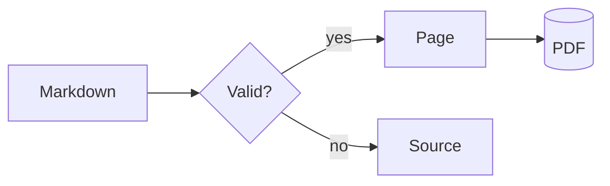
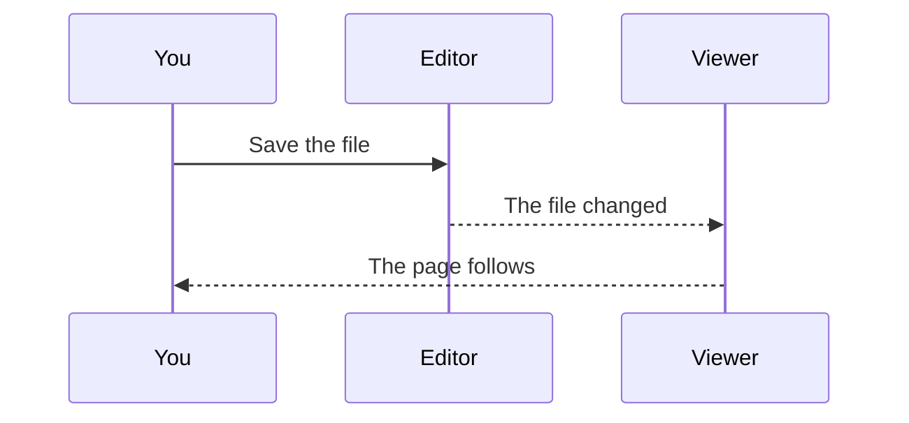
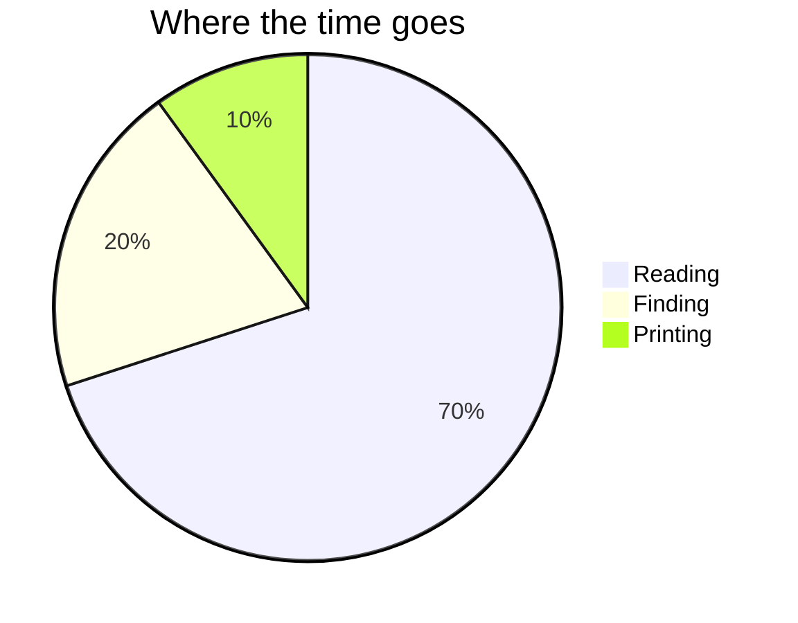
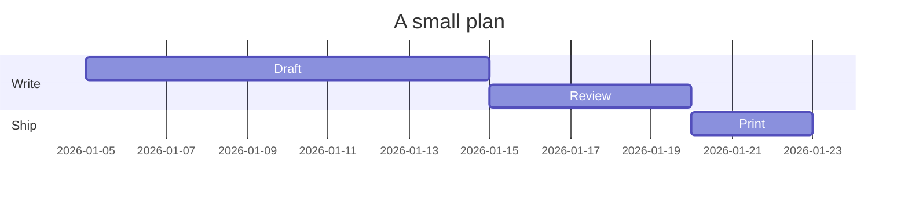
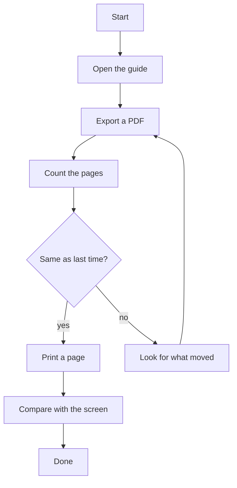

# Guide de Nacho Viewer

Nacho Viewer ouvre des fichiers Markdown et les affiche comme un document soigneusement composé. C'est un visionneur, pas
un éditeur : modifiez un fichier dans n'importe quel éditeur et la page ici suit.

Ce guide comporte trois parties :

1. [Utiliser l'application](#utiliser-lapplication) : comment lire, rechercher, imprimer et exporter.
2. [Ce que Markdown peut afficher](#ce-que-markdown-peut-afficher) : un exemple de tout ce que l'application rend.
3. [Test d'impression et d'export](#test-dimpression-et-dexport) : les cas difficiles, pour comparer le papier à l'écran.

## Utiliser l'application

### Ouvrir un document

- Appuyez sur <kbd>Ctrl</kbd>+<kbd>O</kbd>, ou sur le **+** à côté des onglets.
- Déposez un fichier `.md` ou `.markdown` sur la fenêtre.
- Choisissez un des fichiers récents sur la page d'accueil. Le **×** à côté d'un fichier le retire de la liste.
- Ouvrez un fichier Markdown depuis votre gestionnaire de fichiers avec Nacho Viewer.

Chaque document a son propre onglet. Faites un clic droit sur un onglet pour **Copier le chemin** et pour afficher le fichier dans
votre gestionnaire de fichiers.

> [!TIP]
> Sous macOS, lisez <kbd>Ctrl</kbd> comme <kbd>Cmd</kbd> partout dans ce guide.

### Lire

Le **plan** (<kbd>Ctrl</kbd>+<kbd>B</kbd>) liste les titres du document ; cliquez sur l'un d'eux pour
y aller. Les liens fonctionnent comme dans un navigateur, et **précédent** et **suivant**
(<kbd>Alt</kbd>+<kbd>←</kbd>, <kbd>Alt</kbd>+<kbd>→</kbd>) les parcourent à nouveau dans l'onglet :

- Un lien vers un autre fichier Markdown l'ouvre dans le même onglet ; <kbd>Ctrl</kbd>+clic l'ouvre dans un nouvel onglet.
- Un lien vers un titre, comme ceux en haut de cette page, y fait défiler la page.
- Un lien vers un site web s'ouvre dans votre navigateur.

Zoomez avec <kbd>Ctrl</kbd>+<kbd>+</kbd> et <kbd>Ctrl</kbd>+<kbd>-</kbd>, ou revenez à 100 % avec
<kbd>Ctrl</kbd>+<kbd>0</kbd>. <kbd>Ctrl</kbd>+<kbd>9</kbd> donne à la page la largeur de la fenêtre, et
revient en arrière, ce qui aide pour les tableaux larges.

**Rechercher** (<kbd>Ctrl</kbd>+<kbd>F</kbd>) surligne chaque occurrence ; <kbd>F3</kbd> et
<kbd>Shift</kbd>+<kbd>F3</kbd> les parcourent. **Afficher la source**
(<kbd>Ctrl</kbd>+<kbd>U</kbd>) montre le texte brut du fichier.

Quand le fichier change sur le disque, la page se recharge toute seule et garde votre position. Si le fichier est
supprimé, la dernière version reste à l'écran avec une note en haut.

### Imprimer et exporter

| Pour | Appuyez sur | Vous obtenez |
| :--- | :---------- | :----------- |
| Imprimer | <kbd>Ctrl</kbd>+<kbd>P</kbd> | La boîte de dialogue d'impression du système |
| Exporter | <kbd>Ctrl</kbd>+<kbd>Shift</kbd>+<kbd>E</kbd> | Un fichier PDF, A4 |

Les deux demandent d'abord une taille de texte, Petite, Normale ou Grande, et **Aperçu** affiche le PDF dans la
visionneuse de votre système avant que vous ne validiez. Le papier utilise toujours les couleurs claires, quel que soit le thème
à l'écran.

### Personnaliser

**Réglages** (<kbd>Ctrl</kbd>+<kbd>,</kbd>) contient le thème (système, clair ou sombre, aussi
<kbd>Ctrl</kbd>+<kbd>Shift</kbd>+<kbd>L</kbd>), le style de la page (Classique, Journal, Papier,
Docs ou Machine à écrire), la langue de l'application et de ce guide (celle du système, ou
l'anglais, l'espagnol, l'allemand, le français, l'italien, le portugais, le chinois, le japonais, l'hindi, le bengali, l'indonésien, le coréen, le turc, le vietnamien ou le catalan)
et le chargement ou non des images provenant d'internet.

Pour tout le reste, mettez votre propre CSS dans `user.css` dans le dossier de réglages de l'application :

| Système | Dossier |
| :------ | :------ |
| Linux | `~/.config/nacho-viewer/` |
| Windows | `%APPDATA%\nacho-viewer\` |
| macOS | `~/Library/Application Support/nacho-viewer/` |

### Raccourcis clavier

<kbd>F1</kbd> les liste tous. <kbd>Shift</kbd>+<kbd>F1</kbd> ouvre ce guide.

### Nous contacter

Nacho Viewer est gratuit et open source. **À propos de Nacho Viewer**, dans le menu **⋮**, affiche votre
version. Signalez un problème ou lisez le code sur
[GitHub](https://github.com/nuncaeslupus/nacho-viewer).

## Ce que Markdown peut afficher

### Texte

Du texte simple avec de l'*emphase*, de l'**emphase forte**, ***les deux***, du `code en ligne`,
du ~~texte barré~~, du ==texte surligné==, le 19^e^ siècle et H~2~O. Un [lien](https://example.com),
un lien automatique www.example.com, et un saut de ligne forcé\
juste ici. Le code emoji :tada: devient un caractère.

La spécification HTML est maintenue par le W3C ; survolez ces deux noms pour voir leur signification.

*[HTML]: Hyper Text Markup Language (langage de balisage hypertexte)
*[W3C]: World Wide Web Consortium (consortium du World Wide Web)

Une phrase avec une note de bas de page,[^short] et une autre avec une plus longue.[^long]

[^short]: Une courte note de bas de page.
[^long]: Une note de bas de page plus longue. Elle se prolonge un moment, de sorte qu'elle passe à une deuxième ligne sur
    n'importe quelle largeur de page et montre comment le texte des notes est composé.

Un lien wiki renvoie vers un autre fichier par son nom : [[Nacho Viewer Guide|ce guide]].

### Titres

#### Quatrième niveau

##### Cinquième niveau

###### Sixième niveau

### Listes

1. Une liste ordonnée
2. avec un deuxième élément
   1. et un élément imbriqué
   2. qui continue à compter

- Une liste à puces
  - avec un élément imbriqué
    - et un troisième niveau

- [x] Une tâche terminée
- [ ] Une tâche ouverte

Terme
: Une définition.

Autre terme
: Sa première définition.
: Sa deuxième définition.

### Citations et alertes

> Une citation en bloc.
>
> > Avec une citation à l'intérieur.

> [!NOTE]
> Information utile.

> [!TIP]
> Conseil utile.

> [!IMPORTANT]
> Information essentielle.

> [!WARNING]
> Information urgente.

> [!CAUTION]
> Risques d'une action.

---

### Tableaux

| Gauche | Centre | Droite |
| :--- | :----: | ----: |
| un | deux | 3 |
| *quatre* | `cinq` | 6.00 |
| Une cellule plus longue qui doit passer à la ligne quand la colonne manque de place sur la page | b | 1,234.56 |

### Code

    An indented code block.

```js
// JavaScript
const answer = [1, 2, 3].map((n) => n * 7);
console.log(`The answer is ${answer.at(-1) * 2}`);
```

```python
# Python
def greet(name: str = "world") -> str:
    return f"Hello, {name}!"
```

```rust
// Rust
fn main() {
    let total: u32 = (1..=9).sum();
    println!("{total}");
}
```

```bash
# Shell
for file in *.md; do wc -l "$file"; done
```

```json
{ "name": "Nacho Viewer", "free": true, "platforms": ["Linux", "Windows", "macOS"] }
```

```diff
- The old line
+ The new line
```

### Mathématiques

Maths en ligne : $e^{i\pi} + 1 = 0$ et $\sqrt{a^2 + b^2}$.

$$
\int_0^1 x^2 \, dx = \frac{1}{3}
\qquad
\sum_{n=1}^{\infty} \frac{1}{n^2} = \frac{\pi^2}{6}
$$

$$
\begin{pmatrix} a & b \\ c & d \end{pmatrix}
\begin{pmatrix} x \\ y \end{pmatrix}
=
\begin{pmatrix} ax + by \\ cx + dy \end{pmatrix}
$$

### Diagrammes

Un diagramme dispose de commandes de zoom et de déplacement quand vous le survolez.









### Images

Un SVG local prend la couleur du texte, il suit donc le thème :


Une image locale, avec une balise `` qui fixe sa taille :


### HTML brut

Le HTML sûr fonctionne ; les scripts et les styles sont supprimés.

<details>
<summary>Une section qui s'ouvre</summary>

Appuyez sur <kbd>Ctrl</kbd>+<kbd>C</kbd> pour copier.

</details>

## Test d'impression et d'export

Imprimez ou exportez ce guide pour comparer le papier à l'écran. Le contenu ne change jamais d'une exécution à l'autre
avec la même version, donc deux exports devraient avoir les mêmes pages, et le nombre de pages obtenu sur un système
devrait être à une page près celui d'un autre.

Vérifiez que :

- [ ] Les pages sont en A4, avec une marge de chaque côté.
- [ ] Chaque page commence par du texte, pas par une ligne coupée ou une demi-image.
- [ ] Les barres et boutons de l'application ne s'impriment pas, pas plus que les commandes des diagrammes.
- [ ] Les couleurs sont les claires, même avec le thème sombre à l'écran.
- [ ] Les notes de bas de page, alertes, maths et diagrammes ressemblent à ce qu'ils sont à l'écran.

### Un tableau large

| Trimestre | Région | Produit | Unités | Prix | Chiffre d'affaires | Coût | Marge | Responsable | Statut |
| :------ | :----- | :------ | ---: | ---: | -----: | ---: | -----: | :---- | :----- |
| T1 | Europe du Nord | Reader Standard | 1,204 | 19.00 | 22,876.00 | 9,150.40 | 13,725.60 | Asha | Expédié |
| T2 | Europe du Sud | Reader Standard | 987 | 19.00 | 18,753.00 | 7,501.20 | 11,251.80 | Bruno | Expédié |
| T3 | Amérique du Nord | Reader Professional | 2,310 | 49.00 | 113,190.00 | 39,616.50 | 73,573.50 | Chidi | En cours |
| T4 | Asie et Pacifique | Reader Professional | 1,875 | 49.00 | 91,875.00 | 32,156.25 | 59,718.75 | Dana | Prévu |

### Un tableau long

Une ligne d'en-tête, et des lignes qui ne devraient jamais être coupées entre deux pages.

| # | Élément | Note |
| ---: | :--- | :--- |
| 1 | Alpha | Première des lignes |
| 2 | Bravo | Deuxième |
| 3 | Charlie | Troisième |
| 4 | Delta | Quatrième |
| 5 | Echo | Cinquième |
| 6 | Foxtrot | Sixième |
| 7 | Golf | Septième |
| 8 | Hotel | Huitième |
| 9 | India | Neuvième |
| 10 | Juliett | Dixième |
| 11 | Kilo | Onzième |
| 12 | Lima | Douzième |
| 13 | Mike | Treizième |
| 14 | November | Quatorzième |
| 15 | Oscar | Quinzième |
| 16 | Papa | Seizième |
| 17 | Quebec | Dix-septième |
| 18 | Romeo | Dix-huitième |
| 19 | Sierra | Dix-neuvième |
| 20 | Tango | Vingtième |
| 21 | Uniform | Vingt et unième |
| 22 | Victor | Vingt-deuxième |
| 23 | Whiskey | Vingt-troisième |
| 24 | X-ray | Vingt-quatrième |
| 25 | Yankee | Vingt-cinquième |
| 26 | Zulu | Dernière des lignes |

### Lignes très longues

Une ligne de code bien plus large que la page :

```text
0123456789 abcdefghij 0123456789 abcdefghij 0123456789 abcdefghij 0123456789 abcdefghij 0123456789 abcdefghij 0123456789 abcdefghij 0123456789 abcdefghij
```

Un mot qui n'a aucun endroit où se couper : Pneumonoultramicroscopicsilicovolcanoconiosis_Pneumonoultramicroscopicsilicovolcanoconiosis_Pneumonoultramicroscopicsilicovolcanoconiosis.

Une longue adresse : <https://example.com/a/very/long/path/that/keeps/going/and/going/well/past/the/edge/of/the/sheet/on/any/paper/size>.

### Un long bloc de code

Ce bloc est plus long que ce que la plupart des pages peuvent contenir, il doit donc continuer sur la suivante.

```python
# Sixty numbered lines.
line_01 = "one"
line_02 = "two"
line_03 = "three"
line_04 = "four"
line_05 = "five"
line_06 = "six"
line_07 = "seven"
line_08 = "eight"
line_09 = "nine"
line_10 = "ten"
line_11 = "eleven"
line_12 = "twelve"
line_13 = "thirteen"
line_14 = "fourteen"
line_15 = "fifteen"
line_16 = "sixteen"
line_17 = "seventeen"
line_18 = "eighteen"
line_19 = "nineteen"
line_20 = "twenty"
line_21 = "twenty-one"
line_22 = "twenty-two"
line_23 = "twenty-three"
line_24 = "twenty-four"
line_25 = "twenty-five"
line_26 = "twenty-six"
line_27 = "twenty-seven"
line_28 = "twenty-eight"
line_29 = "twenty-nine"
line_30 = "thirty"
line_31 = "thirty-one"
line_32 = "thirty-two"
line_33 = "thirty-three"
line_34 = "thirty-four"
line_35 = "thirty-five"
line_36 = "thirty-six"
line_37 = "thirty-seven"
line_38 = "thirty-eight"
line_39 = "thirty-nine"
line_40 = "forty"
line_41 = "forty-one"
line_42 = "forty-two"
line_43 = "forty-three"
line_44 = "forty-four"
line_45 = "forty-five"
line_46 = "forty-six"
line_47 = "forty-seven"
line_48 = "forty-eight"
line_49 = "forty-nine"
line_50 = "fifty"
line_51 = "fifty-one"
line_52 = "fifty-two"
line_53 = "fifty-three"
line_54 = "fifty-four"
line_55 = "fifty-five"
line_56 = "fifty-six"
line_57 = "fifty-seven"
line_58 = "fifty-eight"
line_59 = "fifty-nine"
line_60 = "sixty"
```

### Un diagramme haut



### Un texte qui n'en finit pas

Les longs paragraphes montrent le rythme de la page : longueur de ligne, espacement des mots et manière dont le texte passe d'une
page à la suivante. Une bonne page garde un titre avec le texte qui le suit, et ne laisse jamais une
seule ligne d'un paragraphe isolée en haut ou en bas d'une page.

Les typographes appellent ces lignes isolées des veuves et des orphelines. Les éviter compte davantage
sur le papier qu'à l'écran, car un lecteur peut faire défiler un écran mais pas une page. Il en va de même
pour un titre en pied de page dont le texte est au verso : l'œil tombe sur une promesse et
doit tourner la page pour voir qu'elle est tenue.

Rien ici n'exige une lecture attentive. Il suffit de regarder la dernière ligne de chaque page et la
première de la suivante, et de voir que le texte se poursuit comme il se doit. Si c'est le cas, les sauts de page
fonctionnent.
