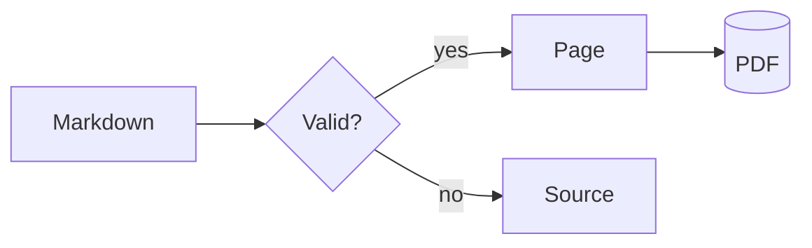
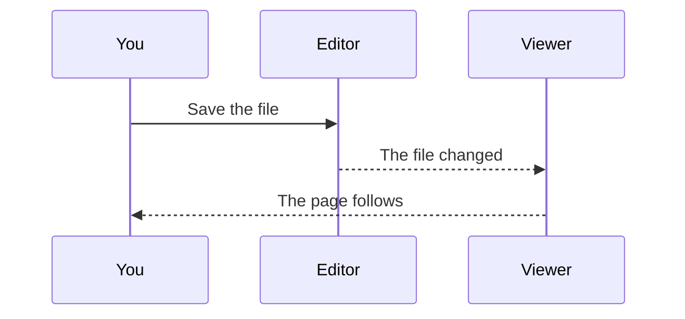
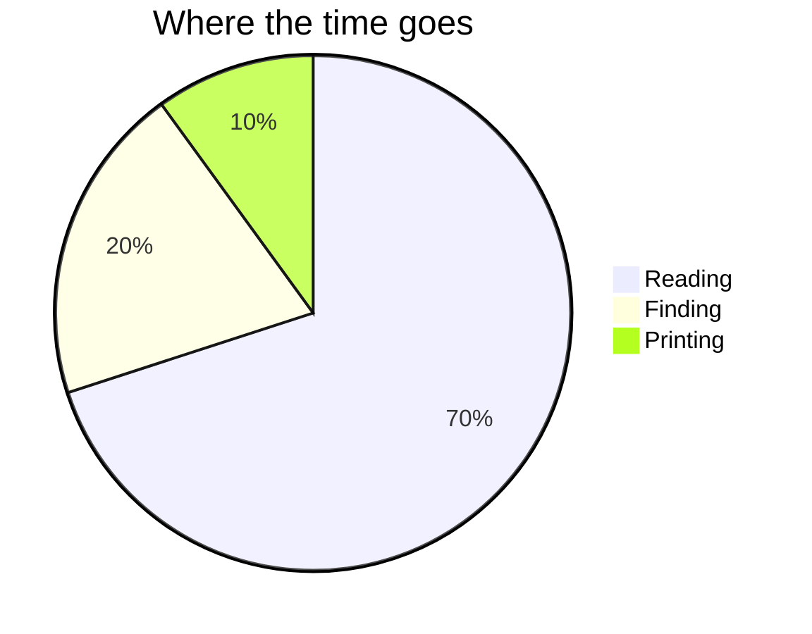
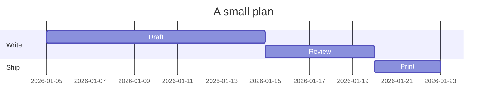
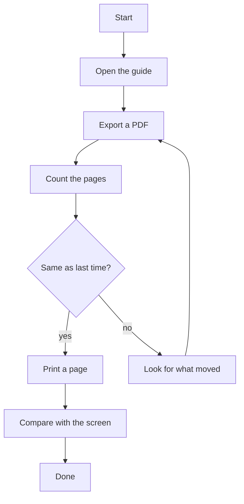

# Nacho Viewer मार्गदर्शिका

Nacho Viewer Markdown फ़ाइलें खोलता है और उन्हें सुव्यवस्थित दस्तावेज़ की तरह दिखाता है। यह एक व्यूअर है, संपादक नहीं: फ़ाइल को किसी भी संपादक में बदलें और यहाँ का पृष्ठ अपने-आप उसके साथ बदल जाता है।

इस मार्गदर्शिका के तीन भाग हैं:

1. [ऐप का उपयोग](#ऐप-का-उपयोग): पढ़ना, खोजना, प्रिंट करना और निर्यात करना।
2. [Markdown क्या दिखा सकता है](#markdown-क्या-दिखा-सकता-है): ऐप जो कुछ दिखाता है, उसका एक-एक उदाहरण।
3. [प्रिंट और निर्यात परीक्षण](#प्रिंट-और-निर्यात-परीक्षण): कठिन मामले, ताकि काग़ज़ को स्क्रीन से मिलाया जा सके।

## ऐप का उपयोग

### दस्तावेज़ खोलना

- <kbd>Ctrl</kbd>+<kbd>O</kbd> दबाएँ, या टैब के पास **+** दबाएँ।
- किसी `.md` या `.markdown` फ़ाइल को विंडो पर छोड़ें।
- शुरुआती पृष्ठ पर हाल की फ़ाइलों में से कोई चुनें। फ़ाइल के पास का **×** उसे सूची से हटा देता है।
- अपने फ़ाइल प्रबंधक से किसी Markdown फ़ाइल को Nacho Viewer से खोलें।

हर दस्तावेज़ का अपना टैब होता है। किसी टैब पर राइट-क्लिक करने पर **पथ कॉपी करें** मिलता है और फ़ाइल को आपके फ़ाइल प्रबंधक में दिखाया जा सकता है।

> [!TIP]
> macOS पर इस मार्गदर्शिका में हर जगह <kbd>Ctrl</kbd> को <kbd>Cmd</kbd> पढ़ें।

### पढ़ना

**रूपरेखा** (<kbd>Ctrl</kbd>+<kbd>B</kbd>) दस्तावेज़ के शीर्षकों की सूची दिखाती है; किसी पर क्लिक करके वहाँ जाएँ। लिंक वैसे ही काम करते हैं जैसे ब्राउज़र में, और **पीछे** तथा **आगे** (<kbd>Alt</kbd>+<kbd>←</kbd>, <kbd>Alt</kbd>+<kbd>→</kbd>) टैब में उन्हीं रास्तों पर लौटाते हैं:

- किसी दूसरी Markdown फ़ाइल का लिंक उसे उसी टैब में खोलता है; <kbd>Ctrl</kbd>+क्लिक नए टैब में खोलता है।
- किसी शीर्षक का लिंक, जैसे इस पृष्ठ के शुरू वाले, वहाँ तक स्क्रॉल करता है।
- किसी वेबसाइट का लिंक आपके ब्राउज़र में खुलता है।

<kbd>Ctrl</kbd>+<kbd>+</kbd> और <kbd>Ctrl</kbd>+<kbd>-</kbd> से ज़ूम करें, या <kbd>Ctrl</kbd>+<kbd>0</kbd> से 100% पर लौटें। <kbd>Ctrl</kbd>+<kbd>9</kbd> पृष्ठ को विंडो जितना चौड़ा करता है और फिर वापस कर देता है, जो चौड़ी तालिकाओं में काम आता है।

**खोजें** (<kbd>Ctrl</kbd>+<kbd>F</kbd>) हर परिणाम को हाइलाइट करता है; <kbd>F3</kbd> और <kbd>Shift</kbd>+<kbd>F3</kbd> उनके बीच आगे-पीछे जाते हैं। **स्रोत देखें** (<kbd>Ctrl</kbd>+<kbd>U</kbd>) फ़ाइल का सादा पाठ दिखाता है।

डिस्क पर फ़ाइल बदलने पर पृष्ठ अपने-आप फिर से लोड हो जाता है और आपकी जगह बनी रहती है। अगर फ़ाइल हटा दी जाए, तो अंतिम संस्करण स्क्रीन पर रहता है और ऊपर एक सूचना दिखती है।

### प्रिंट और निर्यात

| क्या करना है | दबाएँ | क्या मिलेगा |
| :--- | :---- | :------ |
| प्रिंट | <kbd>Ctrl</kbd>+<kbd>P</kbd> | सिस्टम का प्रिंट संवाद |
| निर्यात | <kbd>Ctrl</kbd>+<kbd>Shift</kbd>+<kbd>E</kbd> | एक PDF फ़ाइल, A4 |

दोनों पहले पाठ का आकार पूछते हैं: छोटा, सामान्य या बड़ा, और **पूर्वावलोकन** पक्का करने से पहले PDF को आपके सिस्टम के व्यूअर में दिखाता है। स्क्रीन पर कोई भी थीम हो, काग़ज़ हमेशा हल्के रंगों का उपयोग करता है।

### अपने अनुसार ढालें

**सेटिंग्स** (<kbd>Ctrl</kbd>+<kbd>,</kbd>) में थीम (सिस्टम, हल्की या गहरी; यह <kbd>Ctrl</kbd>+<kbd>Shift</kbd>+<kbd>L</kbd> से भी बदलती है), पृष्ठ की शैली (क्लासिक, अख़बार, काग़ज़, दस्तावेज़ या टाइपराइटर), ऐप और इस मार्गदर्शिका की भाषा (सिस्टम की भाषा, या अंग्रेज़ी, स्पेनिश, जर्मन, फ़्रेंच, इतालवी, पुर्तगाली, चीनी, जापानी, हिन्दी, बांग्ला, इंडोनेशियाई, कोरियाई, तुर्की या वियतनामी) और यह चुनाव मिलता है कि इंटरनेट की छवियाँ लोड हों या नहीं।

बाक़ी सब कुछ के लिए अपना CSS ऐप के सेटिंग्स फ़ोल्डर में `user.css` में रखें:

| सिस्टम | फ़ोल्डर |
| :----- | :----- |
| Linux | `~/.config/nacho-viewer/` |
| Windows | `%APPDATA%\nacho-viewer\` |
| macOS | `~/Library/Application Support/nacho-viewer/` |

### कीबोर्ड शॉर्टकट

<kbd>F1</kbd> उन सबकी सूची दिखाता है। <kbd>Shift</kbd>+<kbd>F1</kbd> यह मार्गदर्शिका खोलता है।

### संपर्क करें

Nacho Viewer निःशुल्क और ओपन सोर्स है। **⋮** मेनू में **Nacho Viewer के बारे में** आपका संस्करण दिखाता है। कोई समस्या बताएँ या कोड [GitHub](https://github.com/nuncaeslupus/nacho-viewer) पर पढ़ें।

## Markdown क्या दिखा सकता है

### पाठ

सादा पाठ, जिसमें *ज़ोर*, **गहरा ज़ोर**, ***दोनों***, `इनलाइन कोड`, ~~कटा हुआ पाठ~~, ==हाइलाइट किया हुआ पाठ==, 25 m^2^ और H~2~O हैं। एक [लिंक](https://example.com), एक स्वचालित लिंक www.example.com, और एक ज़बरदस्ती की नई पंक्ति\
ठीक यहाँ। इमोजी कोड :tada: एक अक्षर में बदल जाता है।

HTML विनिर्देश का रखरखाव W3C करता है; इन दोनों नामों पर कर्सर ले जाकर उनका अर्थ देखें।

*[HTML]: Hyper Text Markup Language (हाइपरटेक्स्ट मार्कअप भाषा)
*[W3C]: World Wide Web Consortium (वर्ल्ड वाइड वेब कंसोर्टियम)

एक वाक्य जिसमें पाद-टिप्पणी है,[^short] और एक दूसरा जिसमें अपेक्षाकृत लंबी है।[^long]

[^short]: एक छोटी पाद-टिप्पणी।
[^long]: एक लंबी पाद-टिप्पणी। यह कुछ देर तक चलती है, ताकि किसी भी पृष्ठ की चौड़ाई पर दूसरी पंक्ति में पहुँच जाए और दिखाए कि पाद-टिप्पणी का पाठ कैसे सजाया जाता है।

एक विकि लिंक किसी दूसरी फ़ाइल पर उसके नाम से ले जाता है: [[Nacho Viewer Guide|यह मार्गदर्शिका]]।

### शीर्षक

#### चौथा स्तर

##### पाँचवाँ स्तर

###### छठा स्तर

### सूचियाँ

1. एक क्रमबद्ध सूची
2. जिसमें दूसरा आइटम है
   1. और एक भीतर वाला
   2. जो गिनती जारी रखता है

- एक बुलेट सूची
  - जिसमें एक भीतर वाला आइटम है
    - और तीसरा स्तर

- [x] एक पूरा हुआ कार्य
- [ ] एक खुला कार्य

शब्द
: एक परिभाषा।

दूसरा शब्द
: इसकी पहली परिभाषा।
: इसकी दूसरी परिभाषा।

### उद्धरण और अलर्ट

> एक ब्लॉक उद्धरण।
>
> > जिसके भीतर एक और उद्धरण है।

> [!NOTE]
> उपयोगी जानकारी।

> [!TIP]
> काम की सलाह।

> [!IMPORTANT]
> मुख्य जानकारी।

> [!WARNING]
> तत्काल ध्यान देने योग्य जानकारी।

> [!CAUTION]
> किसी कार्य के जोखिम।

---

### तालिकाएँ

| बाएँ | केंद्र | दाएँ |
| :--- | :----: | ----: |
| एक | दो | 3 |
| *चार* | `five` | 6.00 |
| एक लंबा सेल जिसे पृष्ठ पर कॉलम की जगह खत्म होते ही अगली पंक्ति में जाना पड़ता है | b | 1,234.56 |

### कोड

    An indented code block.

```js
// JavaScript
const answer = [1, 2, 3].map((n) => n * 7);
console.log(`The answer is ${answer.at(-1) * 2}`);
```

```python
# Python
def greet(name: str = "world") -> str:
    return f"Hello, {name}!"
```

```rust
// Rust
fn main() {
    let total: u32 = (1..=9).sum();
    println!("{total}");
}
```

```bash
# Shell
for file in *.md; do wc -l "$file"; done
```

```json
{ "name": "Nacho Viewer", "free": true, "platforms": ["Linux", "Windows", "macOS"] }
```

```diff
- The old line
+ The new line
```

### गणित

इनलाइन गणित: $e^{i\pi} + 1 = 0$ और $\sqrt{a^2 + b^2}$।


$$
\int_0^1 x^2 \, dx = \frac{1}{3}
\qquad
\sum_{n=1}^{\infty} \frac{1}{n^2} = \frac{\pi^2}{6}
$$

$$
\begin{pmatrix} a & b \\ c & d \end{pmatrix}
\begin{pmatrix} x \\ y \end{pmatrix}
=
\begin{pmatrix} ax + by \\ cx + dy \end{pmatrix}
$$

### आरेख

आरेख पर कर्सर ले जाने पर उसमें ज़ूम और पैन के नियंत्रण दिखते हैं।









### छवियाँ

एक स्थानीय SVG पाठ का रंग लेता है, इसलिए वह थीम के साथ बदलता है:


एक स्थानीय चित्र, `` टैग के साथ जो उसका आकार तय करता है:


### कच्चा HTML

सुरक्षित HTML काम करता है; स्क्रिप्ट और स्टाइल हटा दिए जाते हैं।

<details>
<summary>एक अनुभाग जो खुलता है</summary>

कॉपी करने के लिए <kbd>Ctrl</kbd>+<kbd>C</kbd> दबाएँ।

</details>

## प्रिंट और निर्यात परीक्षण

काग़ज़ को स्क्रीन से मिलाने के लिए इस मार्गदर्शिका को प्रिंट या निर्यात करें। एक ही संस्करण पर हर बार सामग्री वही रहती है, इसलिए दो निर्यातों में पृष्ठ समान होने चाहिए, और एक सिस्टम की पृष्ठ-संख्या दूसरे से एक पृष्ठ के भीतर रहनी चाहिए।

जाँचें कि:

- [ ] पृष्ठ A4 हैं, और हर ओर हाशिया है।
- [ ] हर पृष्ठ पाठ से शुरू होता है, कटी हुई पंक्ति या आधी छवि से नहीं।
- [ ] ऐप के अपने बार और बटन प्रिंट नहीं होते, और आरेखों के नियंत्रण भी नहीं।
- [ ] स्क्रीन पर गहरी थीम होने पर भी रंग हल्के वाले हैं।
- [ ] पाद-टिप्पणियाँ, अलर्ट, गणित और आरेख वैसे ही दिखते हैं जैसे स्क्रीन पर।

### एक चौड़ी तालिका

| तिमाही | क्षेत्र | उत्पाद | इकाइयाँ | मूल्य | राजस्व | लागत | मार्जिन | स्वामी | स्थिति |
| :------ | :----- | :------ | ---: | ---: | -----: | ---: | -----: | :---- | :----- |
| Q1 | उत्तरी यूरोप | Reader Standard | 1,204 | 19.00 | 22,876.00 | 9,150.40 | 13,725.60 | Asha | भेजा गया |
| Q2 | दक्षिणी यूरोप | Reader Standard | 987 | 19.00 | 18,753.00 | 7,501.20 | 11,251.80 | Bruno | भेजा गया |
| Q3 | उत्तर अमेरिका | Reader Professional | 2,310 | 49.00 | 113,190.00 | 39,616.50 | 73,573.50 | Chidi | जारी है |
| Q4 | एशिया और प्रशांत | Reader Professional | 1,875 | 49.00 | 91,875.00 | 32,156.25 | 59,718.75 | Dana | योजनाबद्ध |

### एक लंबी तालिका

एक शीर्ष पंक्ति, और ऐसी पंक्तियाँ जो कभी दो पृष्ठों में नहीं बँटनी चाहिए।

| # | आइटम | टिप्पणी |
| ---: | :--- | :--- |
| 1 | Alpha | पहली पंक्ति |
| 2 | Bravo | दूसरी |
| 3 | Charlie | तीसरी |
| 4 | Delta | चौथी |
| 5 | Echo | पाँचवीं |
| 6 | Foxtrot | छठी |
| 7 | Golf | सातवीं |
| 8 | Hotel | आठवीं |
| 9 | India | नौवीं |
| 10 | Juliett | दसवीं |
| 11 | Kilo | ग्यारहवीं |
| 12 | Lima | बारहवीं |
| 13 | Mike | तेरहवीं |
| 14 | November | चौदहवीं |
| 15 | Oscar | पंद्रहवीं |
| 16 | Papa | सोलहवीं |
| 17 | Quebec | सत्रहवीं |
| 18 | Romeo | अठारहवीं |
| 19 | Sierra | उन्नीसवीं |
| 20 | Tango | बीसवीं |
| 21 | Uniform | इक्कीसवीं |
| 22 | Victor | बाईसवीं |
| 23 | Whiskey | तेईसवीं |
| 24 | X-ray | चौबीसवीं |
| 25 | Yankee | पच्चीसवीं |
| 26 | Zulu | अंतिम पंक्ति |

### बहुत लंबी पंक्तियाँ

कोड की एक पंक्ति, जो पृष्ठ से कहीं ज़्यादा चौड़ी है:

```text
0123456789 abcdefghij 0123456789 abcdefghij 0123456789 abcdefghij 0123456789 abcdefghij 0123456789 abcdefghij 0123456789 abcdefghij 0123456789 abcdefghij
```

एक शब्द जिसमें कहीं टूटने की जगह नहीं है: Pneumonoultramicroscopicsilicovolcanoconiosis_Pneumonoultramicroscopicsilicovolcanoconiosis_Pneumonoultramicroscopicsilicovolcanoconiosis।

एक लंबा पता: <https://example.com/a/very/long/path/that/keeps/going/and/going/well/past/the/edge/of/the/sheet/on/any/paper/size>।

### एक लंबा कोड ब्लॉक

यह ब्लॉक ज़्यादातर पृष्ठों में समाने से लंबा है, इसलिए इसे अगले पृष्ठ पर जारी रहना पड़ता है।

```python
# Sixty numbered lines.
line_01 = "one"
line_02 = "two"
line_03 = "three"
line_04 = "four"
line_05 = "five"
line_06 = "six"
line_07 = "seven"
line_08 = "eight"
line_09 = "nine"
line_10 = "ten"
line_11 = "eleven"
line_12 = "twelve"
line_13 = "thirteen"
line_14 = "fourteen"
line_15 = "fifteen"
line_16 = "sixteen"
line_17 = "seventeen"
line_18 = "eighteen"
line_19 = "nineteen"
line_20 = "twenty"
line_21 = "twenty-one"
line_22 = "twenty-two"
line_23 = "twenty-three"
line_24 = "twenty-four"
line_25 = "twenty-five"
line_26 = "twenty-six"
line_27 = "twenty-seven"
line_28 = "twenty-eight"
line_29 = "twenty-nine"
line_30 = "thirty"
line_31 = "thirty-one"
line_32 = "thirty-two"
line_33 = "thirty-three"
line_34 = "thirty-four"
line_35 = "thirty-five"
line_36 = "thirty-six"
line_37 = "thirty-seven"
line_38 = "thirty-eight"
line_39 = "thirty-nine"
line_40 = "forty"
line_41 = "forty-one"
line_42 = "forty-two"
line_43 = "forty-three"
line_44 = "forty-four"
line_45 = "forty-five"
line_46 = "forty-six"
line_47 = "forty-seven"
line_48 = "forty-eight"
line_49 = "forty-nine"
line_50 = "fifty"
line_51 = "fifty-one"
line_52 = "fifty-two"
line_53 = "fifty-three"
line_54 = "fifty-four"
line_55 = "fifty-five"
line_56 = "fifty-six"
line_57 = "fifty-seven"
line_58 = "fifty-eight"
line_59 = "fifty-nine"
line_60 = "sixty"
```

### एक ऊँचा आरेख



### पाठ जो चलता रहता है

लंबे अनुच्छेद पृष्ठ की लय दिखाते हैं: पंक्ति की लंबाई, शब्दों के बीच की दूरी और पाठ का एक पृष्ठ से दूसरे पृष्ठ पर बहना। एक अच्छा पृष्ठ शीर्षक को उसके बाद के पाठ के साथ रखता है, और अनुच्छेद की एक अकेली पंक्ति को पृष्ठ के ऊपर या नीचे फँसा नहीं छोड़ता।

मुद्रक इन अकेली पंक्तियों को विडो और ऑर्फ़न कहते हैं। इन्हें पृष्ठ से दूर रखना स्क्रीन से ज़्यादा काग़ज़ पर मायने रखता है, क्योंकि पाठक स्क्रीन को स्क्रॉल कर सकता है पर पृष्ठ को नहीं। यही बात पृष्ठ के निचले सिरे पर पड़े उस शीर्षक पर भी लागू होती है जिसका पाठ पन्ने के दूसरी ओर है: आँख एक वादे पर टिकती है और उसे पूरा होते देखने के लिए पन्ना पलटना पड़ता है।

यहाँ कुछ भी ध्यान से पढ़ने की ज़रूरत नहीं है। हर पृष्ठ की अंतिम पंक्ति और अगले पृष्ठ की पहली पंक्ति देख लेना काफ़ी है, और यह कि पाठ ठीक से आगे बढ़ रहा है। अगर ऐसा है, तो पृष्ठ-विभाजन ठीक काम कर रहे हैं।
