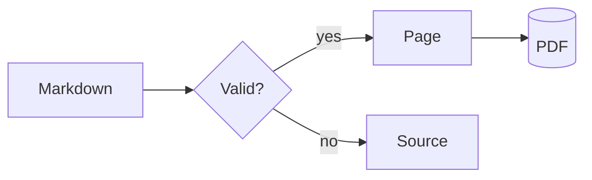
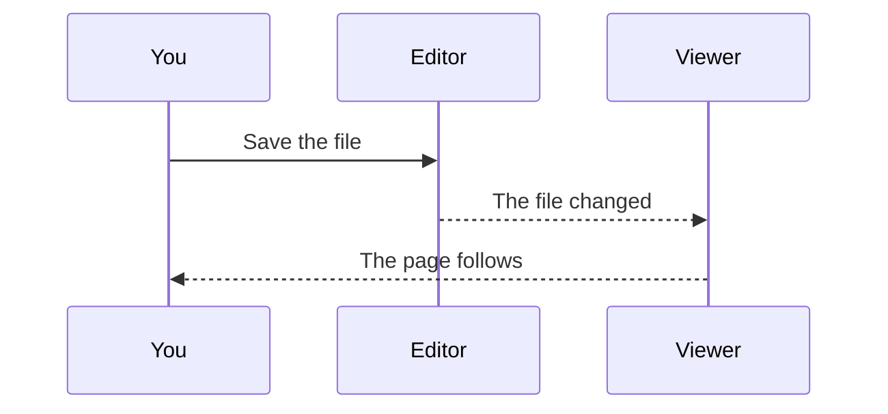
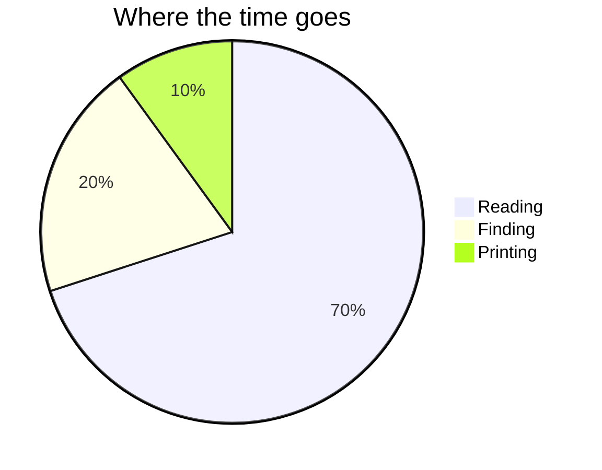
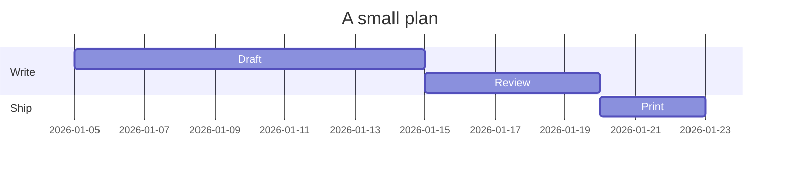
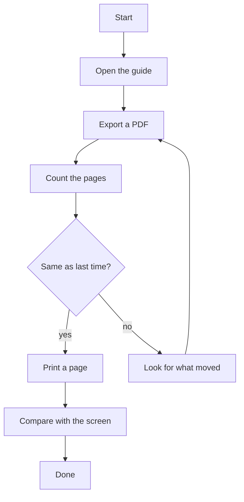

# Panduan Nacho Viewer

Nacho Viewer membuka berkas Markdown dan menampilkannya sebagai dokumen yang tertata rapi. Aplikasi ini adalah penampil, bukan editor: ubah berkas di editor mana pun dan halaman di sini akan mengikutinya.

Panduan ini terdiri dari tiga bagian:

1. [Memakai aplikasi](#memakai-aplikasi): cara membaca, mencari, mencetak, dan mengekspor.
2. [Apa yang dapat ditampilkan Markdown](#apa-yang-dapat-ditampilkan-markdown): satu contoh untuk semua yang ditampilkan aplikasi.
3. [Uji cetak dan ekspor](#uji-cetak-dan-ekspor): kasus-kasus sulit, untuk membandingkan kertas dengan layar.

## Memakai aplikasi

### Membuka dokumen

- Tekan <kbd>Ctrl</kbd>+<kbd>O</kbd>, atau **+** di samping tab.
- Jatuhkan berkas `.md` atau `.markdown` ke jendela.
- Pilih salah satu berkas terbaru di halaman awal. **×** di samping berkas menghapusnya dari daftar.
- Buka berkas Markdown dari pengelola berkas Anda dengan Nacho Viewer.

Setiap dokumen punya tab sendiri. Klik kanan sebuah tab untuk **Salin jalur** dan untuk menampilkan berkas di pengelola berkas Anda.

> [!TIP]
> Di macOS, baca <kbd>Ctrl</kbd> sebagai <kbd>Cmd</kbd> di seluruh panduan ini.

### Membaca

**Kerangka** (<kbd>Ctrl</kbd>+<kbd>B</kbd>) mendaftar judul dokumen; klik salah satunya untuk menuju ke sana. Tautan bekerja seperti di peramban, dan **Kembali** serta **Maju** (<kbd>Alt</kbd>+<kbd>←</kbd>, <kbd>Alt</kbd>+<kbd>→</kbd>) menelusurinya kembali di dalam tab:

- Tautan ke berkas Markdown lain membukanya di tab yang sama; <kbd>Ctrl</kbd>+klik membukanya di tab baru.
- Tautan ke sebuah judul, seperti yang ada di bagian atas halaman ini, menggulir ke sana.
- Tautan ke situs web terbuka di peramban Anda.

Perbesar atau perkecil dengan <kbd>Ctrl</kbd>+<kbd>+</kbd> dan <kbd>Ctrl</kbd>+<kbd>-</kbd>, atau kembali ke 100% dengan <kbd>Ctrl</kbd>+<kbd>0</kbd>. <kbd>Ctrl</kbd>+<kbd>9</kbd> membuat halaman selebar jendela dan mengembalikannya, yang membantu untuk tabel lebar.

**Cari** (<kbd>Ctrl</kbd>+<kbd>F</kbd>) menyorot setiap hasil; <kbd>F3</kbd> dan <kbd>Shift</kbd>+<kbd>F3</kbd> berpindah di antaranya. **Lihat sumber** (<kbd>Ctrl</kbd>+<kbd>U</kbd>) menampilkan teks polos berkas.

Saat berkas berubah di disk, halaman dimuat ulang sendiri dan mempertahankan posisi Anda. Jika berkas dihapus, versi terakhir tetap tampil di layar dengan catatan di bagian atas.

### Cetak dan ekspor

| Untuk | Tekan | Hasilnya |
| :--- | :---- | :------ |
| Cetak | <kbd>Ctrl</kbd>+<kbd>P</kbd> | Dialog cetak sistem |
| Ekspor | <kbd>Ctrl</kbd>+<kbd>Shift</kbd>+<kbd>E</kbd> | Berkas PDF, A4 |

Keduanya lebih dulu menanyakan ukuran teks, Kecil, Normal, atau Besar, dan **Pratinjau** menampilkan PDF di penampil sistem Anda sebelum Anda memastikan. Kertas selalu memakai warna terang, apa pun tema di layar.

### Sesuaikan sendiri

**Pengaturan** (<kbd>Ctrl</kbd>+<kbd>,</kbd>) berisi tema (sistem, terang, atau gelap; juga <kbd>Ctrl</kbd>+<kbd>Shift</kbd>+<kbd>L</kbd>), gaya halaman (Klasik, Koran, Kertas, Dokumen, atau Mesin tik), bahasa aplikasi dan panduan ini (bahasa sistem, atau Inggris, Spanyol, Jerman, Prancis, Italia, Portugis, Tionghoa, Jepang, Hindi, Bengali, Indonesia, Korea, Turki, Vietnam, atau Katalan), dan apakah gambar dari internet dimuat.

Untuk hal lainnya, taruh CSS Anda sendiri di `user.css` di folder pengaturan aplikasi:

| Sistem | Folder |
| :----- | :----- |
| Linux | `~/.config/nacho-viewer/` |
| Windows | `%APPDATA%\nacho-viewer\` |
| macOS | `~/Library/Application Support/nacho-viewer/` |

### Pintasan keyboard

<kbd>F1</kbd> mendaftar semuanya. <kbd>Shift</kbd>+<kbd>F1</kbd> membuka panduan ini.

### Hubungi kami

Nacho Viewer gratis dan sumber terbuka. **Tentang Nacho Viewer**, di menu **⋮**, menampilkan versi Anda. Laporkan masalah atau baca kodenya di [GitHub](https://github.com/nuncaeslupus/nacho-viewer).

## Apa yang dapat ditampilkan Markdown

### Teks

Teks biasa dengan *penekanan*, **penekanan kuat**, ***keduanya***, `kode sebaris`, ~~coretan~~, ==teks yang disorot==, 25 m^2^ dan H~2~O. Sebuah [tautan](https://example.com), tautan otomatis www.example.com, dan pemisah baris paksa\
tepat di sini. Kode pendek emoji :tada: menjadi sebuah karakter.

Spesifikasi HTML dikelola oleh W3C; arahkan kursor ke kedua nama itu untuk melihat artinya.

*[HTML]: Hyper Text Markup Language (bahasa markah hiperteks)
*[W3C]: World Wide Web Consortium (konsorsium Web sedunia)

Sebuah kalimat dengan catatan kaki,[^short] dan satu lagi dengan yang lebih panjang.[^long]

[^short]: Sebuah catatan kaki singkat.
[^long]: Sebuah catatan kaki yang lebih panjang. Isinya berlanjut cukup lama, sehingga turun ke baris kedua pada lebar halaman mana pun dan memperlihatkan bagaimana teks catatan kaki ditata.

Tautan wiki menuju berkas lain berdasarkan namanya: [[Nacho Viewer Guide|panduan ini]].

### Judul

#### Tingkat keempat

##### Tingkat kelima

###### Tingkat keenam

### Daftar

1. Sebuah daftar berurutan
2. dengan butir kedua
   1. dan satu butir bersarang
   2. yang terus menghitung

- Sebuah daftar berbutir
  - dengan butir bersarang
    - dan tingkat ketiga

- [x] Tugas yang selesai
- [ ] Tugas yang belum selesai

Istilah
: Sebuah definisi.

Istilah lain
: Definisi pertamanya.
: Definisi keduanya.

### Kutipan dan peringatan

> Sebuah kutipan blok.
>
> > Dengan kutipan di dalamnya.

> [!NOTE]
> Informasi yang berguna.

> [!TIP]
> Saran yang membantu.

> [!IMPORTANT]
> Informasi penting.

> [!WARNING]
> Informasi mendesak.

> [!CAUTION]
> Risiko dari suatu tindakan.

---

### Tabel

| Kiri | Tengah | Kanan |
| :--- | :----: | ----: |
| satu | dua | 3 |
| *empat* | `five` | 6.00 |
| Sel yang lebih panjang yang harus turun baris begitu kolom kehabisan ruang di halaman | b | 1,234.56 |

### Kode

    An indented code block.

```js
// JavaScript
const answer = [1, 2, 3].map((n) => n * 7);
console.log(`The answer is ${answer.at(-1) * 2}`);
```

```python
# Python
def greet(name: str = "world") -> str:
    return f"Hello, {name}!"
```

```rust
// Rust
fn main() {
    let total: u32 = (1..=9).sum();
    println!("{total}");
}
```

```bash
# Shell
for file in *.md; do wc -l "$file"; done
```

```json
{ "name": "Nacho Viewer", "free": true, "platforms": ["Linux", "Windows", "macOS"] }
```

```diff
- The old line
+ The new line
```

### Matematika

Matematika sebaris: $e^{i\pi} + 1 = 0$ dan $\sqrt{a^2 + b^2}$.


$$
\int_0^1 x^2 \, dx = \frac{1}{3}
\qquad
\sum_{n=1}^{\infty} \frac{1}{n^2} = \frac{\pi^2}{6}
$$

$$
\begin{pmatrix} a & b \\ c & d \end{pmatrix}
\begin{pmatrix} x \\ y \end{pmatrix}
=
\begin{pmatrix} ax + by \\ cx + dy \end{pmatrix}
$$

### Diagram

Diagram memiliki kontrol zoom dan geser saat kursor diarahkan ke atasnya.









### Gambar

SVG lokal mengambil warna teks, sehingga mengikuti tema:


Gambar lokal, dengan tag `` yang menetapkan ukurannya:


### HTML mentah

HTML yang aman berfungsi; skrip dan gaya dihapus.

<details>
<summary>Bagian yang dapat dibuka</summary>

Tekan <kbd>Ctrl</kbd>+<kbd>C</kbd> untuk menyalin.

</details>

## Uji cetak dan ekspor

Cetak atau ekspor panduan ini untuk membandingkan kertas dengan layar. Isinya tidak pernah berubah antarpercobaan pada versi yang sama, jadi dua ekspor seharusnya memiliki halaman yang sama, dan jumlah halaman di satu sistem seharusnya berbeda paling banyak satu halaman dari sistem lain.

Periksa bahwa:

- [ ] Halaman berukuran A4, dengan margin di setiap sisi.
- [ ] Setiap halaman diawali teks, bukan baris yang terpotong atau setengah gambar.
- [ ] Bilah dan tombol aplikasi tidak tercetak, begitu pula kontrol diagram.
- [ ] Warnanya terang, meskipun tema gelap sedang aktif di layar.
- [ ] Catatan kaki, peringatan, matematika, dan diagram tampak seperti di layar.

### Tabel lebar

| Kuartal | Wilayah | Produk | Unit | Harga | Pendapatan | Biaya | Margin | Penanggung jawab | Status |
| :------ | :----- | :------ | ---: | ---: | -----: | ---: | -----: | :---- | :----- |
| Q1 | Eropa Utara | Reader Standard | 1,204 | 19.00 | 22,876.00 | 9,150.40 | 13,725.60 | Asha | Terkirim |
| Q2 | Eropa Selatan | Reader Standard | 987 | 19.00 | 18,753.00 | 7,501.20 | 11,251.80 | Bruno | Terkirim |
| Q3 | Amerika Utara | Reader Professional | 2,310 | 49.00 | 113,190.00 | 39,616.50 | 73,573.50 | Chidi | Sedang berjalan |
| Q4 | Asia dan Pasifik | Reader Professional | 1,875 | 49.00 | 91,875.00 | 32,156.25 | 59,718.75 | Dana | Direncanakan |

### Tabel panjang

Sebuah baris judul, dan baris-baris yang tidak boleh terpotong di dua halaman.

| # | Butir | Catatan |
| ---: | :--- | :--- |
| 1 | Alpha | Baris pertama |
| 2 | Bravo | Kedua |
| 3 | Charlie | Ketiga |
| 4 | Delta | Keempat |
| 5 | Echo | Kelima |
| 6 | Foxtrot | Keenam |
| 7 | Golf | Ketujuh |
| 8 | Hotel | Kedelapan |
| 9 | India | Kesembilan |
| 10 | Juliett | Kesepuluh |
| 11 | Kilo | Kesebelas |
| 12 | Lima | Kedua belas |
| 13 | Mike | Ketiga belas |
| 14 | November | Keempat belas |
| 15 | Oscar | Kelima belas |
| 16 | Papa | Keenam belas |
| 17 | Quebec | Ketujuh belas |
| 18 | Romeo | Kedelapan belas |
| 19 | Sierra | Kesembilan belas |
| 20 | Tango | Kedua puluh |
| 21 | Uniform | Kedua puluh satu |
| 22 | Victor | Kedua puluh dua |
| 23 | Whiskey | Kedua puluh tiga |
| 24 | X-ray | Kedua puluh empat |
| 25 | Yankee | Kedua puluh lima |
| 26 | Zulu | Baris terakhir |

### Baris yang sangat panjang

Satu baris kode yang jauh lebih lebar daripada halaman:

```text
0123456789 abcdefghij 0123456789 abcdefghij 0123456789 abcdefghij 0123456789 abcdefghij 0123456789 abcdefghij 0123456789 abcdefghij 0123456789 abcdefghij
```

Sebuah kata yang tidak punya tempat untuk dipotong: Pneumonoultramicroscopicsilicovolcanoconiosis_Pneumonoultramicroscopicsilicovolcanoconiosis_Pneumonoultramicroscopicsilicovolcanoconiosis.

Sebuah alamat panjang: <https://example.com/a/very/long/path/that/keeps/going/and/going/well/past/the/edge/of/the/sheet/on/any/paper/size>.

### Blok kode panjang

Blok ini lebih panjang daripada yang dapat dimuat sebagian besar halaman, jadi harus berlanjut ke halaman berikutnya.

```python
# Sixty numbered lines.
line_01 = "one"
line_02 = "two"
line_03 = "three"
line_04 = "four"
line_05 = "five"
line_06 = "six"
line_07 = "seven"
line_08 = "eight"
line_09 = "nine"
line_10 = "ten"
line_11 = "eleven"
line_12 = "twelve"
line_13 = "thirteen"
line_14 = "fourteen"
line_15 = "fifteen"
line_16 = "sixteen"
line_17 = "seventeen"
line_18 = "eighteen"
line_19 = "nineteen"
line_20 = "twenty"
line_21 = "twenty-one"
line_22 = "twenty-two"
line_23 = "twenty-three"
line_24 = "twenty-four"
line_25 = "twenty-five"
line_26 = "twenty-six"
line_27 = "twenty-seven"
line_28 = "twenty-eight"
line_29 = "twenty-nine"
line_30 = "thirty"
line_31 = "thirty-one"
line_32 = "thirty-two"
line_33 = "thirty-three"
line_34 = "thirty-four"
line_35 = "thirty-five"
line_36 = "thirty-six"
line_37 = "thirty-seven"
line_38 = "thirty-eight"
line_39 = "thirty-nine"
line_40 = "forty"
line_41 = "forty-one"
line_42 = "forty-two"
line_43 = "forty-three"
line_44 = "forty-four"
line_45 = "forty-five"
line_46 = "forty-six"
line_47 = "forty-seven"
line_48 = "forty-eight"
line_49 = "forty-nine"
line_50 = "fifty"
line_51 = "fifty-one"
line_52 = "fifty-two"
line_53 = "fifty-three"
line_54 = "fifty-four"
line_55 = "fifty-five"
line_56 = "fifty-six"
line_57 = "fifty-seven"
line_58 = "fifty-eight"
line_59 = "fifty-nine"
line_60 = "sixty"
```

### Diagram tinggi



### Teks yang terus berlanjut

Paragraf panjang memperlihatkan irama halaman: panjang baris, jarak antarkata, dan bagaimana teks mengalir dari satu halaman ke halaman berikutnya. Halaman yang baik menjaga judul tetap bersama teks yang mengikutinya, dan tidak pernah membiarkan satu baris paragraf terdampar di bagian atas atau bawah halaman.

Para juru cetak menyebut baris-baris terdampar itu janda dan yatim (widow dan orphan). Menjauhkannya dari halaman lebih penting di kertas daripada di layar, karena pembaca dapat menggulir layar tetapi tidak dapat menggulir halaman. Hal yang sama berlaku untuk judul di dasar halaman, dengan teksnya di balik lembar: mata tertuju pada sebuah janji dan harus membalik halaman untuk melihatnya ditepati.

Tidak ada yang di sini perlu dibaca dengan saksama. Cukup lihat baris terakhir setiap halaman dan baris pertama halaman berikutnya, dan pastikan teks berlanjut sebagaimana mestinya. Jika ya, pemisah halaman bekerja.
