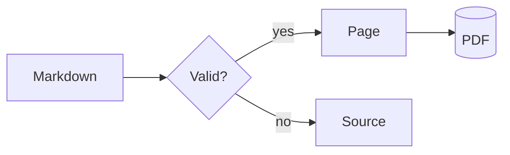
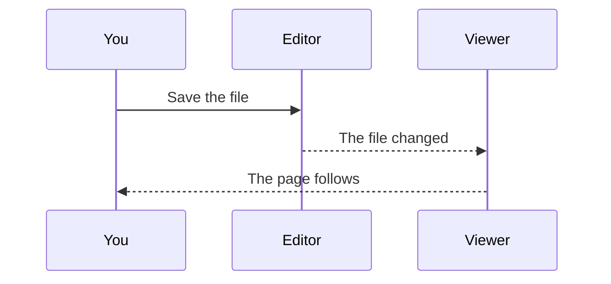
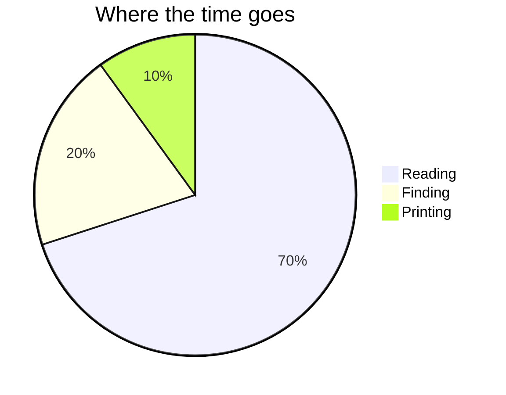
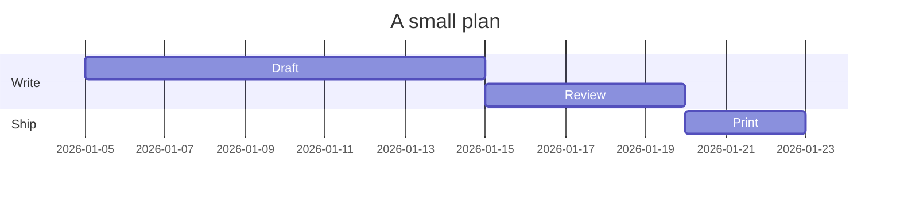
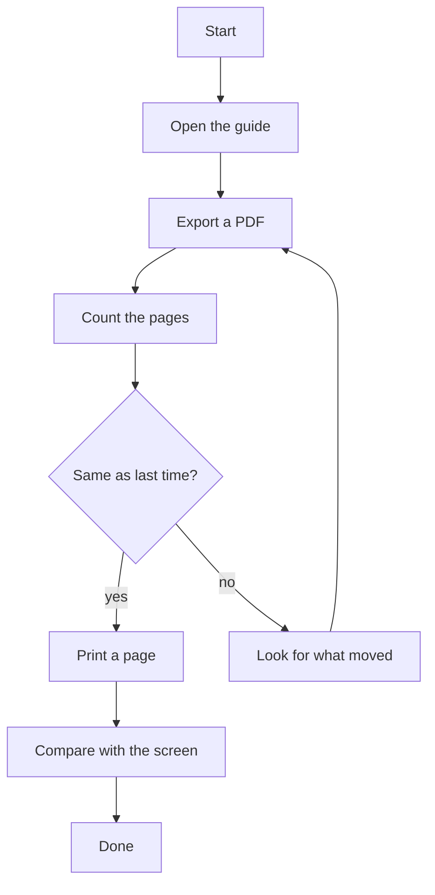

# Guida di Nacho Viewer

Nacho Viewer apre file Markdown e li mostra come un documento ben impaginato. È un visualizzatore, non
un editor: modifica un file con qualsiasi editor e la pagina qui lo segue.

Questa guida ha tre parti:

1. [Usare l'app](#usare-lapp): come leggere, cercare, stampare ed esportare.
2. [Cosa può mostrare Markdown](#cosa-può-mostrare-markdown): un esempio di tutto ciò che l'app rappresenta.
3. [Test di stampa ed esportazione](#test-di-stampa-ed-esportazione): i casi difficili, per confrontare la carta con lo schermo.

## Usare l'app

### Aprire un documento

- Premi <kbd>Ctrl</kbd>+<kbd>O</kbd>, oppure il **+** accanto alle schede.
- Trascina un file `.md` o `.markdown` sulla finestra.
- Scegli uno dei file recenti nella pagina iniziale. La **×** accanto a un file lo rimuove dall'elenco.
- Apri un file Markdown dal tuo file manager con Nacho Viewer.

Ogni documento ha la sua scheda. Fai clic destro su una scheda per **Copia percorso** e per mostrare il file nel
file manager.

> [!TIP]
> Su macOS, leggi <kbd>Ctrl</kbd> come <kbd>Cmd</kbd> in tutta questa guida.

### Leggere

La **struttura** (<kbd>Ctrl</kbd>+<kbd>B</kbd>) elenca i titoli del documento; fai clic su uno per
andarci. I collegamenti funzionano come in un browser, e **indietro** e **avanti**
(<kbd>Alt</kbd>+<kbd>←</kbd>, <kbd>Alt</kbd>+<kbd>→</kbd>) li ripercorrono nella scheda:

- Un collegamento a un altro file Markdown lo apre nella stessa scheda; <kbd>Ctrl</kbd>+clic lo apre in una nuova scheda.
- Un collegamento a un titolo, come quelli all'inizio di questa pagina, scorre fin lì.
- Un collegamento a un sito web si apre nel browser.

Ingrandisci con <kbd>Ctrl</kbd>+<kbd>+</kbd> e riduci con <kbd>Ctrl</kbd>+<kbd>-</kbd>, oppure torna al 100% con
<kbd>Ctrl</kbd>+<kbd>0</kbd>. <kbd>Ctrl</kbd>+<kbd>9</kbd> rende la pagina larga quanto la finestra e
poi la riporta com'era, utile con le tabelle larghe.

**Trova** (<kbd>Ctrl</kbd>+<kbd>F</kbd>) evidenzia ogni corrispondenza; <kbd>F3</kbd> e
<kbd>Shift</kbd>+<kbd>F3</kbd> le scorrono. **Mostra sorgente**
(<kbd>Ctrl</kbd>+<kbd>U</kbd>) mostra il testo semplice del file.

Quando il file cambia sul disco, la pagina si ricarica da sola e mantiene la tua posizione. Se il file viene
eliminato, l'ultima versione resta sullo schermo con una nota in alto.

### Stampare ed esportare

| Per | Premi | Ottieni |
| :--- | :---- | :------ |
| Stampare | <kbd>Ctrl</kbd>+<kbd>P</kbd> | La finestra di stampa del sistema |
| Esportare | <kbd>Ctrl</kbd>+<kbd>Shift</kbd>+<kbd>E</kbd> | Un file PDF, A4 |

Entrambi chiedono prima una dimensione del testo, Piccolo, Normale o Grande, e **Anteprima** mostra il PDF nel
visualizzatore del sistema prima di confermare. La carta usa sempre i colori chiari, qualunque sia il tema
sullo schermo.

### Personalizzare

**Impostazioni** (<kbd>Ctrl</kbd>+<kbd>,</kbd>) contiene il tema (sistema, chiaro o scuro, anche
<kbd>Ctrl</kbd>+<kbd>Shift</kbd>+<kbd>L</kbd>), lo stile della pagina (Classico, Giornale, Carta,
Docs o Macchina da scrivere), la lingua dell'app e di questa guida (quella del sistema, oppure
inglese, spagnolo, tedesco, francese, italiano, portoghese, cinese, giapponese, hindi, bengalese, indonesiano, coreano, turco o vietnamita) e se caricare le
immagini da internet.

Per tutto il resto, metti il tuo CSS in `user.css` nella cartella delle impostazioni dell'app:

| Sistema | Cartella |
| :------ | :------- |
| Linux | `~/.config/nacho-viewer/` |
| Windows | `%APPDATA%\nacho-viewer\` |
| macOS | `~/Library/Application Support/nacho-viewer/` |

### Scorciatoie da tastiera

<kbd>F1</kbd> le elenca tutte. <kbd>Shift</kbd>+<kbd>F1</kbd> apre questa guida.

### Contatti

Nacho Viewer è gratuito e open source. **Informazioni su Nacho Viewer**, nel menu **⋮**, mostra la tua
versione. Segnala un problema o leggi il codice su
[GitHub](https://github.com/nuncaeslupus/nacho-viewer).

## Cosa può mostrare Markdown

### Testo

Testo semplice con *enfasi*, **enfasi forte**, ***entrambe***, `codice in linea`,
~~barrato~~, ==testo evidenziato==, 25 m^2^ e H~2~O. Un [collegamento](https://example.com),
un collegamento automatico www.example.com e un'interruzione di riga forzata\
proprio qui. Lo shortcode emoji :tada: diventa un carattere.

La specifica HTML è mantenuta dal W3C; passa il mouse su questi due nomi per vederne il significato.

*[HTML]: Hyper Text Markup Language (linguaggio di markup per ipertesti)
*[W3C]: World Wide Web Consortium (consorzio del World Wide Web)

Una frase con una nota a piè di pagina,[^short] e un'altra con una più lunga.[^long]

[^short]: Una breve nota a piè di pagina.
[^long]: Una nota a piè di pagina più lunga. Prosegue per un po', così va a capo su una seconda riga a
    qualsiasi larghezza di pagina e mostra come viene composto il testo delle note.

Un collegamento wiki porta a un altro file tramite il suo nome: [[Nacho Viewer Guide|questa guida]].

### Titoli

#### Quarto livello

##### Quinto livello

###### Sesto livello

### Elenchi

1. Un elenco ordinato
2. con un secondo elemento
   1. e uno annidato
   2. che continua a contare

- Un elenco puntato
  - con un elemento annidato
    - e un terzo livello

- [x] Un'attività completata
- [ ] Un'attività aperta

Termine
: Una definizione.

Altro termine
: La sua prima definizione.
: La sua seconda definizione.

### Citazioni e avvisi

> Una citazione in blocco.
>
> > Con una citazione al suo interno.

> [!NOTE]
> Informazione utile.

> [!TIP]
> Consiglio utile.

> [!IMPORTANT]
> Informazione fondamentale.

> [!WARNING]
> Informazione urgente.

> [!CAUTION]
> Rischi di un'azione.

---

### Tabelle

| Sinistra | Centro | Destra |
| :--- | :----: | ----: |
| uno | due | 3 |
| *quattro* | `cinque` | 6.00 |
| Una cella più lunga che deve andare a capo quando la colonna finisce lo spazio sulla pagina | b | 1,234.56 |

### Codice

    An indented code block.

```js
// JavaScript
const answer = [1, 2, 3].map((n) => n * 7);
console.log(`The answer is ${answer.at(-1) * 2}`);
```

```python
# Python
def greet(name: str = "world") -> str:
    return f"Hello, {name}!"
```

```rust
// Rust
fn main() {
    let total: u32 = (1..=9).sum();
    println!("{total}");
}
```

```bash
# Shell
for file in *.md; do wc -l "$file"; done
```

```json
{ "name": "Nacho Viewer", "free": true, "platforms": ["Linux", "Windows", "macOS"] }
```

```diff
- The old line
+ The new line
```

### Matematica

Matematica in linea: $e^{i\pi} + 1 = 0$ e $\sqrt{a^2 + b^2}$.

$$
\int_0^1 x^2 \, dx = \frac{1}{3}
\qquad
\sum_{n=1}^{\infty} \frac{1}{n^2} = \frac{\pi^2}{6}
$$

$$
\begin{pmatrix} a & b \\ c & d \end{pmatrix}
\begin{pmatrix} x \\ y \end{pmatrix}
=
\begin{pmatrix} ax + by \\ cx + dy \end{pmatrix}
$$

### Diagrammi

Un diagramma ha i controlli di zoom e spostamento quando ci passi sopra con il mouse.









### Immagini

Un SVG locale prende il colore del testo, quindi segue il tema:


Un'immagine locale, con un tag `` che ne imposta la dimensione:


### HTML grezzo

L'HTML sicuro funziona; script e stili vengono rimossi.

<details>
<summary>Una sezione che si apre</summary>

Premi <kbd>Ctrl</kbd>+<kbd>C</kbd> per copiare.

</details>

## Test di stampa ed esportazione

Stampa o esporta questa guida per confrontare la carta con lo schermo. Il contenuto non cambia mai tra un'esecuzione e l'altra
con la stessa versione, quindi due esportazioni dovrebbero avere le stesse pagine, e il numero di pagine di un sistema
dovrebbe differire al massimo di una pagina da quello di un altro.

Verifica che:

- [ ] Le pagine siano A4, con un margine su ogni lato.
- [ ] Ogni pagina inizi con del testo, non con una riga tagliata o mezza immagine.
- [ ] Le barre e i pulsanti dell'app non vengano stampati, né i controlli dei diagrammi.
- [ ] I colori siano quelli chiari, anche con il tema scuro sullo schermo.
- [ ] Note a piè di pagina, avvisi, matematica e diagrammi appaiano come sullo schermo.

### Una tabella larga

| Trimestre | Regione | Prodotto | Unità | Prezzo | Ricavi | Costi | Margine | Responsabile | Stato |
| :------ | :----- | :------ | ---: | ---: | -----: | ---: | -----: | :---- | :----- |
| T1 | Europa settentrionale | Reader Standard | 1,204 | 19.00 | 22,876.00 | 9,150.40 | 13,725.60 | Asha | Spedito |
| T2 | Europa meridionale | Reader Standard | 987 | 19.00 | 18,753.00 | 7,501.20 | 11,251.80 | Bruno | Spedito |
| T3 | Nord America | Reader Professional | 2,310 | 49.00 | 113,190.00 | 39,616.50 | 73,573.50 | Chidi | In corso |
| T4 | Asia e Pacifico | Reader Professional | 1,875 | 49.00 | 91,875.00 | 32,156.25 | 59,718.75 | Dana | Pianificato |

### Una tabella lunga

Una riga di intestazione e righe che non dovrebbero mai spezzarsi tra due pagine.

| # | Voce | Nota |
| ---: | :--- | :--- |
| 1 | Alpha | Prima delle righe |
| 2 | Bravo | Seconda |
| 3 | Charlie | Terza |
| 4 | Delta | Quarta |
| 5 | Echo | Quinta |
| 6 | Foxtrot | Sesta |
| 7 | Golf | Settima |
| 8 | Hotel | Ottava |
| 9 | India | Nona |
| 10 | Juliett | Decima |
| 11 | Kilo | Undicesima |
| 12 | Lima | Dodicesima |
| 13 | Mike | Tredicesima |
| 14 | November | Quattordicesima |
| 15 | Oscar | Quindicesima |
| 16 | Papa | Sedicesima |
| 17 | Quebec | Diciassettesima |
| 18 | Romeo | Diciottesima |
| 19 | Sierra | Diciannovesima |
| 20 | Tango | Ventesima |
| 21 | Uniform | Ventunesima |
| 22 | Victor | Ventiduesima |
| 23 | Whiskey | Ventitreesima |
| 24 | X-ray | Ventiquattresima |
| 25 | Yankee | Venticinquesima |
| 26 | Zulu | Ultima delle righe |

### Righe molto lunghe

Una riga di codice ben più larga della pagina:

```text
0123456789 abcdefghij 0123456789 abcdefghij 0123456789 abcdefghij 0123456789 abcdefghij 0123456789 abcdefghij 0123456789 abcdefghij 0123456789 abcdefghij
```

Una parola che non ha dove andare a capo: Pneumonoultramicroscopicsilicovolcanoconiosis_Pneumonoultramicroscopicsilicovolcanoconiosis_Pneumonoultramicroscopicsilicovolcanoconiosis.

Un indirizzo lungo: <https://example.com/a/very/long/path/that/keeps/going/and/going/well/past/the/edge/of/the/sheet/on/any/paper/size>.

### Un lungo blocco di codice

Questo blocco è più lungo di quanto la maggior parte delle pagine possa contenere, quindi deve continuare sulla successiva.

```python
# Sixty numbered lines.
line_01 = "one"
line_02 = "two"
line_03 = "three"
line_04 = "four"
line_05 = "five"
line_06 = "six"
line_07 = "seven"
line_08 = "eight"
line_09 = "nine"
line_10 = "ten"
line_11 = "eleven"
line_12 = "twelve"
line_13 = "thirteen"
line_14 = "fourteen"
line_15 = "fifteen"
line_16 = "sixteen"
line_17 = "seventeen"
line_18 = "eighteen"
line_19 = "nineteen"
line_20 = "twenty"
line_21 = "twenty-one"
line_22 = "twenty-two"
line_23 = "twenty-three"
line_24 = "twenty-four"
line_25 = "twenty-five"
line_26 = "twenty-six"
line_27 = "twenty-seven"
line_28 = "twenty-eight"
line_29 = "twenty-nine"
line_30 = "thirty"
line_31 = "thirty-one"
line_32 = "thirty-two"
line_33 = "thirty-three"
line_34 = "thirty-four"
line_35 = "thirty-five"
line_36 = "thirty-six"
line_37 = "thirty-seven"
line_38 = "thirty-eight"
line_39 = "thirty-nine"
line_40 = "forty"
line_41 = "forty-one"
line_42 = "forty-two"
line_43 = "forty-three"
line_44 = "forty-four"
line_45 = "forty-five"
line_46 = "forty-six"
line_47 = "forty-seven"
line_48 = "forty-eight"
line_49 = "forty-nine"
line_50 = "fifty"
line_51 = "fifty-one"
line_52 = "fifty-two"
line_53 = "fifty-three"
line_54 = "fifty-four"
line_55 = "fifty-five"
line_56 = "fifty-six"
line_57 = "fifty-seven"
line_58 = "fifty-eight"
line_59 = "fifty-nine"
line_60 = "sixty"
```

### Un diagramma alto



### Testo che continua

I paragrafi lunghi mostrano il ritmo della pagina: lunghezza delle righe, spaziatura tra le parole e come il testo scorre da una
pagina all'altra. Una buona pagina tiene un titolo insieme al testo che lo segue e non lascia mai una
sola riga di un paragrafo isolata in cima o in fondo a una pagina.

I tipografi chiamano quelle righe isolate vedove e orfane. Tenerle lontane dalla pagina conta di più
su carta che sullo schermo, perché un lettore può scorrere uno schermo ma non una pagina. Lo stesso
vale per un titolo a piè di pagina con il suo testo sul retro: l'occhio si posa su una promessa e
deve voltare pagina per vedere che viene mantenuta.

Niente di tutto questo richiede una lettura attenta. Basta guardare l'ultima riga di ogni pagina e la
prima della successiva, e vedere che il testo prosegue come dovrebbe. Se è così, le interruzioni di pagina
funzionano.
