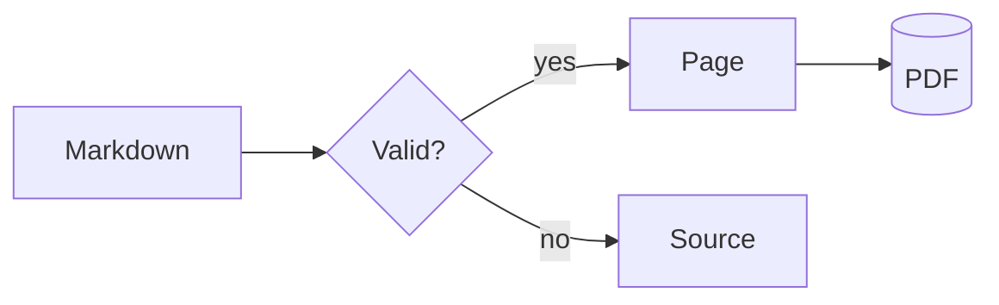
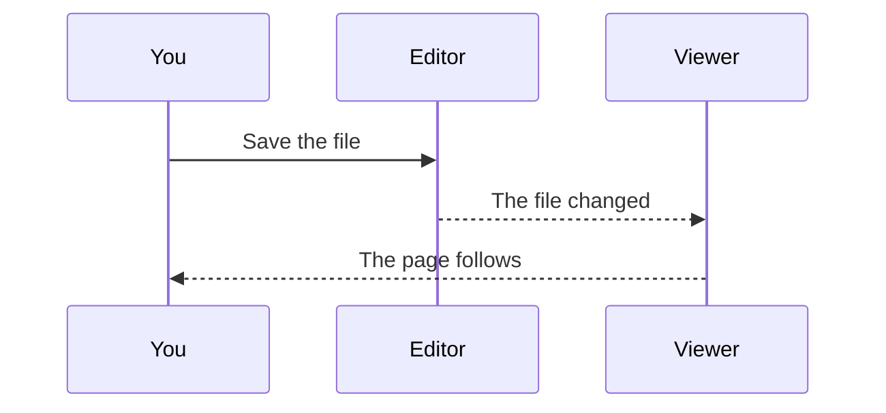
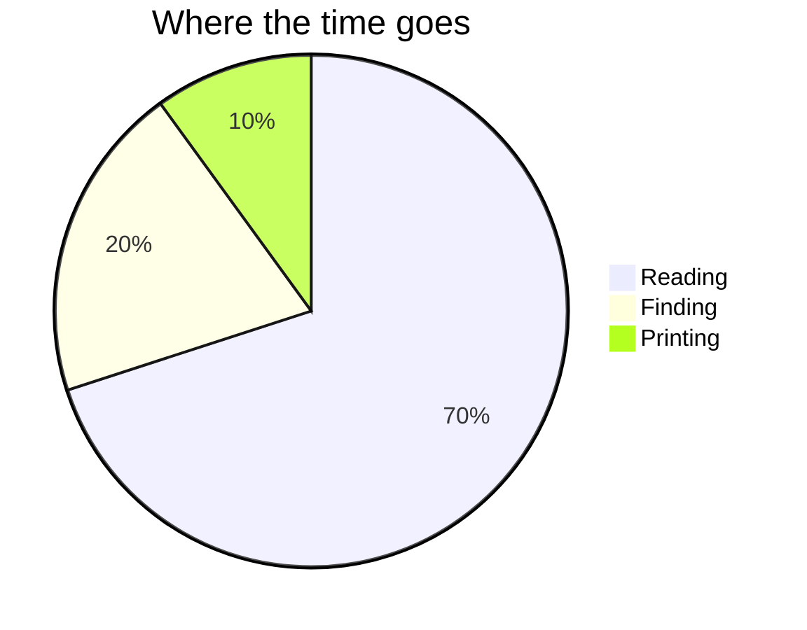
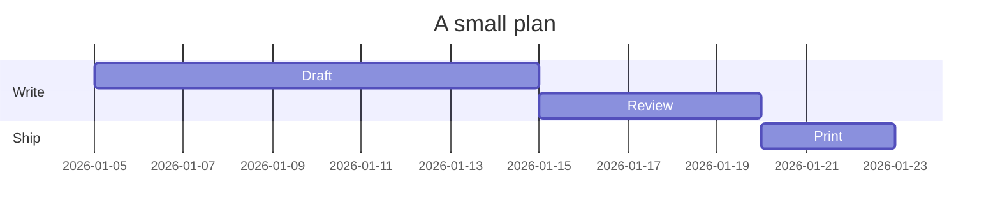
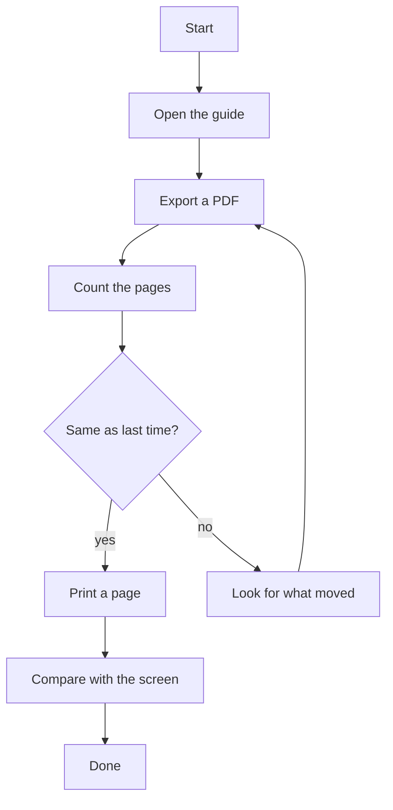

# Nacho Viewer ガイド

Nacho Viewer は Markdown ファイルを開き、きれいに組版されたドキュメントとして表示します。これはビューアであり、
エディタではありません。好きなエディタでファイルを変更すると、ここのページも追従します。

このガイドは 3 つのパートで構成されています。

1. [アプリの使い方](#アプリの使い方)：読む、探す、印刷する、エクスポートする方法。
2. [Markdown で表示できるもの](#markdown-で表示できるもの)：アプリが描画するあらゆるものの例。
3. [印刷とエクスポートのテスト](#印刷とエクスポートのテスト)：難しいケースを使って、紙と画面を見比べます。

## アプリの使い方

### ドキュメントを開く

- <kbd>Ctrl</kbd>+<kbd>O</kbd> を押すか、タブの横の **+** を押します。
- `.md` または `.markdown` ファイルをウィンドウにドロップします。
- スタートページの最近使ったファイルから選びます。ファイルの横の **×** でリストから削除できます。
- ファイルマネージャから Markdown ファイルを Nacho Viewer で開きます。

ドキュメントごとに専用のタブが開きます。タブを右クリックすると **パスをコピー** や、
ファイルマネージャでのファイル表示が使えます。

> [!TIP]
> macOS では、このガイドの <kbd>Ctrl</kbd> をすべて <kbd>Cmd</kbd> に読み替えてください。

### 読む

**アウトライン**（<kbd>Ctrl</kbd>+<kbd>B</kbd>）にはドキュメントの見出しが一覧表示されます。見出しをクリックすると
そこへ移動します。リンクはブラウザと同じように動作し、**戻る** と **進む**
（<kbd>Alt</kbd>+<kbd>←</kbd>、<kbd>Alt</kbd>+<kbd>→</kbd>）でタブ内の移動をたどれます。

- 別の Markdown ファイルへのリンクは同じタブで開きます。<kbd>Ctrl</kbd>+クリックで新しいタブで開きます。
- このページの冒頭にあるような見出しへのリンクは、そこまでスクロールします。
- ウェブサイトへのリンクはブラウザで開きます。

<kbd>Ctrl</kbd>+<kbd>+</kbd> と <kbd>Ctrl</kbd>+<kbd>-</kbd> で拡大・縮小し、
<kbd>Ctrl</kbd>+<kbd>0</kbd> で 100% に戻します。<kbd>Ctrl</kbd>+<kbd>9</kbd> でページ幅がウィンドウいっぱいになり、
もう一度押すと元に戻ります。幅の広い表を見るときに便利です。

**検索**（<kbd>Ctrl</kbd>+<kbd>F</kbd>）は一致する箇所をすべてハイライトします。<kbd>F3</kbd> と
<kbd>Shift</kbd>+<kbd>F3</kbd> で順に移動できます。**ソースを表示**
（<kbd>Ctrl</kbd>+<kbd>U</kbd>）はファイルのプレーンテキストを表示します。

ディスク上のファイルが変更されると、ページは自動的に再読み込みされ、位置も保たれます。ファイルが
削除された場合は、最後のバージョンが画面に残り、上部にメモが表示されます。

### 印刷とエクスポート

| 目的 | 操作 | 結果 |
| :--- | :---- | :------ |
| 印刷 | <kbd>Ctrl</kbd>+<kbd>P</kbd> | システムの印刷ダイアログ |
| エクスポート | <kbd>Ctrl</kbd>+<kbd>Shift</kbd>+<kbd>E</kbd> | PDF ファイル（A4） |

どちらも最初に文字サイズ（小、標準、大）を尋ね、**プレビュー** では確定する前に PDF を
システムのビューアで確認できます。紙には、画面のテーマに関係なく、常に明るい配色が使われます。

### 自分好みにする

**設定**（<kbd>Ctrl</kbd>+<kbd>,</kbd>）では、テーマ（システム、ライト、ダーク。
<kbd>Ctrl</kbd>+<kbd>Shift</kbd>+<kbd>L</kbd> でも切り替え可）、ページのスタイル（クラシック、新聞、ペーパー、
Docs、タイプライター）、アプリとこのガイドの言語（システムの言語、または英語、
スペイン語、ドイツ語、フランス語、イタリア語、ポルトガル語、中国語、日本語、ヒンディー語、ベンガル語、インドネシア語、韓国語、トルコ語、ベトナム語、カタルーニャ語）、そしてインターネット上の画像を
読み込むかどうかを選べます。

それ以外は、アプリの設定フォルダにある `user.css` に独自の CSS を書いてください。

| システム | フォルダ |
| :----- | :----- |
| Linux | `~/.config/nacho-viewer/` |
| Windows | `%APPDATA%\nacho-viewer\` |
| macOS | `~/Library/Application Support/nacho-viewer/` |

### キーボードショートカット

<kbd>F1</kbd> ですべて一覧表示されます。<kbd>Shift</kbd>+<kbd>F1</kbd> でこのガイドが開きます。

### お問い合わせ

Nacho Viewer は無料のオープンソースソフトウェアです。**⋮** メニューの **Nacho Viewer について** で
バージョンを確認できます。問題の報告やコードの閲覧は
[GitHub](https://github.com/nuncaeslupus/nacho-viewer) で行えます。

## Markdown で表示できるもの

### テキスト

通常のテキストに、*強調*、**強い強調**、***両方***、`インラインコード`、
~~取り消し線~~、==ハイライトされたテキスト==、25 m^2^、H~2~O を加えられます。[リンク](https://example.com)、
自動リンク www.example.com、そして強制改行\
もここにあります。絵文字ショートコード :tada: は 1 つの文字になります。

HTML の仕様は W3C が管理しています。この 2 つの名前にカーソルを合わせると意味が表示されます。

*[HTML]: Hyper Text Markup Language（ハイパーテキスト・マークアップ言語）
*[W3C]: World Wide Web Consortium（ワールド・ワイド・ウェブ・コンソーシアム）

脚注付きの文,[^short] と、もっと長い脚注付きの文。[^long]

[^short]: 短い脚注。
[^long]: 長い脚注。しばらく続くので、どのページ幅でも 2 行目に折り返され、
    脚注テキストがどのように組まれるかがわかります。

Wiki リンクは名前でほかのファイルへ移動します：[[Nacho Viewer Guide|このガイド]]。

### 見出し

#### 第 4 レベル

##### 第 5 レベル

###### 第 6 レベル

### リスト

1. 番号付きリスト
2. 2 番目の項目
   1. その中の入れ子の項目
   2. 番号は続きます

- 箇条書きリスト
  - 入れ子の項目
    - さらに 3 段目

- [x] 完了したタスク
- [ ] 未完了のタスク

用語
: 定義。

別の用語
: 1 つ目の定義。
: 2 つ目の定義。

### 引用とアラート

> ブロック引用。
>
> > その中にさらに引用。

> [!NOTE]
> 役に立つ情報。

> [!TIP]
> 役に立つヒント。

> [!IMPORTANT]
> 重要な情報。

> [!WARNING]
> 緊急の情報。

> [!CAUTION]
> 操作に伴うリスク。

---

### 表

| 左揃え | 中央揃え | 右揃え |
| :--- | :----: | ----: |
| 1 | 2 | 3 |
| *4* | `5` | 6.00 |
| 列がページ内で幅を使い切ったときに折り返される、長めのセル | b | 1,234.56 |

### コード

    An indented code block.

```js
// JavaScript
const answer = [1, 2, 3].map((n) => n * 7);
console.log(`The answer is ${answer.at(-1) * 2}`);
```

```python
# Python
def greet(name: str = "world") -> str:
    return f"Hello, {name}!"
```

```rust
// Rust
fn main() {
    let total: u32 = (1..=9).sum();
    println!("{total}");
}
```

```bash
# Shell
for file in *.md; do wc -l "$file"; done
```

```json
{ "name": "Nacho Viewer", "free": true, "platforms": ["Linux", "Windows", "macOS"] }
```

```diff
- The old line
+ The new line
```

### 数式

インライン数式：$e^{i\pi} + 1 = 0$ と $\sqrt{a^2 + b^2}$。

$$
\int_0^1 x^2 \, dx = \frac{1}{3}
\qquad
\sum_{n=1}^{\infty} \frac{1}{n^2} = \frac{\pi^2}{6}
$$

$$
\begin{pmatrix} a & b \\ c & d \end{pmatrix}
\begin{pmatrix} x \\ y \end{pmatrix}
=
\begin{pmatrix} ax + by \\ cx + dy \end{pmatrix}
$$

### 図

図にカーソルを合わせると、ズームと移動のコントロールが表示されます。









### 画像

ローカルの SVG は文字の色を引き継ぐので、テーマに追従します。


サイズを指定する `` タグを使ったローカル画像：


### 生の HTML

安全な HTML は使えます。スクリプトとスタイルは削除されます。

<details>
<summary>開くセクション</summary>

<kbd>Ctrl</kbd>+<kbd>C</kbd> を押してコピーします。

</details>

## 印刷とエクスポートのテスト

このガイドを印刷またはエクスポートして、紙と画面を比べてください。同じバージョンなら実行のたびに内容は変わらないので、
2 回のエクスポートはページ構成が同じになるはずで、システムが違っても
ページ数の差は 1 ページ以内に収まるはずです。

次の点を確認してください。

- [ ] ページは A4 で、四方に余白がある。
- [ ] 各ページが、途切れた行や半分の画像ではなく、テキストから始まっている。
- [ ] アプリ自体のバーやボタン、図のコントロールが印刷されない。
- [ ] 画面でダークテーマを使っていても、色は明るい配色になっている。
- [ ] 脚注、アラート、数式、図が画面と同じように見える。

### 幅の広い表

| 四半期 | 地域 | 製品 | 数量 | 価格 | 売上 | 原価 | 利益 | 担当 | 状況 |
| :------ | :----- | :------ | ---: | ---: | -----: | ---: | -----: | :---- | :----- |
| Q1 | 北ヨーロッパ | Reader Standard | 1,204 | 19.00 | 22,876.00 | 9,150.40 | 13,725.60 | Asha | 出荷済み |
| Q2 | 南ヨーロッパ | Reader Standard | 987 | 19.00 | 18,753.00 | 7,501.20 | 11,251.80 | Bruno | 出荷済み |
| Q3 | 北アメリカ | Reader Professional | 2,310 | 49.00 | 113,190.00 | 39,616.50 | 73,573.50 | Chidi | 進行中 |
| Q4 | アジア太平洋 | Reader Professional | 1,875 | 49.00 | 91,875.00 | 32,156.25 | 59,718.75 | Dana | 計画中 |

### 長い表

見出し行と、2 ページにまたがって分割されてはならない行。

| # | 項目 | 備考 |
| ---: | :--- | :--- |
| 1 | Alpha | 最初の行 |
| 2 | Bravo | 2番目 |
| 3 | Charlie | 3番目 |
| 4 | Delta | 4番目 |
| 5 | Echo | 5番目 |
| 6 | Foxtrot | 6番目 |
| 7 | Golf | 7番目 |
| 8 | Hotel | 8番目 |
| 9 | India | 9番目 |
| 10 | Juliett | 10番目 |
| 11 | Kilo | 11番目 |
| 12 | Lima | 12番目 |
| 13 | Mike | 13番目 |
| 14 | November | 14番目 |
| 15 | Oscar | 15番目 |
| 16 | Papa | 16番目 |
| 17 | Quebec | 17番目 |
| 18 | Romeo | 18番目 |
| 19 | Sierra | 19番目 |
| 20 | Tango | 20番目 |
| 21 | Uniform | 21番目 |
| 22 | Victor | 22番目 |
| 23 | Whiskey | 23番目 |
| 24 | X-ray | 24番目 |
| 25 | Yankee | 25番目 |
| 26 | Zulu | 最後の行 |

### 非常に長い行

ページよりずっと幅の広いコードの 1 行：

```text
0123456789 abcdefghij 0123456789 abcdefghij 0123456789 abcdefghij 0123456789 abcdefghij 0123456789 abcdefghij 0123456789 abcdefghij 0123456789 abcdefghij
```

改行できる場所のない単語：Pneumonoultramicroscopicsilicovolcanoconiosis_Pneumonoultramicroscopicsilicovolcanoconiosis_Pneumonoultramicroscopicsilicovolcanoconiosis。

長いアドレス：<https://example.com/a/very/long/path/that/keeps/going/and/going/well/past/the/edge/of/the/sheet/on/any/paper/size>。

### 長いコードブロック

このブロックはほとんどのページに収まらない長さなので、次のページへ続く必要があります。

```python
# Sixty numbered lines.
line_01 = "one"
line_02 = "two"
line_03 = "three"
line_04 = "four"
line_05 = "five"
line_06 = "six"
line_07 = "seven"
line_08 = "eight"
line_09 = "nine"
line_10 = "ten"
line_11 = "eleven"
line_12 = "twelve"
line_13 = "thirteen"
line_14 = "fourteen"
line_15 = "fifteen"
line_16 = "sixteen"
line_17 = "seventeen"
line_18 = "eighteen"
line_19 = "nineteen"
line_20 = "twenty"
line_21 = "twenty-one"
line_22 = "twenty-two"
line_23 = "twenty-three"
line_24 = "twenty-four"
line_25 = "twenty-five"
line_26 = "twenty-six"
line_27 = "twenty-seven"
line_28 = "twenty-eight"
line_29 = "twenty-nine"
line_30 = "thirty"
line_31 = "thirty-one"
line_32 = "thirty-two"
line_33 = "thirty-three"
line_34 = "thirty-four"
line_35 = "thirty-five"
line_36 = "thirty-six"
line_37 = "thirty-seven"
line_38 = "thirty-eight"
line_39 = "thirty-nine"
line_40 = "forty"
line_41 = "forty-one"
line_42 = "forty-two"
line_43 = "forty-three"
line_44 = "forty-four"
line_45 = "forty-five"
line_46 = "forty-six"
line_47 = "forty-seven"
line_48 = "forty-eight"
line_49 = "forty-nine"
line_50 = "fifty"
line_51 = "fifty-one"
line_52 = "fifty-two"
line_53 = "fifty-three"
line_54 = "fifty-four"
line_55 = "fifty-five"
line_56 = "fifty-six"
line_57 = "fifty-seven"
line_58 = "fifty-eight"
line_59 = "fifty-nine"
line_60 = "sixty"
```

### 縦に長い図



### 延々と続くテキスト

長い段落は、行の長さ、単語の間隔、テキストがページからページへどう流れるかといった、
ページのリズムを見せてくれます。良いページは見出しを後に続くテキストと一緒に保ち、
段落の 1 行だけがページの先頭や末尾に取り残されることも決してありません。

組版の世界では、こうして取り残された行を「ウィドウ」と「オーファン」と呼びます。これを避けることは、
画面より紙のほうがずっと大切です。読者は画面ならスクロールできますが、紙のページはスクロールできないからです。
ページの末尾に見出しがあり、本文が裏面にある場合も同じです。目は約束にたどり着き、
それが果たされるのを見るにはページをめくらなければなりません。

ここにあるものを注意深く読む必要はありません。各ページの最後の行と次のページの
最初の行を見て、テキストが正しくつながっているか確認すれば十分です。つながっていれば、
改ページは正しく機能しています。
