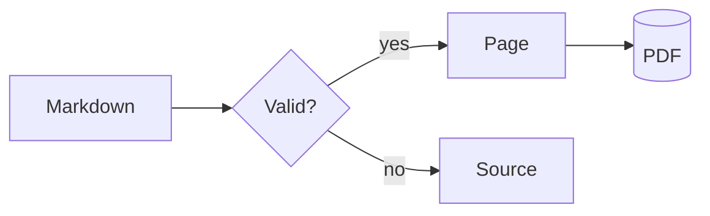
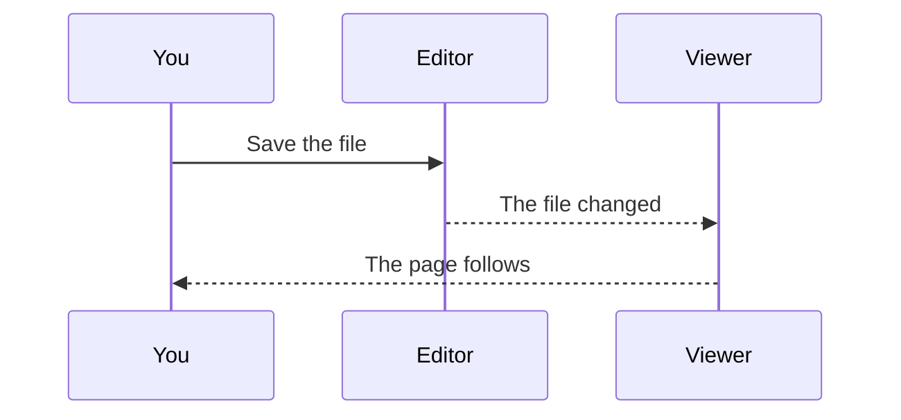
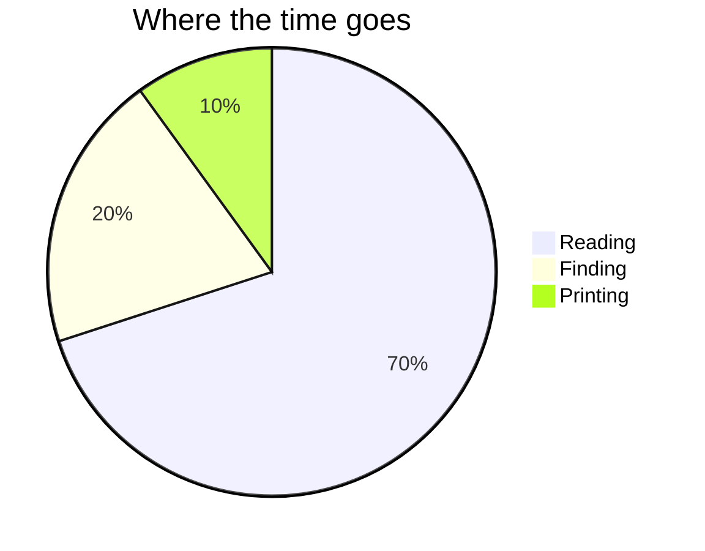
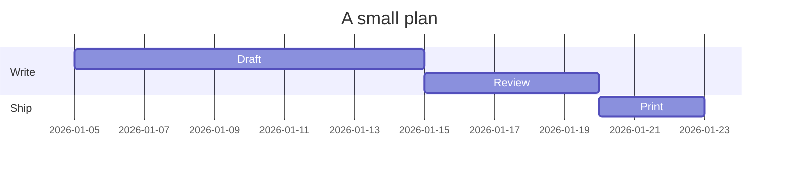
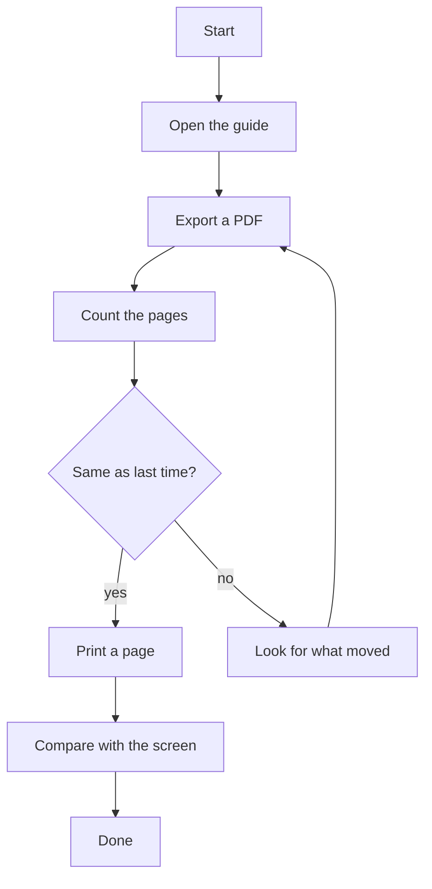

# Nacho Viewer 안내서

Nacho Viewer는 Markdown 파일을 열어 잘 조판된 문서로 보여 줍니다. 편집기가 아니라 뷰어입니다. 아무 편집기에서나 파일을 고치면 여기 페이지가 따라서 바뀝니다.

이 안내서는 세 부분으로 되어 있습니다.

1. [앱 사용하기](#앱-사용하기): 읽기, 찾기, 인쇄, 내보내기 방법.
2. [Markdown이 보여 줄 수 있는 것](#markdown이-보여-줄-수-있는-것): 앱이 표시하는 모든 것의 예시 하나씩.
3. [인쇄 및 내보내기 테스트](#인쇄-및-내보내기-테스트): 종이와 화면을 비교하기 위한 까다로운 경우들.

## 앱 사용하기

### 문서 열기

- <kbd>Ctrl</kbd>+<kbd>O</kbd>를 누르거나 탭 옆의 **+**를 누르세요.
- `.md` 또는 `.markdown` 파일을 창에 끌어다 놓으세요.
- 시작 페이지에서 최근 파일 중 하나를 고르세요. 파일 옆의 **×**를 누르면 목록에서 제거됩니다.
- 파일 관리자에서 Markdown 파일을 Nacho Viewer로 여세요.

문서마다 자체 탭이 있습니다. 탭을 마우스 오른쪽 버튼으로 클릭하면 **경로 복사**를 쓰거나 파일 관리자에서 파일을 볼 수 있습니다.

> [!TIP]
> macOS에서는 이 안내서의 모든 <kbd>Ctrl</kbd>을 <kbd>Cmd</kbd>로 읽으세요.

### 읽기

**개요**(<kbd>Ctrl</kbd>+<kbd>B</kbd>)는 문서의 제목을 나열합니다. 하나를 클릭하면 그곳으로 이동합니다. 링크는 브라우저에서처럼 동작하며, **뒤로**와 **앞으로**(<kbd>Alt</kbd>+<kbd>←</kbd>, <kbd>Alt</kbd>+<kbd>→</kbd>)는 탭 안에서 그 이동을 되짚습니다.

- 다른 Markdown 파일로 가는 링크는 같은 탭에서 열립니다. <kbd>Ctrl</kbd>+클릭하면 새 탭에서 열립니다.
- 이 페이지 맨 위의 링크처럼 제목으로 가는 링크는 그곳으로 스크롤합니다.
- 웹사이트로 가는 링크는 브라우저에서 열립니다.

<kbd>Ctrl</kbd>+<kbd>+</kbd>와 <kbd>Ctrl</kbd>+<kbd>-</kbd>로 확대/축소하고, <kbd>Ctrl</kbd>+<kbd>0</kbd>으로 100%로 돌아갑니다. <kbd>Ctrl</kbd>+<kbd>9</kbd>는 페이지를 창 너비에 맞추고 다시 되돌리며, 넓은 표를 볼 때 유용합니다.

**찾기**(<kbd>Ctrl</kbd>+<kbd>F</kbd>)는 일치하는 모든 항목을 강조 표시하며, <kbd>F3</kbd>와 <kbd>Shift</kbd>+<kbd>F3</kbd>로 하나씩 넘어갑니다. **소스 보기**(<kbd>Ctrl</kbd>+<kbd>U</kbd>)는 파일의 일반 텍스트를 보여 줍니다.

디스크에서 파일이 바뀌면 페이지가 저절로 다시 불러와지고 보던 위치가 유지됩니다. 파일이 삭제되면 마지막 버전이 화면에 남고 위쪽에 안내가 표시됩니다.

### 인쇄 및 내보내기

| 하려는 일 | 누르기 | 결과 |
| :--- | :---- | :------ |
| 인쇄 | <kbd>Ctrl</kbd>+<kbd>P</kbd> | 시스템 인쇄 대화상자 |
| 내보내기 | <kbd>Ctrl</kbd>+<kbd>Shift</kbd>+<kbd>E</kbd> | PDF 파일, A4 |

둘 다 먼저 글자 크기(작게, 보통, 크게)를 묻고, **미리보기**는 확정하기 전에 시스템 뷰어에서 PDF를 보여 줍니다. 화면의 테마와 관계없이 종이에는 항상 밝은 색이 사용됩니다.

### 나에게 맞추기

**설정**(<kbd>Ctrl</kbd>+<kbd>,</kbd>)에서는 테마(시스템, 밝게, 어둡게. <kbd>Ctrl</kbd>+<kbd>Shift</kbd>+<kbd>L</kbd>로도 바꿉니다), 페이지 스타일(클래식, 신문, 종이, 문서, 타자기), 앱과 이 안내서의 언어(시스템 언어, 또는 영어, 스페인어, 독일어, 프랑스어, 이탈리아어, 포르투갈어, 중국어, 일본어, 힌디어, 벵골어, 인도네시아어, 한국어, 터키어, 베트남어, 카탈루냐어), 인터넷의 이미지를 불러올지 여부를 정할 수 있습니다.

그 밖의 모든 것은 앱의 설정 폴더에 있는 `user.css`에 직접 CSS를 넣으세요.

| 시스템 | 폴더 |
| :----- | :----- |
| Linux | `~/.config/nacho-viewer/` |
| Windows | `%APPDATA%\nacho-viewer\` |
| macOS | `~/Library/Application Support/nacho-viewer/` |

### 키보드 단축키

<kbd>F1</kbd>은 모든 단축키를 나열합니다. <kbd>Shift</kbd>+<kbd>F1</kbd>은 이 안내서를 엽니다.

### 문의하기

Nacho Viewer는 무료 오픈 소스입니다. **⋮** 메뉴의 **Nacho Viewer 정보**에서 버전을 볼 수 있습니다. 문제를 알리거나 코드를 보려면 [GitHub](https://github.com/nuncaeslupus/nacho-viewer)를 방문하세요.

## Markdown이 보여 줄 수 있는 것

### 텍스트

*강조*, **강한 강조**, ***둘 다***, `인라인 코드`, ~~취소선~~, ==형광펜 텍스트==, 25 m^2^, H~2~O가 있는 일반 텍스트입니다. [링크](https://example.com), 자동 링크 www.example.com, 그리고 강제 줄바꿈\
바로 여기. 이모지 단축 코드 :tada:는 문자로 바뀝니다.

HTML 사양은 W3C가 관리합니다. 이 두 이름에 마우스를 올려 뜻을 확인해 보세요.

*[HTML]: Hyper Text Markup Language (하이퍼텍스트 마크업 언어)
*[W3C]: World Wide Web Consortium (월드 와이드 웹 컨소시엄)

각주가 있는 문장,[^short] 그리고 더 긴 각주가 있는 또 다른 문장.[^long]

[^short]: 짧은 각주.
[^long]: 더 긴 각주. 어떤 페이지 너비에서든 두 번째 줄로 넘어갈 만큼 한동안 이어져서 각주 텍스트가 어떻게 조판되는지 보여 줍니다.

위키 링크는 이름으로 다른 파일로 이동합니다: [[Nacho Viewer Guide|이 안내서]].

### 제목

#### 4단계

##### 5단계

###### 6단계

### 목록

1. 순서 있는 목록
2. 두 번째 항목이 있고
   1. 중첩된 항목이 있으며
   2. 번호가 계속 이어집니다

- 글머리 기호 목록
  - 중첩된 항목이 있고
    - 세 번째 단계도 있습니다

- [x] 완료한 작업
- [ ] 남은 작업

용어
: 정의 하나.

다른 용어
: 첫 번째 정의.
: 두 번째 정의.

### 인용과 알림

> 블록 인용.
>
> > 그 안의 인용.

> [!NOTE]
> 유용한 정보.

> [!TIP]
> 도움이 되는 조언.

> [!IMPORTANT]
> 핵심 정보.

> [!WARNING]
> 긴급한 정보.

> [!CAUTION]
> 어떤 행동의 위험.

---

### 표

| 왼쪽 | 가운데 | 오른쪽 |
| :--- | :----: | ----: |
| 하나 | 둘 | 3 |
| *넷* | `five` | 6.00 |
| 열의 공간이 부족해지면 줄바꿈이 필요한 더 긴 셀입니다 | b | 1,234.56 |

### 코드

    An indented code block.

```js
// JavaScript
const answer = [1, 2, 3].map((n) => n * 7);
console.log(`The answer is ${answer.at(-1) * 2}`);
```

```python
# Python
def greet(name: str = "world") -> str:
    return f"Hello, {name}!"
```

```rust
// Rust
fn main() {
    let total: u32 = (1..=9).sum();
    println!("{total}");
}
```

```bash
# Shell
for file in *.md; do wc -l "$file"; done
```

```json
{ "name": "Nacho Viewer", "free": true, "platforms": ["Linux", "Windows", "macOS"] }
```

```diff
- The old line
+ The new line
```

### 수식

인라인 수식: $e^{i\pi} + 1 = 0$ 그리고 $\sqrt{a^2 + b^2}$.


$$
\int_0^1 x^2 \, dx = \frac{1}{3}
\qquad
\sum_{n=1}^{\infty} \frac{1}{n^2} = \frac{\pi^2}{6}
$$

$$
\begin{pmatrix} a & b \\ c & d \end{pmatrix}
\begin{pmatrix} x \\ y \end{pmatrix}
=
\begin{pmatrix} ax + by \\ cx + dy \end{pmatrix}
$$

### 다이어그램

다이어그램 위에 마우스를 올리면 확대/축소와 이동 컨트롤이 나타납니다.









### 이미지

로컬 SVG는 텍스트 색을 따르므로 테마에 맞춰 바뀝니다.


크기를 지정하는 `` 태그가 있는 로컬 그림:


### 원시 HTML

안전한 HTML은 동작하며, 스크립트와 스타일은 제거됩니다.

<details>
<summary>펼쳐지는 섹션</summary>

복사하려면 <kbd>Ctrl</kbd>+<kbd>C</kbd>를 누르세요.

</details>

## 인쇄 및 내보내기 테스트

종이와 화면을 비교하려면 이 안내서를 인쇄하거나 내보내 보세요. 같은 버전에서는 실행할 때마다 내용이 바뀌지 않으므로, 두 번 내보낸 결과는 페이지가 같아야 하고 시스템 간 페이지 수 차이는 한 페이지 이내여야 합니다.

다음을 확인하세요.

- [ ] 페이지가 A4이며 사방에 여백이 있다.
- [ ] 각 페이지가 잘린 줄이나 반쪽짜리 이미지가 아닌 텍스트로 시작한다.
- [ ] 앱 자체의 막대와 버튼, 다이어그램 컨트롤이 인쇄되지 않는다.
- [ ] 화면이 어두운 테마여도 색상은 밝은 색이다.
- [ ] 각주, 알림, 수식, 다이어그램이 화면과 같게 보인다.

### 넓은 표

| 분기 | 지역 | 제품 | 수량 | 가격 | 매출 | 비용 | 마진 | 담당자 | 상태 |
| :------ | :----- | :------ | ---: | ---: | -----: | ---: | -----: | :---- | :----- |
| Q1 | 북유럽 | Reader Standard | 1,204 | 19.00 | 22,876.00 | 9,150.40 | 13,725.60 | Asha | 출하됨 |
| Q2 | 남유럽 | Reader Standard | 987 | 19.00 | 18,753.00 | 7,501.20 | 11,251.80 | Bruno | 출하됨 |
| Q3 | 북미 | Reader Professional | 2,310 | 49.00 | 113,190.00 | 39,616.50 | 73,573.50 | Chidi | 진행 중 |
| Q4 | 아시아 태평양 | Reader Professional | 1,875 | 49.00 | 91,875.00 | 32,156.25 | 59,718.75 | Dana | 계획됨 |

### 긴 표

머리글 행, 그리고 두 페이지에 걸쳐 나뉘면 안 되는 행들.

| # | 항목 | 비고 |
| ---: | :--- | :--- |
| 1 | Alpha | 첫 번째 행 |
| 2 | Bravo | 두 번째 |
| 3 | Charlie | 세 번째 |
| 4 | Delta | 네 번째 |
| 5 | Echo | 다섯 번째 |
| 6 | Foxtrot | 여섯 번째 |
| 7 | Golf | 일곱 번째 |
| 8 | Hotel | 여덟 번째 |
| 9 | India | 아홉 번째 |
| 10 | Juliett | 열 번째 |
| 11 | Kilo | 열한 번째 |
| 12 | Lima | 열두 번째 |
| 13 | Mike | 열세 번째 |
| 14 | November | 열네 번째 |
| 15 | Oscar | 열다섯 번째 |
| 16 | Papa | 열여섯 번째 |
| 17 | Quebec | 열일곱 번째 |
| 18 | Romeo | 열여덟 번째 |
| 19 | Sierra | 열아홉 번째 |
| 20 | Tango | 스무 번째 |
| 21 | Uniform | 스물한 번째 |
| 22 | Victor | 스물두 번째 |
| 23 | Whiskey | 스물세 번째 |
| 24 | X-ray | 스물네 번째 |
| 25 | Yankee | 스물다섯 번째 |
| 26 | Zulu | 마지막 행 |

### 아주 긴 줄

페이지보다 훨씬 넓은 코드 한 줄:

```text
0123456789 abcdefghij 0123456789 abcdefghij 0123456789 abcdefghij 0123456789 abcdefghij 0123456789 abcdefghij 0123456789 abcdefghij 0123456789 abcdefghij
```

줄바꿈할 곳이 없는 단어: Pneumonoultramicroscopicsilicovolcanoconiosis_Pneumonoultramicroscopicsilicovolcanoconiosis_Pneumonoultramicroscopicsilicovolcanoconiosis.

긴 주소: <https://example.com/a/very/long/path/that/keeps/going/and/going/well/past/the/edge/of/the/sheet/on/any/paper/size>.

### 긴 코드 블록

이 블록은 대부분의 페이지가 담을 수 있는 것보다 길어서 다음 페이지로 이어져야 합니다.

```python
# Sixty numbered lines.
line_01 = "one"
line_02 = "two"
line_03 = "three"
line_04 = "four"
line_05 = "five"
line_06 = "six"
line_07 = "seven"
line_08 = "eight"
line_09 = "nine"
line_10 = "ten"
line_11 = "eleven"
line_12 = "twelve"
line_13 = "thirteen"
line_14 = "fourteen"
line_15 = "fifteen"
line_16 = "sixteen"
line_17 = "seventeen"
line_18 = "eighteen"
line_19 = "nineteen"
line_20 = "twenty"
line_21 = "twenty-one"
line_22 = "twenty-two"
line_23 = "twenty-three"
line_24 = "twenty-four"
line_25 = "twenty-five"
line_26 = "twenty-six"
line_27 = "twenty-seven"
line_28 = "twenty-eight"
line_29 = "twenty-nine"
line_30 = "thirty"
line_31 = "thirty-one"
line_32 = "thirty-two"
line_33 = "thirty-three"
line_34 = "thirty-four"
line_35 = "thirty-five"
line_36 = "thirty-six"
line_37 = "thirty-seven"
line_38 = "thirty-eight"
line_39 = "thirty-nine"
line_40 = "forty"
line_41 = "forty-one"
line_42 = "forty-two"
line_43 = "forty-three"
line_44 = "forty-four"
line_45 = "forty-five"
line_46 = "forty-six"
line_47 = "forty-seven"
line_48 = "forty-eight"
line_49 = "forty-nine"
line_50 = "fifty"
line_51 = "fifty-one"
line_52 = "fifty-two"
line_53 = "fifty-three"
line_54 = "fifty-four"
line_55 = "fifty-five"
line_56 = "fifty-six"
line_57 = "fifty-seven"
line_58 = "fifty-eight"
line_59 = "fifty-nine"
line_60 = "sixty"
```

### 키가 큰 다이어그램



### 계속 이어지는 텍스트

긴 문단은 페이지의 리듬, 즉 줄 길이와 단어 간격, 그리고 텍스트가 한 페이지에서 다음 페이지로 흐르는 방식을 보여 줍니다. 좋은 페이지는 제목을 뒤따르는 텍스트와 함께 두고, 문단의 한 줄만 페이지 맨 위나 맨 아래에 외톨이로 남기지 않습니다.

조판하는 사람들은 이렇게 홀로 남은 줄을 과부(widow)와 고아(orphan)라고 부릅니다. 독자는 화면은 스크롤할 수 있어도 페이지는 스크롤할 수 없으므로, 이를 피하는 것은 화면보다 종이에서 더 중요합니다. 페이지 맨 아래에 있고 본문은 다음 장에 있는 제목도 마찬가지입니다. 눈은 약속에 머물렀다가 그것이 지켜지는 걸 보려면 페이지를 넘겨야 합니다.

여기 있는 어떤 것도 꼼꼼히 읽을 필요는 없습니다. 각 페이지의 마지막 줄과 다음 페이지의 첫 줄을 보고 텍스트가 제대로 이어지는지만 확인하면 충분합니다. 그렇다면 페이지 나눔이 잘 동작하는 것입니다.
