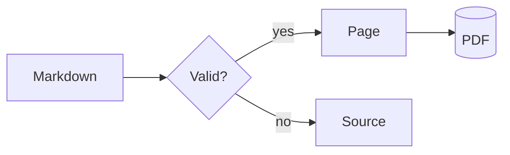
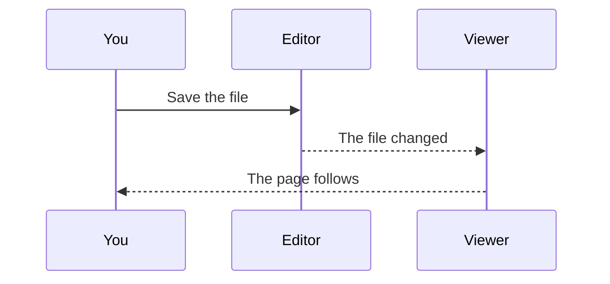
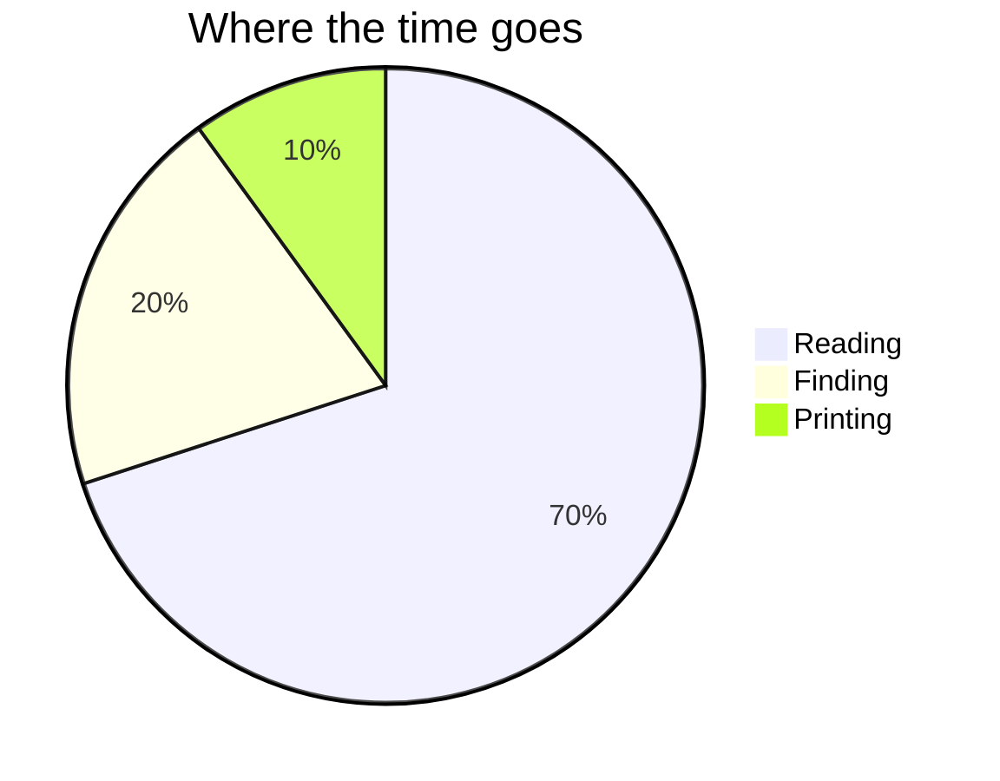
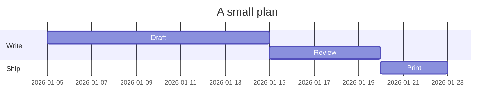
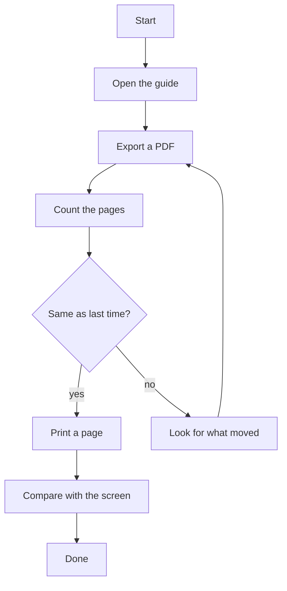

# Guia do Nacho Viewer

O Nacho Viewer abre ficheiros Markdown e mostra-os como um documento bem composto. É um visualizador, não
um editor: altere um ficheiro em qualquer editor e a página aqui acompanha.

Este guia tem três partes:

1. [Usar a aplicação](#usar-a-aplicação): como ler, procurar, imprimir e exportar.
2. [O que o Markdown pode mostrar](#o-que-o-markdown-pode-mostrar): um exemplo de tudo o que a aplicação apresenta.
3. [Teste de impressão e exportação](#teste-de-impressão-e-exportação): os casos difíceis, para comparar o papel com o ecrã.

## Usar a aplicação

### Abrir um documento

- Prima <kbd>Ctrl</kbd>+<kbd>O</kbd>, ou o **+** ao lado dos separadores.
- Largue um ficheiro `.md` ou `.markdown` sobre a janela.
- Escolha um dos ficheiros recentes na página inicial. O **×** ao lado de um ficheiro remove-o da lista.
- Abra um ficheiro Markdown a partir do seu gestor de ficheiros com o Nacho Viewer.

Cada documento tem o seu próprio separador. Clique com o botão direito num separador para **Copiar caminho** e para mostrar o ficheiro no
gestor de ficheiros.

> [!TIP]
> No macOS, leia <kbd>Ctrl</kbd> como <kbd>Cmd</kbd> em todo este guia.

### Ler

A **estrutura** (<kbd>Ctrl</kbd>+<kbd>B</kbd>) lista os títulos do documento; clique num deles para
ir até lá. As ligações funcionam como num navegador, e **recuar** e **avançar**
(<kbd>Alt</kbd>+<kbd>←</kbd>, <kbd>Alt</kbd>+<kbd>→</kbd>) percorrem-nas de novo no separador:

- Uma ligação para outro ficheiro Markdown abre-o no mesmo separador; <kbd>Ctrl</kbd>+clique abre-o num novo separador.
- Uma ligação para um título, como as do início desta página, desloca-se até lá.
- Uma ligação para um site abre no seu navegador.

Aumente ou diminua o zoom com <kbd>Ctrl</kbd>+<kbd>+</kbd> e <kbd>Ctrl</kbd>+<kbd>-</kbd>, ou volte a 100% com
<kbd>Ctrl</kbd>+<kbd>0</kbd>. <kbd>Ctrl</kbd>+<kbd>9</kbd> torna a página tão larga como a janela e
volta ao normal, o que ajuda com tabelas largas.

**Localizar** (<kbd>Ctrl</kbd>+<kbd>F</kbd>) realça todas as correspondências; <kbd>F3</kbd> e
<kbd>Shift</kbd>+<kbd>F3</kbd> percorrem-nas. **Ver código-fonte**
(<kbd>Ctrl</kbd>+<kbd>U</kbd>) mostra o texto simples do ficheiro.

Quando o ficheiro muda no disco, a página recarrega sozinha e mantém a sua posição. Se o ficheiro for
eliminado, a última versão fica no ecrã com uma nota no topo.

### Imprimir e exportar

| Para | Prima | Obtém |
| :--- | :---- | :---- |
| Imprimir | <kbd>Ctrl</kbd>+<kbd>P</kbd> | A caixa de diálogo de impressão do sistema |
| Exportar | <kbd>Ctrl</kbd>+<kbd>Shift</kbd>+<kbd>E</kbd> | Um ficheiro PDF, A4 |

Ambos pedem primeiro um tamanho de texto, Pequeno, Normal ou Grande, e **Pré-visualização** mostra o PDF no
visualizador do sistema antes de confirmar. O papel usa sempre as cores claras, seja qual for o tema
no ecrã.

### Personalizar

As **Definições** (<kbd>Ctrl</kbd>+<kbd>,</kbd>) incluem o tema (sistema, claro ou escuro, também
<kbd>Ctrl</kbd>+<kbd>Shift</kbd>+<kbd>L</kbd>), o estilo da página (Clássico, Jornal, Papel,
Docs ou Máquina de escrever), o idioma da aplicação e deste guia (o do sistema, ou inglês,
espanhol, alemão, francês, italiano, português, chinês, japonês, hindi, bengali, indonésio, coreano, turco, vietnamita ou catalão) e se as imagens da internet
são carregadas.

Para tudo o resto, coloque o seu próprio CSS em `user.css` na pasta de definições da aplicação:

| Sistema | Pasta |
| :------ | :---- |
| Linux | `~/.config/nacho-viewer/` |
| Windows | `%APPDATA%\nacho-viewer\` |
| macOS | `~/Library/Application Support/nacho-viewer/` |

### Atalhos de teclado

<kbd>F1</kbd> lista-os todos. <kbd>Shift</kbd>+<kbd>F1</kbd> abre este guia.

### Contacto

O Nacho Viewer é gratuito e de código aberto. **Sobre o Nacho Viewer**, no menu **⋮**, mostra a sua
versão. Comunique um problema ou leia o código no
[GitHub](https://github.com/nuncaeslupus/nacho-viewer).

## O que o Markdown pode mostrar

### Texto

Texto simples com *ênfase*, **ênfase forte**, ***ambas***, `código em linha`,
~~rasurado~~, ==texto realçado==, 25 m^2^ e H~2~O. Uma [ligação](https://example.com),
uma ligação automática www.example.com e uma quebra de linha forçada\
mesmo aqui. O código de emoji :tada: transforma-se num carácter.

A especificação HTML é mantida pelo W3C; passe o rato por cima desses dois nomes para ver o seu significado.

*[HTML]: Hyper Text Markup Language (linguagem de marcação de hipertexto)
*[W3C]: World Wide Web Consortium (consórcio da World Wide Web)

Uma frase com uma nota de rodapé,[^short] e outra com uma mais longa.[^long]

[^short]: Uma nota de rodapé curta.
[^long]: Uma nota de rodapé mais longa. Prolonga-se durante algum tempo, de modo a quebrar numa segunda linha em
    qualquer largura de página e a mostrar como o texto das notas de rodapé é composto.

Uma ligação wiki leva a outro ficheiro pelo seu nome: [[Nacho Viewer Guide|este guia]].

### Títulos

#### Quarto nível

##### Quinto nível

###### Sexto nível

### Listas

1. Uma lista ordenada
2. com um segundo item
   1. e um aninhado
   2. que continua a contar

- Uma lista com marcadores
  - com um item aninhado
    - e um terceiro nível

- [x] Uma tarefa concluída
- [ ] Uma tarefa em aberto

Termo
: Uma definição.

Outro termo
: A sua primeira definição.
: A sua segunda definição.

### Citações e avisos

> Uma citação em bloco.
>
> > Com uma citação lá dentro.

> [!NOTE]
> Informação útil.

> [!TIP]
> Conselho útil.

> [!IMPORTANT]
> Informação fundamental.

> [!WARNING]
> Informação urgente.

> [!CAUTION]
> Riscos de uma ação.

---

### Tabelas

| Esquerda | Centro | Direita |
| :--- | :----: | ----: |
| um | dois | 3 |
| *quatro* | `cinco` | 6.00 |
| Uma célula mais longa que tem de quebrar quando a coluna fica sem espaço na página | b | 1,234.56 |

### Código

    An indented code block.

```js
// JavaScript
const answer = [1, 2, 3].map((n) => n * 7);
console.log(`The answer is ${answer.at(-1) * 2}`);
```

```python
# Python
def greet(name: str = "world") -> str:
    return f"Hello, {name}!"
```

```rust
// Rust
fn main() {
    let total: u32 = (1..=9).sum();
    println!("{total}");
}
```

```bash
# Shell
for file in *.md; do wc -l "$file"; done
```

```json
{ "name": "Nacho Viewer", "free": true, "platforms": ["Linux", "Windows", "macOS"] }
```

```diff
- The old line
+ The new line
```

### Matemática

Matemática em linha: $e^{i\pi} + 1 = 0$ e $\sqrt{a^2 + b^2}$.

$$
\int_0^1 x^2 \, dx = \frac{1}{3}
\qquad
\sum_{n=1}^{\infty} \frac{1}{n^2} = \frac{\pi^2}{6}
$$

$$
\begin{pmatrix} a & b \\ c & d \end{pmatrix}
\begin{pmatrix} x \\ y \end{pmatrix}
=
\begin{pmatrix} ax + by \\ cx + dy \end{pmatrix}
$$

### Diagramas

Um diagrama tem controlos de zoom e deslocamento quando passa o rato por cima.









### Imagens

Um SVG local assume a cor do texto, por isso acompanha o tema:


Uma imagem local, com uma etiqueta `` que define o seu tamanho:


### HTML em bruto

O HTML seguro funciona; os scripts e os estilos são removidos.

<details>
<summary>Uma secção que se abre</summary>

Prima <kbd>Ctrl</kbd>+<kbd>C</kbd> para copiar.

</details>

## Teste de impressão e exportação

Imprima ou exporte este guia para comparar o papel com o ecrã. O conteúdo nunca muda entre execuções
na mesma versão, por isso duas exportações devem ter as mesmas páginas, e o número de páginas de um sistema
deve ficar a uma página do de outro.

Verifique se:

- [ ] As páginas são A4, com margem em todos os lados.
- [ ] Cada página começa com texto, não com uma linha cortada ou meia imagem.
- [ ] As barras e botões da própria aplicação não são impressos, nem os controlos dos diagramas.
- [ ] As cores são as claras, mesmo com o tema escuro no ecrã.
- [ ] As notas de rodapé, avisos, matemática e diagramas têm o mesmo aspeto que no ecrã.

### Uma tabela larga

| Trimestre | Região | Produto | Unidades | Preço | Receita | Custo | Margem | Responsável | Estado |
| :------ | :----- | :------ | ---: | ---: | -----: | ---: | -----: | :---- | :----- |
| T1 | Norte da Europa | Reader Standard | 1,204 | 19.00 | 22,876.00 | 9,150.40 | 13,725.60 | Asha | Enviado |
| T2 | Sul da Europa | Reader Standard | 987 | 19.00 | 18,753.00 | 7,501.20 | 11,251.80 | Bruno | Enviado |
| T3 | América do Norte | Reader Professional | 2,310 | 49.00 | 113,190.00 | 39,616.50 | 73,573.50 | Chidi | Em curso |
| T4 | Ásia e Pacífico | Reader Professional | 1,875 | 49.00 | 91,875.00 | 32,156.25 | 59,718.75 | Dana | Planeado |

### Uma tabela longa

Uma linha de cabeçalho e linhas que nunca devem ser divididas por duas páginas.

| # | Item | Nota |
| ---: | :--- | :--- |
| 1 | Alpha | Primeira das linhas |
| 2 | Bravo | Segunda |
| 3 | Charlie | Terceira |
| 4 | Delta | Quarta |
| 5 | Echo | Quinta |
| 6 | Foxtrot | Sexta |
| 7 | Golf | Sétima |
| 8 | Hotel | Oitava |
| 9 | India | Nona |
| 10 | Juliett | Décima |
| 11 | Kilo | Décima primeira |
| 12 | Lima | Décima segunda |
| 13 | Mike | Décima terceira |
| 14 | November | Décima quarta |
| 15 | Oscar | Décima quinta |
| 16 | Papa | Décima sexta |
| 17 | Quebec | Décima sétima |
| 18 | Romeo | Décima oitava |
| 19 | Sierra | Décima nona |
| 20 | Tango | Vigésima |
| 21 | Uniform | Vigésima primeira |
| 22 | Victor | Vigésima segunda |
| 23 | Whiskey | Vigésima terceira |
| 24 | X-ray | Vigésima quarta |
| 25 | Yankee | Vigésima quinta |
| 26 | Zulu | Última das linhas |

### Linhas muito longas

Uma linha de código muito mais larga do que a página:

```text
0123456789 abcdefghij 0123456789 abcdefghij 0123456789 abcdefghij 0123456789 abcdefghij 0123456789 abcdefghij 0123456789 abcdefghij 0123456789 abcdefghij
```

Uma palavra sem sítio onde quebrar: Pneumonoultramicroscopicsilicovolcanoconiosis_Pneumonoultramicroscopicsilicovolcanoconiosis_Pneumonoultramicroscopicsilicovolcanoconiosis.

Um endereço longo: <https://example.com/a/very/long/path/that/keeps/going/and/going/well/past/the/edge/of/the/sheet/on/any/paper/size>.

### Um bloco de código longo

Este bloco é mais longo do que a maioria das páginas consegue conter, por isso tem de continuar na seguinte.

```python
# Sixty numbered lines.
line_01 = "one"
line_02 = "two"
line_03 = "three"
line_04 = "four"
line_05 = "five"
line_06 = "six"
line_07 = "seven"
line_08 = "eight"
line_09 = "nine"
line_10 = "ten"
line_11 = "eleven"
line_12 = "twelve"
line_13 = "thirteen"
line_14 = "fourteen"
line_15 = "fifteen"
line_16 = "sixteen"
line_17 = "seventeen"
line_18 = "eighteen"
line_19 = "nineteen"
line_20 = "twenty"
line_21 = "twenty-one"
line_22 = "twenty-two"
line_23 = "twenty-three"
line_24 = "twenty-four"
line_25 = "twenty-five"
line_26 = "twenty-six"
line_27 = "twenty-seven"
line_28 = "twenty-eight"
line_29 = "twenty-nine"
line_30 = "thirty"
line_31 = "thirty-one"
line_32 = "thirty-two"
line_33 = "thirty-three"
line_34 = "thirty-four"
line_35 = "thirty-five"
line_36 = "thirty-six"
line_37 = "thirty-seven"
line_38 = "thirty-eight"
line_39 = "thirty-nine"
line_40 = "forty"
line_41 = "forty-one"
line_42 = "forty-two"
line_43 = "forty-three"
line_44 = "forty-four"
line_45 = "forty-five"
line_46 = "forty-six"
line_47 = "forty-seven"
line_48 = "forty-eight"
line_49 = "forty-nine"
line_50 = "fifty"
line_51 = "fifty-one"
line_52 = "fifty-two"
line_53 = "fifty-three"
line_54 = "fifty-four"
line_55 = "fifty-five"
line_56 = "fifty-six"
line_57 = "fifty-seven"
line_58 = "fifty-eight"
line_59 = "fifty-nine"
line_60 = "sixty"
```

### Um diagrama alto



### Texto que não acaba

Os parágrafos longos mostram o ritmo da página: comprimento da linha, espaçamento entre palavras e como o texto flui de uma
página para a seguinte. Uma boa página mantém um título junto do texto que o segue e nunca deixa uma
única linha de um parágrafo isolada no topo ou no fundo de uma página.

Os tipógrafos chamam a essas linhas isoladas viúvas e órfãs. Evitá-las importa mais
no papel do que no ecrã, porque um leitor pode deslocar um ecrã mas não pode deslocar uma página. O mesmo
se aplica a um título no fundo de uma página, com o texto no verso: o olhar pousa numa promessa e
tem de virar a página para ver que foi cumprida.

Nada disto precisa de ser lido com atenção. Basta olhar para a última linha de cada página e para a
primeira da seguinte, e ver que o texto continua como deve. Se continuar, as quebras de página
estão a funcionar.
