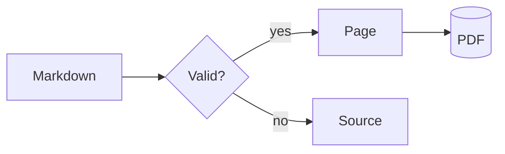
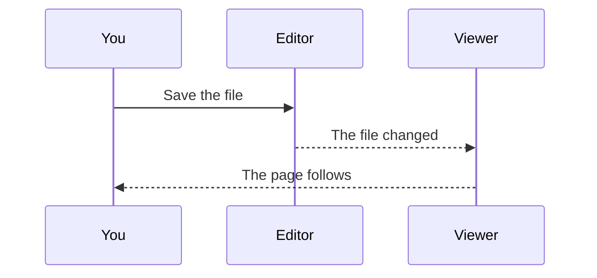
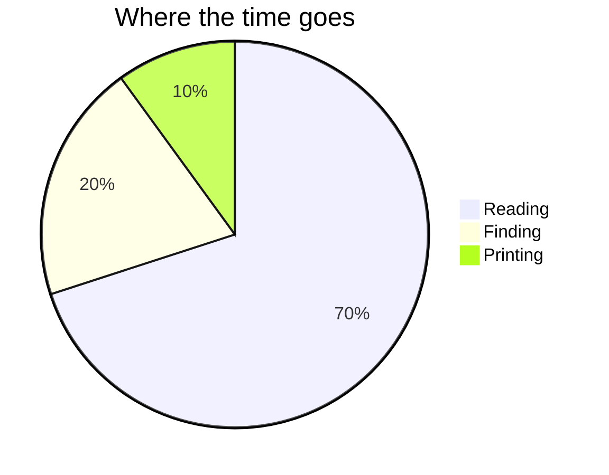
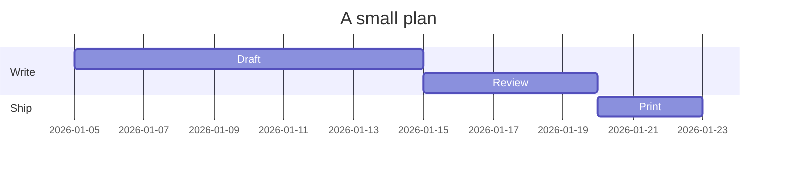
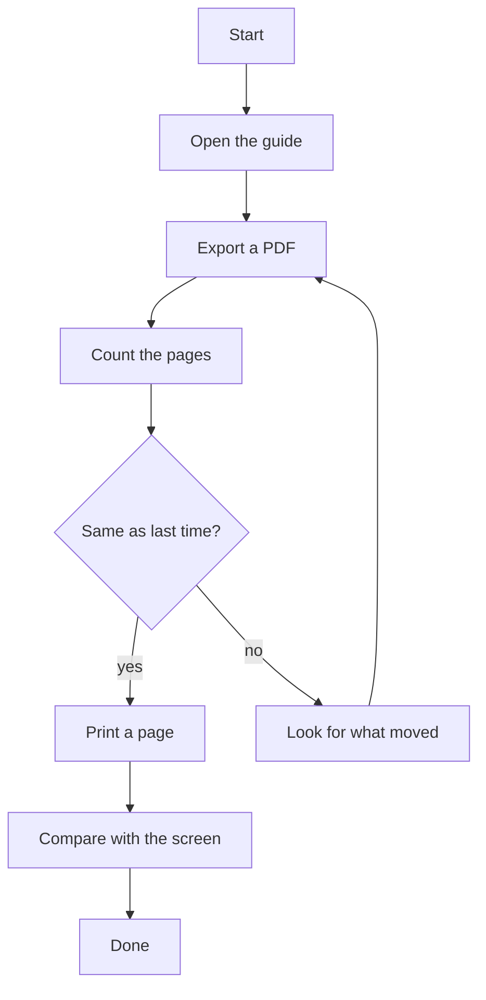

# Nacho Viewer Kılavuzu

Nacho Viewer, Markdown dosyalarını açar ve onları iyi dizilmiş bir belge olarak gösterir. Bir düzenleyici değil, bir görüntüleyicidir: dosyayı herhangi bir düzenleyicide değiştirin, buradaki sayfa onu izler.

Bu kılavuz üç bölümden oluşur:

1. [Uygulamayı kullanma](#uygulamayı-kullanma): okuma, bulma, yazdırma ve dışa aktarma.
2. [Markdown neler gösterebilir](#markdown-neler-gösterebilir): uygulamanın görüntülediği her şeyden bir örnek.
3. [Yazdırma ve dışa aktarma testi](#yazdırma-ve-dışa-aktarma-testi): kâğıdı ekranla karşılaştırmak için zor durumlar.

## Uygulamayı kullanma

### Belge açma

- <kbd>Ctrl</kbd>+<kbd>O</kbd> tuşlarına veya sekmelerin yanındaki **+** düğmesine basın.
- Bir `.md` veya `.markdown` dosyasını pencerenin üzerine bırakın.
- Başlangıç sayfasındaki son dosyalardan birini seçin. Dosyanın yanındaki **×** onu listeden kaldırır.
- Dosya yöneticinizden bir Markdown dosyasını Nacho Viewer ile açın.

Her belgenin kendi sekmesi vardır. **Yolu kopyala** için ve dosyayı dosya yöneticinizde göstermek için bir sekmeye sağ tıklayın.

> [!TIP]
> macOS'ta bu kılavuzun her yerinde <kbd>Ctrl</kbd> tuşunu <kbd>Cmd</kbd> olarak okuyun.

### Okuma

**Ana hat** (<kbd>Ctrl</kbd>+<kbd>B</kbd>) belgenin başlıklarını listeler; birine tıklayarak oraya gidin. Bağlantılar tarayıcıdaki gibi çalışır; **Geri** ve **İleri** (<kbd>Alt</kbd>+<kbd>←</kbd>, <kbd>Alt</kbd>+<kbd>→</kbd>) sekmede onların izini sürer:

- Başka bir Markdown dosyasına giden bağlantı onu aynı sekmede açar; <kbd>Ctrl</kbd>+tıklama yeni sekmede açar.
- Bu sayfanın başındakiler gibi bir başlığa giden bağlantı oraya kaydırır.
- Bir web sitesine giden bağlantı tarayıcınızda açılır.

<kbd>Ctrl</kbd>+<kbd>+</kbd> ve <kbd>Ctrl</kbd>+<kbd>-</kbd> ile yakınlaştırın ya da <kbd>Ctrl</kbd>+<kbd>0</kbd> ile %100'e dönün. <kbd>Ctrl</kbd>+<kbd>9</kbd> sayfayı pencere kadar geniş yapar ve tekrar eski haline getirir; bu, geniş tablolarda işe yarar.

**Bul** (<kbd>Ctrl</kbd>+<kbd>F</kbd>) her eşleşmeyi vurgular; <kbd>F3</kbd> ve <kbd>Shift</kbd>+<kbd>F3</kbd> aralarında gezinir. **Kaynağı görüntüle** (<kbd>Ctrl</kbd>+<kbd>U</kbd>) dosyanın düz metnini gösterir.

Dosya diskte değiştiğinde sayfa kendiliğinden yeniden yüklenir ve yerinizi korur. Dosya silinirse son sürüm ekranda kalır ve üstte bir not görünür.

### Yazdırma ve dışa aktarma

| Amaç | Tuş | Sonuç |
| :--- | :---- | :------ |
| Yazdır | <kbd>Ctrl</kbd>+<kbd>P</kbd> | Sistemin yazdırma penceresi |
| Dışa aktar | <kbd>Ctrl</kbd>+<kbd>Shift</kbd>+<kbd>E</kbd> | Bir PDF dosyası, A4 |

İkisi de önce metin boyutunu sorar: Küçük, Normal veya Büyük; **Önizleme** ise karar vermeden önce PDF'yi sisteminizin görüntüleyicisinde gösterir. Ekrandaki tema ne olursa olsun kâğıt her zaman açık renkleri kullanır.

### Kendinize göre ayarlayın

**Ayarlar** (<kbd>Ctrl</kbd>+<kbd>,</kbd>) temayı (sistem, açık veya koyu; ayrıca <kbd>Ctrl</kbd>+<kbd>Shift</kbd>+<kbd>L</kbd>), sayfa stilini (Klasik, Gazete, Kâğıt, Belge veya Daktilo), uygulamanın ve bu kılavuzun dilini (sistemin dili ya da İngilizce, İspanyolca, Almanca, Fransızca, İtalyanca, Portekizce, Çince, Japonca, Hintçe, Bengalce, Endonezce, Korece, Türkçe, Vietnamca veya Katalanca) ve internetteki görsellerin yüklenip yüklenmeyeceğini içerir.

Başka her şey için kendi CSS'inizi uygulamanın ayarlar klasöründeki `user.css` dosyasına koyun:

| Sistem | Klasör |
| :----- | :----- |
| Linux | `~/.config/nacho-viewer/` |
| Windows | `%APPDATA%\nacho-viewer\` |
| macOS | `~/Library/Application Support/nacho-viewer/` |

### Klavye kısayolları

<kbd>F1</kbd> hepsini listeler. <kbd>Shift</kbd>+<kbd>F1</kbd> bu kılavuzu açar.

### İletişim

Nacho Viewer ücretsiz ve açık kaynaktır. **⋮** menüsündeki **Nacho Viewer Hakkında** sürümünüzü gösterir. Bir sorunu bildirin ya da kodu [GitHub](https://github.com/nuncaeslupus/nacho-viewer)'da okuyun.

## Markdown neler gösterebilir

### Metin

*Vurgu*, **güçlü vurgu**, ***ikisi birden***, `satır içi kod`, ~~üstü çizili~~, ==vurgulanmış metin==, 25 m^2^ ve H~2~O içeren düz metin. Bir [bağlantı](https://example.com), bir otomatik bağlantı www.example.com ve zorunlu bir satır sonu\
tam burada. :tada: emoji kısa kodu bir karaktere dönüşür.

HTML belirtimini W3C sürdürür; anlamlarını görmek için fareyle bu iki adın üzerine gelin.

*[HTML]: Hyper Text Markup Language (hiper metin işaretleme dili)
*[W3C]: World Wide Web Consortium (dünya çapında ağ konsorsiyumu)

Dipnotlu bir cümle,[^short] ve daha uzun dipnotlu bir başkası.[^long]

[^short]: Kısa bir dipnot.
[^long]: Daha uzun bir dipnot. Bir süre devam eder, böylece herhangi bir sayfa genişliğinde ikinci satıra taşar ve dipnot metninin nasıl dizildiğini gösterir.

Bir wiki bağlantısı başka bir dosyaya adıyla gider: [[Nacho Viewer Guide|bu kılavuz]].

### Başlıklar

#### Dördüncü düzey

##### Beşinci düzey

###### Altıncı düzey

### Listeler

1. Sıralı bir liste
2. ikinci bir maddesiyle
   1. ve iç içe bir madde
   2. saymaya devam eden

- Madde işaretli bir liste
  - iç içe bir maddesiyle
    - ve üçüncü bir düzey

- [x] Biten bir görev
- [ ] Açık bir görev

Terim
: Bir tanım.

Başka bir terim
: Birinci tanımı.
: İkinci tanımı.

### Alıntılar ve uyarılar

> Bir blok alıntı.
>
> > İçinde bir alıntı olan.

> [!NOTE]
> Yararlı bilgi.

> [!TIP]
> Faydalı öneri.

> [!IMPORTANT]
> Önemli bilgi.

> [!WARNING]
> Acil bilgi.

> [!CAUTION]
> Bir eylemin riskleri.

---

### Tablolar

| Sol | Orta | Sağ |
| :--- | :----: | ----: |
| bir | iki | 3 |
| *dört* | `five` | 6.00 |
| Sütunda yer kalmayınca sayfada bir kez alt satıra geçmesi gereken daha uzun bir hücre | b | 1,234.56 |

### Kod

    An indented code block.

```js
// JavaScript
const answer = [1, 2, 3].map((n) => n * 7);
console.log(`The answer is ${answer.at(-1) * 2}`);
```

```python
# Python
def greet(name: str = "world") -> str:
    return f"Hello, {name}!"
```

```rust
// Rust
fn main() {
    let total: u32 = (1..=9).sum();
    println!("{total}");
}
```

```bash
# Shell
for file in *.md; do wc -l "$file"; done
```

```json
{ "name": "Nacho Viewer", "free": true, "platforms": ["Linux", "Windows", "macOS"] }
```

```diff
- The old line
+ The new line
```

### Matematik

Satır içi matematik: $e^{i\pi} + 1 = 0$ ve $\sqrt{a^2 + b^2}$.


$$
\int_0^1 x^2 \, dx = \frac{1}{3}
\qquad
\sum_{n=1}^{\infty} \frac{1}{n^2} = \frac{\pi^2}{6}
$$

$$
\begin{pmatrix} a & b \\ c & d \end{pmatrix}
\begin{pmatrix} x \\ y \end{pmatrix}
=
\begin{pmatrix} ax + by \\ cx + dy \end{pmatrix}
$$

### Diyagramlar

Bir diyagramın üzerine gelindiğinde yakınlaştırma ve kaydırma denetimleri görünür.









### Görseller

Yerel bir SVG metnin rengini alır, bu yüzden temayı izler:


Boyutunu belirleyen bir `` etiketiyle yerel bir resim:


### Ham HTML

Güvenli HTML çalışır; betikler ve stiller kaldırılır.

<details>
<summary>Açılan bir bölüm</summary>

Kopyalamak için <kbd>Ctrl</kbd>+<kbd>C</kbd> tuşlarına basın.

</details>

## Yazdırma ve dışa aktarma testi

Kâğıdı ekranla karşılaştırmak için bu kılavuzu yazdırın veya dışa aktarın. İçerik aynı sürümde çalıştırmalar arasında hiç değişmez; bu yüzden iki dışa aktarımın sayfaları aynı olmalı ve bir sistemdeki sayfa sayısı diğerinden en fazla bir sayfa farklı olmalıdır.

Şunları kontrol edin:

- [ ] Sayfalar A4'tür ve her yanda boşluk vardır.
- [ ] Her sayfa, kesilmiş bir satırla ya da yarım bir görselle değil, metinle başlar.
- [ ] Uygulamanın kendi çubukları ve düğmeleri yazdırılmaz, diyagramların denetimleri de yazdırılmaz.
- [ ] Ekranda koyu tema olsa bile renkler açık olanlardır.
- [ ] Dipnotlar, uyarılar, matematik ve diyagramlar ekrandakiyle aynı görünür.

### Geniş bir tablo

| Çeyrek | Bölge | Ürün | Adet | Fiyat | Gelir | Maliyet | Marj | Sorumlu | Durum |
| :------ | :----- | :------ | ---: | ---: | -----: | ---: | -----: | :---- | :----- |
| Q1 | Kuzey Avrupa | Reader Standard | 1,204 | 19.00 | 22,876.00 | 9,150.40 | 13,725.60 | Asha | Gönderildi |
| Q2 | Güney Avrupa | Reader Standard | 987 | 19.00 | 18,753.00 | 7,501.20 | 11,251.80 | Bruno | Gönderildi |
| Q3 | Kuzey Amerika | Reader Professional | 2,310 | 49.00 | 113,190.00 | 39,616.50 | 73,573.50 | Chidi | Sürüyor |
| Q4 | Asya ve Pasifik | Reader Professional | 1,875 | 49.00 | 91,875.00 | 32,156.25 | 59,718.75 | Dana | Planlandı |

### Uzun bir tablo

Bir başlık satırı ve asla iki sayfaya bölünmemesi gereken satırlar.

| # | Öğe | Not |
| ---: | :--- | :--- |
| 1 | Alpha | Satırların ilki |
| 2 | Bravo | İkinci |
| 3 | Charlie | Üçüncü |
| 4 | Delta | Dördüncü |
| 5 | Echo | Beşinci |
| 6 | Foxtrot | Altıncı |
| 7 | Golf | Yedinci |
| 8 | Hotel | Sekizinci |
| 9 | India | Dokuzuncu |
| 10 | Juliett | Onuncu |
| 11 | Kilo | On birinci |
| 12 | Lima | On ikinci |
| 13 | Mike | On üçüncü |
| 14 | November | On dördüncü |
| 15 | Oscar | On beşinci |
| 16 | Papa | On altıncı |
| 17 | Quebec | On yedinci |
| 18 | Romeo | On sekizinci |
| 19 | Sierra | On dokuzuncu |
| 20 | Tango | Yirminci |
| 21 | Uniform | Yirmi birinci |
| 22 | Victor | Yirmi ikinci |
| 23 | Whiskey | Yirmi üçüncü |
| 24 | X-ray | Yirmi dördüncü |
| 25 | Yankee | Yirmi beşinci |
| 26 | Zulu | Satırların sonuncusu |

### Çok uzun satırlar

Sayfadan çok daha geniş bir kod satırı:

```text
0123456789 abcdefghij 0123456789 abcdefghij 0123456789 abcdefghij 0123456789 abcdefghij 0123456789 abcdefghij 0123456789 abcdefghij 0123456789 abcdefghij
```

Bölünecek yeri olmayan bir sözcük: Pneumonoultramicroscopicsilicovolcanoconiosis_Pneumonoultramicroscopicsilicovolcanoconiosis_Pneumonoultramicroscopicsilicovolcanoconiosis.

Uzun bir adres: <https://example.com/a/very/long/path/that/keeps/going/and/going/well/past/the/edge/of/the/sheet/on/any/paper/size>.

### Uzun bir kod bloğu

Bu blok çoğu sayfanın alabileceğinden uzundur, bu yüzden bir sonraki sayfada devam etmesi gerekir.

```python
# Sixty numbered lines.
line_01 = "one"
line_02 = "two"
line_03 = "three"
line_04 = "four"
line_05 = "five"
line_06 = "six"
line_07 = "seven"
line_08 = "eight"
line_09 = "nine"
line_10 = "ten"
line_11 = "eleven"
line_12 = "twelve"
line_13 = "thirteen"
line_14 = "fourteen"
line_15 = "fifteen"
line_16 = "sixteen"
line_17 = "seventeen"
line_18 = "eighteen"
line_19 = "nineteen"
line_20 = "twenty"
line_21 = "twenty-one"
line_22 = "twenty-two"
line_23 = "twenty-three"
line_24 = "twenty-four"
line_25 = "twenty-five"
line_26 = "twenty-six"
line_27 = "twenty-seven"
line_28 = "twenty-eight"
line_29 = "twenty-nine"
line_30 = "thirty"
line_31 = "thirty-one"
line_32 = "thirty-two"
line_33 = "thirty-three"
line_34 = "thirty-four"
line_35 = "thirty-five"
line_36 = "thirty-six"
line_37 = "thirty-seven"
line_38 = "thirty-eight"
line_39 = "thirty-nine"
line_40 = "forty"
line_41 = "forty-one"
line_42 = "forty-two"
line_43 = "forty-three"
line_44 = "forty-four"
line_45 = "forty-five"
line_46 = "forty-six"
line_47 = "forty-seven"
line_48 = "forty-eight"
line_49 = "forty-nine"
line_50 = "fifty"
line_51 = "fifty-one"
line_52 = "fifty-two"
line_53 = "fifty-three"
line_54 = "fifty-four"
line_55 = "fifty-five"
line_56 = "fifty-six"
line_57 = "fifty-seven"
line_58 = "fifty-eight"
line_59 = "fifty-nine"
line_60 = "sixty"
```

### Uzun bir diyagram



### Devam edip giden metin

Uzun paragraflar sayfanın ritmini gösterir: satır uzunluğu, sözcük aralığı ve metnin bir sayfadan diğerine nasıl aktığı. İyi bir sayfa başlığı kendisini izleyen metinle birlikte tutar ve bir paragrafın tek bir satırını sayfanın üstünde ya da altında yalnız bırakmaz.

Dizgiciler bu yalnız kalan satırlara dul ve yetim (widow ve orphan) der. Onları sayfadan uzak tutmak kâğıtta ekrandakinden daha önemlidir, çünkü okur ekranı kaydırabilir ama sayfayı kaydıramaz. Sayfanın dibinde kalan, metni yaprağın öbür yüzünde olan başlık için de aynısı geçerlidir: göz bir vaatte durur ve tutulduğunu görmek için sayfayı çevirmesi gerekir.

Buradaki hiçbir şeyin dikkatle okunması gerekmez. Her sayfanın son satırına ve bir sonrakinin ilk satırına bakıp metnin olması gerektiği gibi devam ettiğini görmek yeterlidir. Öyleyse sayfa sonları çalışıyor demektir.
