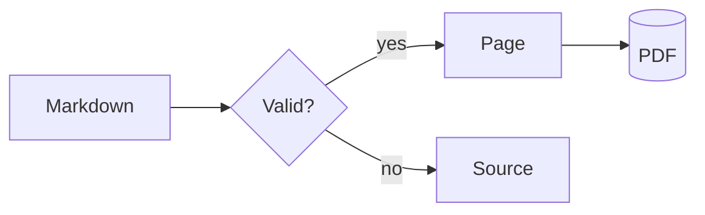
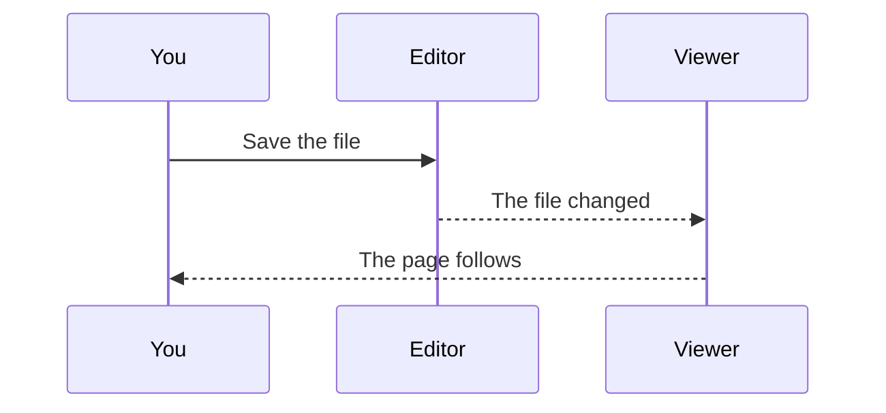
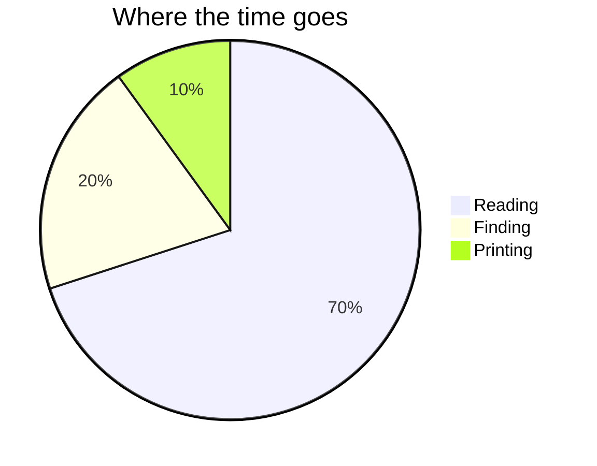
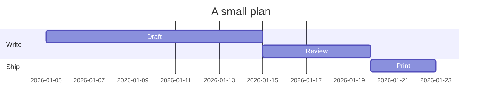
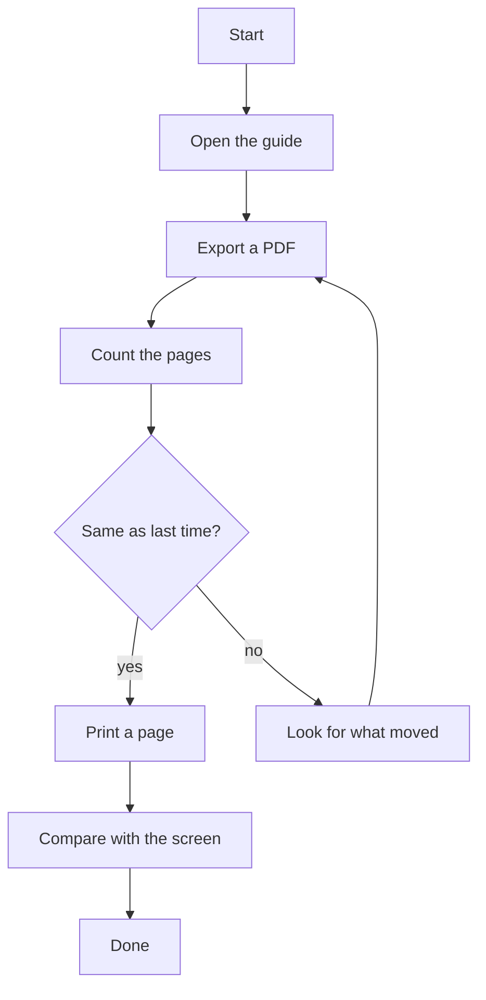

# Hướng dẫn Nacho Viewer

Nacho Viewer mở các tệp Markdown và hiển thị chúng như một tài liệu được dàn trang đẹp. Đây là trình xem, không phải trình soạn thảo: hãy sửa tệp bằng bất kỳ trình soạn thảo nào và trang ở đây sẽ theo kịp.

Hướng dẫn này có ba phần:

1. [Dùng ứng dụng](#dùng-ứng-dụng): cách đọc, tìm, in và xuất.
2. [Markdown có thể hiển thị gì](#markdown-có-thể-hiển-thị-gì): một ví dụ cho mọi thứ ứng dụng hiển thị.
3. [Kiểm tra in và xuất](#kiểm-tra-in-và-xuất): những trường hợp khó, để so giấy với màn hình.

## Dùng ứng dụng

### Mở tài liệu

- Nhấn <kbd>Ctrl</kbd>+<kbd>O</kbd>, hoặc nhấn **+** cạnh các thẻ.
- Thả một tệp `.md` hoặc `.markdown` vào cửa sổ.
- Chọn một trong các tệp gần đây ở trang bắt đầu. Dấu **×** cạnh tệp sẽ xóa nó khỏi danh sách.
- Mở tệp Markdown từ trình quản lý tệp của bạn bằng Nacho Viewer.

Mỗi tài liệu có một thẻ riêng. Nhấp chuột phải vào thẻ để chọn **Sao chép đường dẫn** và để hiện tệp trong trình quản lý tệp của bạn.

> [!TIP]
> Trên macOS, hãy đọc <kbd>Ctrl</kbd> là <kbd>Cmd</kbd> ở mọi nơi trong hướng dẫn này.

### Đọc

**Đại cương** (<kbd>Ctrl</kbd>+<kbd>B</kbd>) liệt kê các tiêu đề của tài liệu; nhấp vào một mục để đến đó. Liên kết hoạt động như trong trình duyệt, còn **Quay lại** và **Tiến tới** (<kbd>Alt</kbd>+<kbd>←</kbd>, <kbd>Alt</kbd>+<kbd>→</kbd>) đi lại các bước đó trong thẻ:

- Liên kết đến một tệp Markdown khác sẽ mở nó trong cùng thẻ; <kbd>Ctrl</kbd>+nhấp sẽ mở trong thẻ mới.
- Liên kết đến một tiêu đề, như những liên kết ở đầu trang này, sẽ cuộn đến đó.
- Liên kết đến một trang web sẽ mở trong trình duyệt của bạn.

Phóng to, thu nhỏ bằng <kbd>Ctrl</kbd>+<kbd>+</kbd> và <kbd>Ctrl</kbd>+<kbd>-</kbd>, hoặc về 100% bằng <kbd>Ctrl</kbd>+<kbd>0</kbd>. <kbd>Ctrl</kbd>+<kbd>9</kbd> làm trang rộng bằng cửa sổ và trả lại như cũ, giúp ích với các bảng rộng.

**Tìm** (<kbd>Ctrl</kbd>+<kbd>F</kbd>) tô sáng mọi kết quả khớp; <kbd>F3</kbd> và <kbd>Shift</kbd>+<kbd>F3</kbd> chuyển qua từng kết quả. **Xem nguồn** (<kbd>Ctrl</kbd>+<kbd>U</kbd>) hiển thị văn bản thuần của tệp.

Khi tệp thay đổi trên ổ đĩa, trang tự tải lại và giữ nguyên vị trí của bạn. Nếu tệp bị xóa, phiên bản cuối cùng vẫn ở trên màn hình kèm một ghi chú ở đầu trang.

### In và xuất

| Để | Nhấn | Kết quả |
| :--- | :---- | :------ |
| In | <kbd>Ctrl</kbd>+<kbd>P</kbd> | Hộp thoại in của hệ thống |
| Xuất | <kbd>Ctrl</kbd>+<kbd>Shift</kbd>+<kbd>E</kbd> | Một tệp PDF, A4 |

Cả hai đều hỏi cỡ chữ trước: Nhỏ, Vừa hoặc Lớn, và **Xem trước** hiển thị PDF trong trình xem của hệ thống trước khi bạn quyết định. Giấy luôn dùng màu sáng, bất kể giao diện trên màn hình.

### Tùy chỉnh theo ý bạn

**Cài đặt** (<kbd>Ctrl</kbd>+<kbd>,</kbd>) có giao diện (hệ thống, sáng hoặc tối; cũng đổi được bằng <kbd>Ctrl</kbd>+<kbd>Shift</kbd>+<kbd>L</kbd>), kiểu trang (Cổ điển, Báo chí, Giấy, Tài liệu hoặc Máy chữ), ngôn ngữ của ứng dụng và hướng dẫn này (ngôn ngữ hệ thống, hoặc tiếng Anh, Tây Ban Nha, Đức, Pháp, Ý, Bồ Đào Nha, Trung, Nhật, Hindi, Bengal, Indonesia, Hàn, Thổ Nhĩ Kỳ, Việt hoặc Catalan) và việc có tải hình ảnh từ internet hay không.

Với mọi thứ khác, hãy đặt CSS của riêng bạn vào `user.css` trong thư mục cài đặt của ứng dụng:

| Hệ thống | Thư mục |
| :----- | :----- |
| Linux | `~/.config/nacho-viewer/` |
| Windows | `%APPDATA%\nacho-viewer\` |
| macOS | `~/Library/Application Support/nacho-viewer/` |

### Phím tắt

<kbd>F1</kbd> liệt kê tất cả. <kbd>Shift</kbd>+<kbd>F1</kbd> mở hướng dẫn này.

### Liên hệ

Nacho Viewer miễn phí và là mã nguồn mở. **Giới thiệu Nacho Viewer**, trong menu **⋮**, hiển thị phiên bản của bạn. Hãy báo lỗi hoặc đọc mã nguồn trên [GitHub](https://github.com/nuncaeslupus/nacho-viewer).

## Markdown có thể hiển thị gì

### Văn bản

Văn bản thường với *nhấn mạnh*, **nhấn mạnh đậm**, ***cả hai***, `mã nội dòng`, ~~gạch ngang~~, ==văn bản được tô sáng==, 25 m^2^ và H~2~O. Một [liên kết](https://example.com), một liên kết tự động www.example.com, và một dấu ngắt dòng cưỡng bức\
ngay tại đây. Mã emoji :tada: biến thành một ký tự.

Đặc tả HTML do W3C duy trì; di chuột lên hai tên đó để xem ý nghĩa.

*[HTML]: Hyper Text Markup Language (ngôn ngữ đánh dấu siêu văn bản)
*[W3C]: World Wide Web Consortium (liên minh Web toàn cầu)

Một câu có chú thích cuối trang,[^short] và một câu khác có chú thích dài hơn.[^long]

[^short]: Một chú thích cuối trang ngắn.
[^long]: Một chú thích cuối trang dài hơn. Nó kéo dài một lúc, để xuống dòng thứ hai ở mọi độ rộng trang và cho thấy văn bản chú thích được dàn trang thế nào.

Liên kết wiki dẫn đến tệp khác theo tên của nó: [[Nacho Viewer Guide|hướng dẫn này]].

### Tiêu đề

#### Cấp bốn

##### Cấp năm

###### Cấp sáu

### Danh sách

1. Một danh sách có thứ tự
2. với mục thứ hai
   1. và một mục lồng nhau
   2. tiếp tục đếm

- Một danh sách gạch đầu dòng
  - với một mục lồng nhau
    - và cấp thứ ba

- [x] Một việc đã xong
- [ ] Một việc đang mở

Thuật ngữ
: Một định nghĩa.

Thuật ngữ khác
: Định nghĩa thứ nhất của nó.
: Định nghĩa thứ hai của nó.

### Trích dẫn và cảnh báo

> Một trích dẫn khối.
>
> > Với một trích dẫn bên trong.

> [!NOTE]
> Thông tin hữu ích.

> [!TIP]
> Lời khuyên hữu ích.

> [!IMPORTANT]
> Thông tin quan trọng.

> [!WARNING]
> Thông tin khẩn cấp.

> [!CAUTION]
> Rủi ro của một hành động.

---

### Bảng

| Trái | Giữa | Phải |
| :--- | :----: | ----: |
| một | hai | 3 |
| *bốn* | `five` | 6.00 |
| Một ô dài hơn phải xuống dòng khi cột hết chỗ trên trang | b | 1,234.56 |

### Mã

    An indented code block.

```js
// JavaScript
const answer = [1, 2, 3].map((n) => n * 7);
console.log(`The answer is ${answer.at(-1) * 2}`);
```

```python
# Python
def greet(name: str = "world") -> str:
    return f"Hello, {name}!"
```

```rust
// Rust
fn main() {
    let total: u32 = (1..=9).sum();
    println!("{total}");
}
```

```bash
# Shell
for file in *.md; do wc -l "$file"; done
```

```json
{ "name": "Nacho Viewer", "free": true, "platforms": ["Linux", "Windows", "macOS"] }
```

```diff
- The old line
+ The new line
```

### Toán

Toán nội dòng: $e^{i\pi} + 1 = 0$ và $\sqrt{a^2 + b^2}$.


$$
\int_0^1 x^2 \, dx = \frac{1}{3}
\qquad
\sum_{n=1}^{\infty} \frac{1}{n^2} = \frac{\pi^2}{6}
$$

$$
\begin{pmatrix} a & b \\ c & d \end{pmatrix}
\begin{pmatrix} x \\ y \end{pmatrix}
=
\begin{pmatrix} ax + by \\ cx + dy \end{pmatrix}
$$

### Sơ đồ

Sơ đồ có các nút điều khiển thu phóng và kéo khi bạn di chuột lên nó.









### Hình ảnh

Một SVG cục bộ lấy màu của văn bản, nên nó theo giao diện:


Một ảnh cục bộ, với thẻ `` đặt kích thước của nó:


### HTML thô

HTML an toàn hoạt động; tập lệnh và kiểu bị loại bỏ.

<details>
<summary>Một phần có thể mở ra</summary>

Nhấn <kbd>Ctrl</kbd>+<kbd>C</kbd> để sao chép.

</details>

## Kiểm tra in và xuất

Hãy in hoặc xuất hướng dẫn này để so giấy với màn hình. Nội dung không bao giờ thay đổi giữa các lần chạy trên cùng một phiên bản, nên hai bản xuất phải có cùng các trang, và số trang trên một hệ thống chỉ lệch tối đa một trang so với hệ thống khác.

Hãy kiểm tra rằng:

- [ ] Các trang là A4, có lề ở mọi phía.
- [ ] Mỗi trang bắt đầu bằng văn bản, không phải một dòng bị cắt hay nửa bức ảnh.
- [ ] Các thanh và nút của chính ứng dụng không được in, các nút điều khiển của sơ đồ cũng vậy.
- [ ] Màu là màu sáng, kể cả khi màn hình đang dùng giao diện tối.
- [ ] Chú thích cuối trang, cảnh báo, toán và sơ đồ trông giống như trên màn hình.

### Một bảng rộng

| Quý | Khu vực | Sản phẩm | Số lượng | Giá | Doanh thu | Chi phí | Biên lợi nhuận | Phụ trách | Trạng thái |
| :------ | :----- | :------ | ---: | ---: | -----: | ---: | -----: | :---- | :----- |
| Q1 | Bắc Âu | Reader Standard | 1,204 | 19.00 | 22,876.00 | 9,150.40 | 13,725.60 | Asha | Đã giao |
| Q2 | Nam Âu | Reader Standard | 987 | 19.00 | 18,753.00 | 7,501.20 | 11,251.80 | Bruno | Đã giao |
| Q3 | Bắc Mỹ | Reader Professional | 2,310 | 49.00 | 113,190.00 | 39,616.50 | 73,573.50 | Chidi | Đang thực hiện |
| Q4 | Châu Á và Thái Bình Dương | Reader Professional | 1,875 | 49.00 | 91,875.00 | 32,156.25 | 59,718.75 | Dana | Đã lên kế hoạch |

### Một bảng dài

Một hàng tiêu đề, và các hàng không bao giờ được tách ra giữa hai trang.

| # | Mục | Ghi chú |
| ---: | :--- | :--- |
| 1 | Alpha | Hàng đầu tiên |
| 2 | Bravo | Thứ hai |
| 3 | Charlie | Thứ ba |
| 4 | Delta | Thứ tư |
| 5 | Echo | Thứ năm |
| 6 | Foxtrot | Thứ sáu |
| 7 | Golf | Thứ bảy |
| 8 | Hotel | Thứ tám |
| 9 | India | Thứ chín |
| 10 | Juliett | Thứ mười |
| 11 | Kilo | Thứ mười một |
| 12 | Lima | Thứ mười hai |
| 13 | Mike | Thứ mười ba |
| 14 | November | Thứ mười bốn |
| 15 | Oscar | Thứ mười lăm |
| 16 | Papa | Thứ mười sáu |
| 17 | Quebec | Thứ mười bảy |
| 18 | Romeo | Thứ mười tám |
| 19 | Sierra | Thứ mười chín |
| 20 | Tango | Thứ hai mươi |
| 21 | Uniform | Thứ hai mươi mốt |
| 22 | Victor | Thứ hai mươi hai |
| 23 | Whiskey | Thứ hai mươi ba |
| 24 | X-ray | Thứ hai mươi bốn |
| 25 | Yankee | Thứ hai mươi lăm |
| 26 | Zulu | Hàng cuối cùng |

### Các dòng rất dài

Một dòng mã rộng hơn trang rất nhiều:

```text
0123456789 abcdefghij 0123456789 abcdefghij 0123456789 abcdefghij 0123456789 abcdefghij 0123456789 abcdefghij 0123456789 abcdefghij 0123456789 abcdefghij
```

Một từ không có chỗ nào để ngắt: Pneumonoultramicroscopicsilicovolcanoconiosis_Pneumonoultramicroscopicsilicovolcanoconiosis_Pneumonoultramicroscopicsilicovolcanoconiosis.

Một địa chỉ dài: <https://example.com/a/very/long/path/that/keeps/going/and/going/well/past/the/edge/of/the/sheet/on/any/paper/size>.

### Một khối mã dài

Khối này dài hơn mức hầu hết các trang có thể chứa, nên nó phải tiếp tục sang trang kế tiếp.

```python
# Sixty numbered lines.
line_01 = "one"
line_02 = "two"
line_03 = "three"
line_04 = "four"
line_05 = "five"
line_06 = "six"
line_07 = "seven"
line_08 = "eight"
line_09 = "nine"
line_10 = "ten"
line_11 = "eleven"
line_12 = "twelve"
line_13 = "thirteen"
line_14 = "fourteen"
line_15 = "fifteen"
line_16 = "sixteen"
line_17 = "seventeen"
line_18 = "eighteen"
line_19 = "nineteen"
line_20 = "twenty"
line_21 = "twenty-one"
line_22 = "twenty-two"
line_23 = "twenty-three"
line_24 = "twenty-four"
line_25 = "twenty-five"
line_26 = "twenty-six"
line_27 = "twenty-seven"
line_28 = "twenty-eight"
line_29 = "twenty-nine"
line_30 = "thirty"
line_31 = "thirty-one"
line_32 = "thirty-two"
line_33 = "thirty-three"
line_34 = "thirty-four"
line_35 = "thirty-five"
line_36 = "thirty-six"
line_37 = "thirty-seven"
line_38 = "thirty-eight"
line_39 = "thirty-nine"
line_40 = "forty"
line_41 = "forty-one"
line_42 = "forty-two"
line_43 = "forty-three"
line_44 = "forty-four"
line_45 = "forty-five"
line_46 = "forty-six"
line_47 = "forty-seven"
line_48 = "forty-eight"
line_49 = "forty-nine"
line_50 = "fifty"
line_51 = "fifty-one"
line_52 = "fifty-two"
line_53 = "fifty-three"
line_54 = "fifty-four"
line_55 = "fifty-five"
line_56 = "fifty-six"
line_57 = "fifty-seven"
line_58 = "fifty-eight"
line_59 = "fifty-nine"
line_60 = "sixty"
```

### Một sơ đồ cao



### Văn bản kéo dài

Các đoạn văn dài cho thấy nhịp điệu của trang: độ dài dòng, khoảng cách giữa các từ và cách văn bản chảy từ trang này sang trang kế tiếp. Một trang tốt giữ tiêu đề đi cùng văn bản theo sau nó, và không bao giờ để một dòng lẻ của đoạn văn bị bỏ lại ở đầu hoặc cuối trang.

Thợ sắp chữ gọi những dòng lẻ đó là widow và orphan (dòng góa và dòng mồ côi). Tránh chúng quan trọng với giấy hơn với màn hình, vì người đọc có thể cuộn màn hình nhưng không thể cuộn một trang giấy. Điều tương tự đúng với một tiêu đề ở cuối trang mà phần văn bản nằm ở mặt sau: mắt dừng lại ở một lời hứa và phải lật trang mới thấy nó được giữ.

Không có gì ở đây cần đọc kỹ. Chỉ cần nhìn dòng cuối của mỗi trang và dòng đầu của trang kế, rồi xem văn bản có tiếp nối đúng như mong đợi hay không. Nếu có, các chỗ ngắt trang đang hoạt động tốt.
