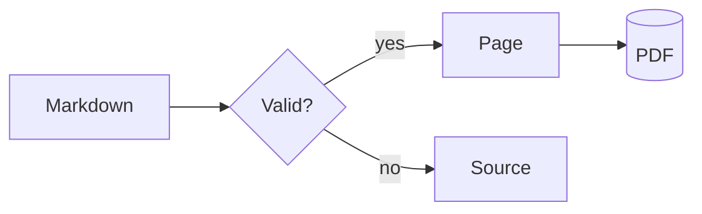
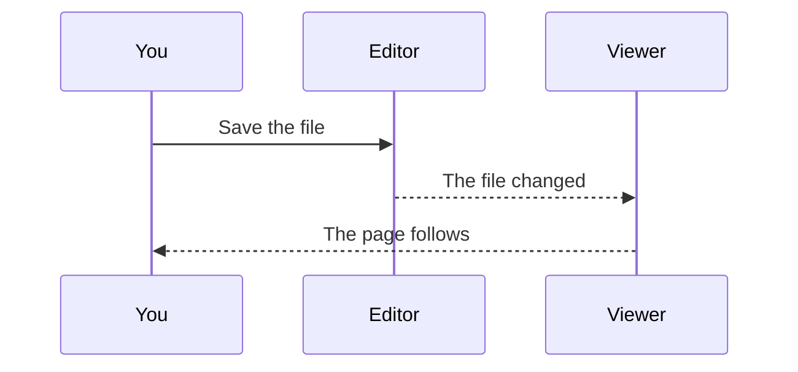
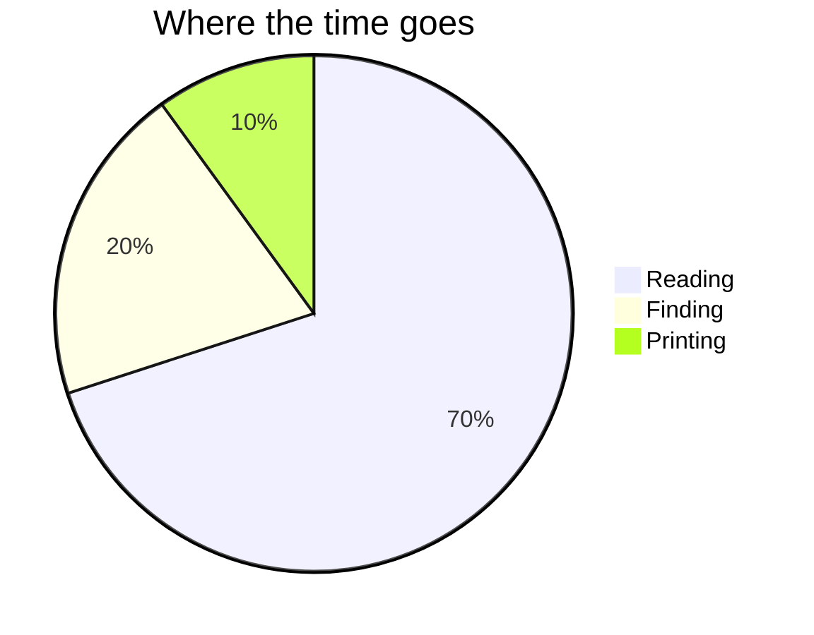
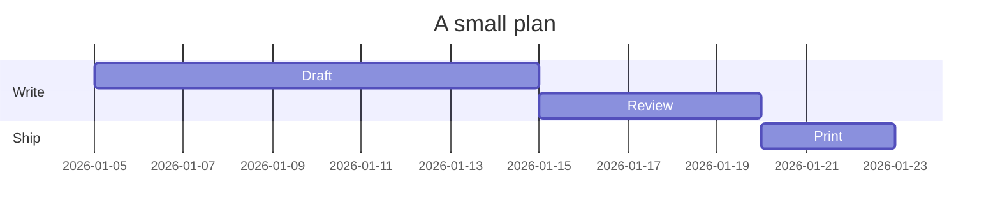
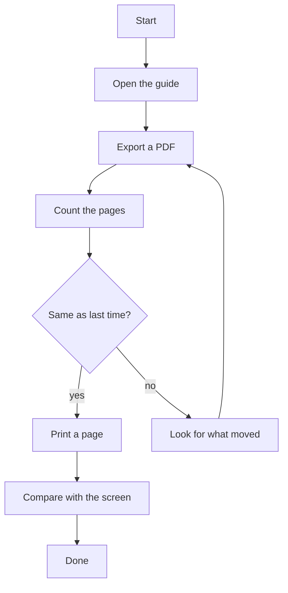

# Nacho Viewer 使用指南

Nacho Viewer 可以打开 Markdown 文件，并把它们显示为排版精美的文档。它是查看器，不是
编辑器：用任意编辑器修改文件，这里的页面会随之更新。

本指南分为三部分：

1. [使用应用](#使用应用)：如何阅读、查找、打印和导出。
2. [Markdown 能显示什么](#markdown-能显示什么)：应用所能渲染的每种内容的示例。
3. [打印与导出测试](#打印与导出测试)：各种疑难情形，用来对比纸张与屏幕效果。

## 使用应用

### 打开文档

- 按 <kbd>Ctrl</kbd>+<kbd>O</kbd>，或点击标签页旁的 **+**。
- 将 `.md` 或 `.markdown` 文件拖放到窗口上。
- 在起始页选择一个最近使用的文件。文件旁的 **×** 可将其从列表中移除。
- 在文件管理器中用 Nacho Viewer 打开 Markdown 文件。

每个文档都有自己的标签页。右键单击标签页可选择 **复制路径**，也可在
文件管理器中显示该文件。

> [!TIP]
> 在 macOS 上，本指南中的 <kbd>Ctrl</kbd> 请一律理解为 <kbd>Cmd</kbd>。

### 阅读

**大纲**（<kbd>Ctrl</kbd>+<kbd>B</kbd>）列出文档的标题；点击其中一个即可
跳转。链接的行为与浏览器一致，**后退** 和 **前进**
（<kbd>Alt</kbd>+<kbd>←</kbd>、<kbd>Alt</kbd>+<kbd>→</kbd>）可在标签页中沿着这些链接往回或往前走：

- 指向另一个 Markdown 文件的链接会在同一标签页中打开；<kbd>Ctrl</kbd>+点击则在新标签页中打开。
- 指向标题的链接，比如本页顶部的那几个，会滚动到相应位置。
- 指向网站的链接会在浏览器中打开。

用 <kbd>Ctrl</kbd>+<kbd>+</kbd> 和 <kbd>Ctrl</kbd>+<kbd>-</kbd> 缩放，或用
<kbd>Ctrl</kbd>+<kbd>0</kbd> 恢复到 100%。<kbd>Ctrl</kbd>+<kbd>9</kbd> 可让页面与窗口一样宽，
再按一次则恢复，这对宽表格很有帮助。

**查找**（<kbd>Ctrl</kbd>+<kbd>F</kbd>）会高亮每一处匹配；<kbd>F3</kbd> 和
<kbd>Shift</kbd>+<kbd>F3</kbd> 可逐个跳转。**查看源码**
（<kbd>Ctrl</kbd>+<kbd>U</kbd>）显示文件的纯文本。

当磁盘上的文件发生变化时，页面会自动重新加载并保持你的阅读位置。如果文件被
删除，最后的版本会保留在屏幕上，并在顶部显示一条提示。

### 打印与导出

| 操作 | 按键 | 结果 |
| :--- | :---- | :------ |
| 打印 | <kbd>Ctrl</kbd>+<kbd>P</kbd> | 系统的打印对话框 |
| 导出 | <kbd>Ctrl</kbd>+<kbd>Shift</kbd>+<kbd>E</kbd> | 一个 PDF 文件，A4 |

两者都会先询问文字大小：小、正常或大；**预览** 会在确认之前用系统的
查看器显示 PDF。无论屏幕上使用何种主题，纸张始终使用浅色。

### 个性化

**设置**（<kbd>Ctrl</kbd>+<kbd>,</kbd>）中可以选择主题（跟随系统、浅色或深色，也可用
<kbd>Ctrl</kbd>+<kbd>Shift</kbd>+<kbd>L</kbd> 切换）、页面样式（经典、报纸、纸张、
Docs 或打字机）、应用和本指南的语言（跟随系统，或英语、西班牙语、德语、法语、意大利语、
葡萄牙语、中文、日语、印地语、孟加拉语、印尼语、韩语、土耳其语、越南语或加泰罗尼亚语），以及是否加载来自互联网的图片。

如需更多定制，可把你自己的 CSS 放进应用设置文件夹中的 `user.css`：

| 系统 | 文件夹 |
| :----- | :----- |
| Linux | `~/.config/nacho-viewer/` |
| Windows | `%APPDATA%\nacho-viewer\` |
| macOS | `~/Library/Application Support/nacho-viewer/` |

### 键盘快捷键

<kbd>F1</kbd> 会列出全部快捷键。<kbd>Shift</kbd>+<kbd>F1</kbd> 打开本指南。

### 联系我们

Nacho Viewer 免费且开源。**⋮** 菜单中的 **关于 Nacho Viewer** 会显示你的
版本。你可以在 [GitHub](https://github.com/nuncaeslupus/nacho-viewer)
上报告问题或阅读源代码。

## Markdown 能显示什么

### 文本

普通文本，可带有*强调*、**加重强调**、***两者兼有***、`行内代码`、
~~删除线~~、==高亮文本==、面积 25 m^2^ 和 H~2~O。一个[链接](https://example.com)，
一个自动链接 www.example.com，还有一个硬换行\
就在这里。表情符号短代码 :tada: 会变成一个字符。

HTML 规范由 W3C 维护；把鼠标悬停在这两个名称上可查看它们的含义。

*[HTML]: Hyper Text Markup Language（超文本标记语言）
*[W3C]: World Wide Web Consortium（万维网联盟）

一个带脚注的句子，[^short] 以及另一个带较长脚注的句子。[^long]

[^short]: 一条简短的脚注。
[^long]: 一条较长的脚注。它会持续一小段文字，从而在任何页面宽度下都会折到第二行，
    以展示脚注文字是如何排版的。

维基链接通过名称指向另一个文件：[[Nacho Viewer Guide|本指南]]。

### 标题

#### 四级标题

##### 五级标题

###### 六级标题

### 列表

1. 一个有序列表
2. 带有第二项
   1. 以及一个嵌套项
   2. 它会继续编号

- 一个无序列表
  - 带有一个嵌套项
    - 以及第三层

- [x] 一项已完成的任务
- [ ] 一项未完成的任务

术语
: 一个定义。

另一个术语
: 它的第一个定义。
: 它的第二个定义。

### 引用与提示块

> 一段块引用。
>
> > 其中还嵌套了一段引用。

> [!NOTE]
> 有用的信息。

> [!TIP]
> 有帮助的建议。

> [!IMPORTANT]
> 关键信息。

> [!WARNING]
> 紧急信息。

> [!CAUTION]
> 某项操作的风险。

---

### 表格

| 左对齐 | 居中 | 右对齐 |
| :--- | :----: | ----: |
| 一 | 二 | 3 |
| *四* | `五` | 6.00 |
| 一个较长的单元格，当该列在页面上没有足够空间时，需要换行显示 | b | 1,234.56 |

### 代码

    An indented code block.

```js
// JavaScript
const answer = [1, 2, 3].map((n) => n * 7);
console.log(`The answer is ${answer.at(-1) * 2}`);
```

```python
# Python
def greet(name: str = "world") -> str:
    return f"Hello, {name}!"
```

```rust
// Rust
fn main() {
    let total: u32 = (1..=9).sum();
    println!("{total}");
}
```

```bash
# Shell
for file in *.md; do wc -l "$file"; done
```

```json
{ "name": "Nacho Viewer", "free": true, "platforms": ["Linux", "Windows", "macOS"] }
```

```diff
- The old line
+ The new line
```

### 数学公式

行内公式：$e^{i\pi} + 1 = 0$ 和 $\sqrt{a^2 + b^2}$。

$$
\int_0^1 x^2 \, dx = \frac{1}{3}
\qquad
\sum_{n=1}^{\infty} \frac{1}{n^2} = \frac{\pi^2}{6}
$$

$$
\begin{pmatrix} a & b \\ c & d \end{pmatrix}
\begin{pmatrix} x \\ y \end{pmatrix}
=
\begin{pmatrix} ax + by \\ cx + dy \end{pmatrix}
$$

### 图表

将鼠标悬停在图表上时，会出现缩放和平移控件。









### 图片

本地 SVG 会采用文字的颜色，因此会随主题变化：


一张本地图片，使用 `` 标签设置其尺寸：


### 原始 HTML

安全的 HTML 可以使用；脚本和样式会被移除。

<details>
<summary>一个可展开的部分</summary>

按 <kbd>Ctrl</kbd>+<kbd>C</kbd> 复制。

</details>

## 打印与导出测试

打印或导出本指南，以对比纸张与屏幕。同一版本每次运行的内容都不会改变，
因此两次导出的页面应当相同，不同系统得到的页数
相差不应超过一页。

请检查：

- [ ] 页面为 A4，四边都有页边距。
- [ ] 每一页都以文字开头，而不是被切断的一行或半张图片。
- [ ] 应用自身的工具栏和按钮不会被打印，图表的控件也不会。
- [ ] 即使屏幕上使用深色主题，颜色也是浅色的。
- [ ] 脚注、提示块、数学公式和图表看起来与屏幕上一致。

### 一个宽表格

| 季度 | 地区 | 产品 | 数量 | 单价 | 收入 | 成本 | 利润 | 负责人 | 状态 |
| :------ | :----- | :------ | ---: | ---: | -----: | ---: | -----: | :---- | :----- |
| Q1 | 北欧 | Reader Standard | 1,204 | 19.00 | 22,876.00 | 9,150.40 | 13,725.60 | Asha | 已发货 |
| Q2 | 南欧 | Reader Standard | 987 | 19.00 | 18,753.00 | 7,501.20 | 11,251.80 | Bruno | 已发货 |
| Q3 | 北美 | Reader Professional | 2,310 | 49.00 | 113,190.00 | 39,616.50 | 73,573.50 | Chidi | 进行中 |
| Q4 | 亚太 | Reader Professional | 1,875 | 49.00 | 91,875.00 | 32,156.25 | 59,718.75 | Dana | 已计划 |

### 一个长表格

一行表头，以及绝不应跨两页拆开的数据行。

| # | 项目 | 备注 |
| ---: | :--- | :--- |
| 1 | Alpha | 第一行 |
| 2 | Bravo | 第二 |
| 3 | Charlie | 第三 |
| 4 | Delta | 第四 |
| 5 | Echo | 第五 |
| 6 | Foxtrot | 第六 |
| 7 | Golf | 第七 |
| 8 | Hotel | 第八 |
| 9 | India | 第九 |
| 10 | Juliett | 第十 |
| 11 | Kilo | 第十一 |
| 12 | Lima | 第十二 |
| 13 | Mike | 第十三 |
| 14 | November | 第十四 |
| 15 | Oscar | 第十五 |
| 16 | Papa | 第十六 |
| 17 | Quebec | 第十七 |
| 18 | Romeo | 第十八 |
| 19 | Sierra | 第十九 |
| 20 | Tango | 第二十 |
| 21 | Uniform | 第二十一 |
| 22 | Victor | 第二十二 |
| 23 | Whiskey | 第二十三 |
| 24 | X-ray | 第二十四 |
| 25 | Yankee | 第二十五 |
| 26 | Zulu | 最后一行 |

### 超长的行

一行比页面宽得多的代码：

```text
0123456789 abcdefghij 0123456789 abcdefghij 0123456789 abcdefghij 0123456789 abcdefghij 0123456789 abcdefghij 0123456789 abcdefghij 0123456789 abcdefghij
```

一个无处可断的单词：Pneumonoultramicroscopicsilicovolcanoconiosis_Pneumonoultramicroscopicsilicovolcanoconiosis_Pneumonoultramicroscopicsilicovolcanoconiosis。

一个很长的地址：<https://example.com/a/very/long/path/that/keeps/going/and/going/well/past/the/edge/of/the/sheet/on/any/paper/size>。

### 一个很长的代码块

这个代码块比大多数页面所能容纳的还要长，所以必须延续到下一页。

```python
# Sixty numbered lines.
line_01 = "one"
line_02 = "two"
line_03 = "three"
line_04 = "four"
line_05 = "five"
line_06 = "six"
line_07 = "seven"
line_08 = "eight"
line_09 = "nine"
line_10 = "ten"
line_11 = "eleven"
line_12 = "twelve"
line_13 = "thirteen"
line_14 = "fourteen"
line_15 = "fifteen"
line_16 = "sixteen"
line_17 = "seventeen"
line_18 = "eighteen"
line_19 = "nineteen"
line_20 = "twenty"
line_21 = "twenty-one"
line_22 = "twenty-two"
line_23 = "twenty-three"
line_24 = "twenty-four"
line_25 = "twenty-five"
line_26 = "twenty-six"
line_27 = "twenty-seven"
line_28 = "twenty-eight"
line_29 = "twenty-nine"
line_30 = "thirty"
line_31 = "thirty-one"
line_32 = "thirty-two"
line_33 = "thirty-three"
line_34 = "thirty-four"
line_35 = "thirty-five"
line_36 = "thirty-six"
line_37 = "thirty-seven"
line_38 = "thirty-eight"
line_39 = "thirty-nine"
line_40 = "forty"
line_41 = "forty-one"
line_42 = "forty-two"
line_43 = "forty-three"
line_44 = "forty-four"
line_45 = "forty-five"
line_46 = "forty-six"
line_47 = "forty-seven"
line_48 = "forty-eight"
line_49 = "forty-nine"
line_50 = "fifty"
line_51 = "fifty-one"
line_52 = "fifty-two"
line_53 = "fifty-three"
line_54 = "fifty-four"
line_55 = "fifty-five"
line_56 = "fifty-six"
line_57 = "fifty-seven"
line_58 = "fifty-eight"
line_59 = "fifty-nine"
line_60 = "sixty"
```

### 一个很高的图表



### 连绵不断的文字

长段落能展现页面的节奏：行长、字间距，以及文字如何从一页
流向下一页。好的页面会让标题与其后的文字待在一起，也绝不会让段落中的
单独一行孤零零地留在页面顶部或底部。

排版师把这种孤立的行称为孤行和寡行。避免它们出现在页面上，在纸上
比在屏幕上更重要，因为读者可以滚动屏幕，却无法滚动一页纸。页面底部的标题、
正文却在背面也是同理：目光落在一个承诺上，
却要翻页才能看到它兑现。

这里的内容不需要仔细阅读。只需看看每页的最后一行和下一页的
第一行，确认文字按预期接续即可。如果是这样，分页就工作正常。
